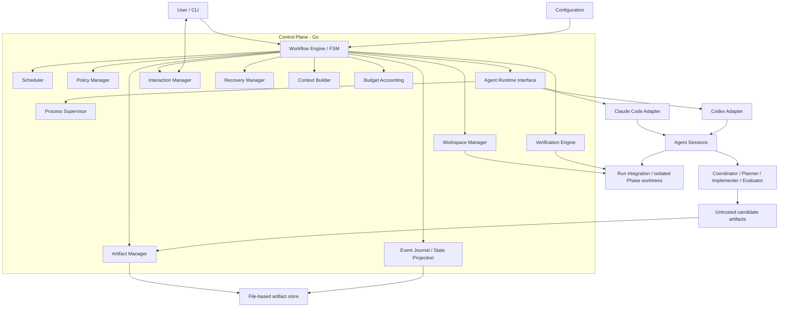
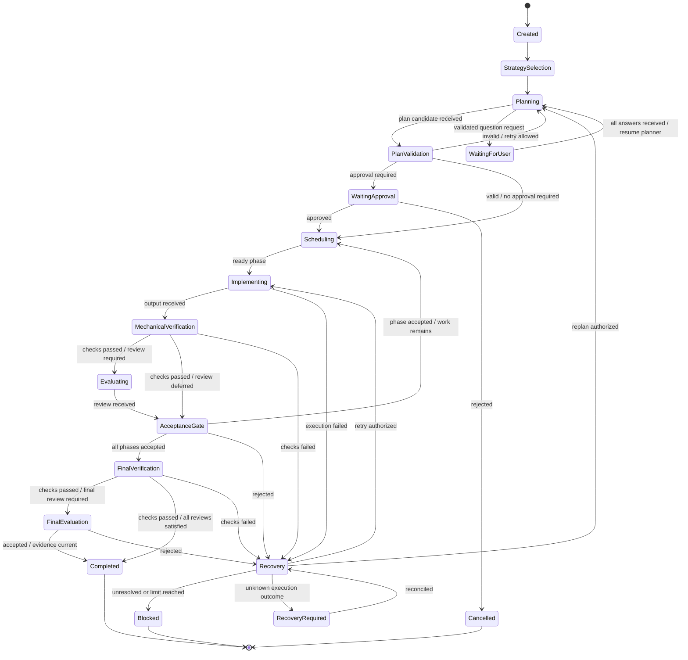
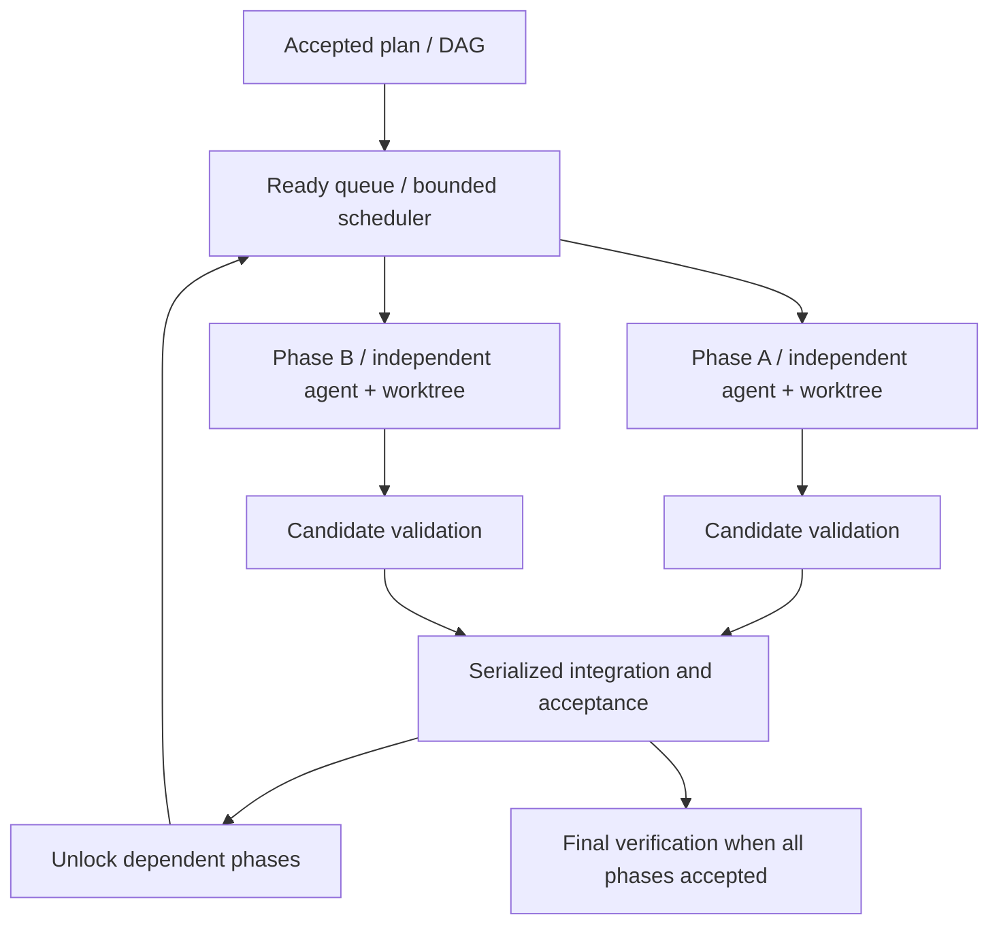

# Bellona — Architecture Specification

- Status: Proposed / pre-implementation
- Scope: Local-first agent workflow engine for software development
- Initial platform: Linux
- Core language: Go (standard-library-first; no third-party Go modules targeted for MVP)
- Workspace isolation: Git worktree only; no Bellona-managed sandbox
- Execution model: Daemon-optional; foreground CLI for MVP
- Durability: Local file journal, immutable artifacts, explicit reconciliation
- Scheduling: Bounded parallel DAG execution and isolated phase worktrees are MVP requirements

## 1. Overview

Bellona is a local-first workflow engine that runs existing coding agents as external processes and controls planning, implementation, evaluation, and verification.

Rather than replacing Claude Code or Codex, Bellona operates as a control layer above them. Unlike orchestrators primarily concerned with issue-level job management, Bellona focuses on the execution flow within individual development tasks.

> Non-deterministic reasoning, deterministic execution.

Reasoning and semantic judgments are delegated to LLMs, while execution order, dependencies, logical role responsibilities, retries, state transitions, and completion criteria are controlled programmatically. OS-level access control is outside the scope of the initial implementation.

## 2. Goals and non-goals

### Goals

- Local-first: No external database or persistent service is required.
- Harness-agnostic: Support Claude Code, Codex, and other harnesses through a common interface.
- Deterministic execution: Prevent state transitions that bypass planning or verification gates.
- Adaptive effort: Allow models to be configured while letting the LLM select effort according to the task or phase.
- Artifact-driven communication: Use structured artifacts for handoffs between agents.
- Independent evaluation: Separate implementation from quality evaluation.
- Recoverability: Reconcile execution state and artifacts after abnormal termination and resume when appropriate.
- Parallel execution: Launch agents for independent phases concurrently, with the engine controlling dependencies, concurrency limits, workspace separation, and integration verification. Sequential execution is a special case with a concurrency limit of one.
- Human-in-the-loop: Present structured decisions to users, accept natural-language answers outside the offered choices, and support safe suspension and resumption.
- Observability: Make execution history, decision rationale, verification results, and execution parameters traceable.

### Non-goals for the initial release

- Implementing an LLM inference runtime or a coding agent itself.
- Distributed workers, clustering, multi-tenancy, or a persistent daemon.
- Continuous synchronization with issue trackers.
- A custom general-purpose workflow DSL or an arbitrary-code plugin framework.
- Dependencies on SQLite or other databases.
- A Bellona-managed sandbox, containers, OS-level access control, or management of harness sandbox settings.
- Frameworks or general-purpose parsers requiring third-party Go libraries. The MVP targets standard-library-only implementation.
- Automatic commits to user branches, pushes, pull request creation, or production deployment. Internal commits on Bellona-managed refs for artifact preservation and integration are part of the MVP (§10.2).

## 3. System architecture



### Components

| Component | Responsibility |
| --- | --- |
| Workflow Engine | Sole authority for state transitions. Controls execution order, failure branches, and termination conditions. |
| Scheduler | Manages phase dependencies, concurrency, and runnable phases. |
| Policy Manager | Validates role-specific model configuration, permitted effort values, budgets, retry and time limits, and logical role restrictions. |
| Agent Runtime | Abstracts host-specific launch, resume, cancellation, and event collection. |
| Verification Engine | Performs typed JSON validation, semantic checks, diff inspection, tests, linting, and other checks; produces evidence. |
| Artifact Manager | Validates and stores artifacts, associating them with revisions and attempts. |
| Event Journal | Appends state changes and preserves execution history. |
| State Projection | Derives current Run, Phase, and Attempt state from events. |
| Workspace Manager | Prepares Git workspaces, manages base revisions, obtains diffs, and handles integration. |
| Interaction Manager | Validates and presents structured questions, adds Other, validates and persists answers, and passes them to the resume target. |
| Recovery Manager | Reconciles uncertain attempts, classifies errors, and determines whether retries or replanning are permitted. |
| Context Builder | Selects role-specific input artifacts, manages size, and constructs handoff context when a session is lost. |
| Budget Accounting | Accounts for execution limits, usage, and retry counts within a single Run. |
| Process Supervisor | Handles process launch, termination, reaping, and timeouts within the adapter. |

These are logical responsibilities, not a requirement to implement each as a separate service or package. The MVP implements only the necessary small Go components.

## 4. Agent roles

Because the term Orchestrator can refer to either a program or an LLM, Bellona calls the program-side component the Workflow Engine and the LLM-side component the Coordinator.

| Role | Kind | Responsibilities | Production code | Plan |
| --- | --- | --- | --- | --- |
| Workflow Engine | Program | Execution control, state transitions, acceptance gates | No direct edits | Accept/version only |
| Coordinator | LLM | Strategy selection, initial effort, exception handling, resource allocation | Read-only | Propose only |
| Planner | LLM | Investigation, design, phase decomposition, acceptance criteria, per-phase effort | Read-only | Produce/revise |
| Implementer | LLM | Implementation, fixes, and tests for the assigned phase | Write in assigned workspace | Read-only |
| Evaluator | LLM | Independent assessment of specification compliance, quality, and regressions | Read-only | Read-only |
| Validator | Program | Mechanical verification and evidence generation | No direct edits | Read-only |

The Coordinator is not a continuously running parent agent. It is launched only when reasoning is needed, such as initial strategy selection, Planner effort selection, failure analysis, replanning, retry decisions, or session reuse decisions.

The Planner and Evaluator may inspect source code but must not modify it. The table describes logical role contracts, not mandatory OS access controls. Bellona compares Git diffs before and after execution when necessary and stops if unexpected changes are detected. Evaluator verification commands run in the target worktree or, when necessary, a dedicated verification worktree.

Agents may report their own completion but cannot determine whether a phase or Run is accepted. The engine verifies the required evidence before granting acceptance.

## 5. Domain model

- **Run**: A workflow execution for one user request.
- **Plan Revision**: An immutable version of an accepted plan. Replanning creates a new revision.
- **Phase**: A unit of work in a plan, with dependencies, acceptance criteria, and an intended change scope.
- **Attempt**: One execution attempt for a phase or role. Every retry receives a new ID.
- **Agent Session**: Host-specific conversation and execution context, with a lifecycle independent of a Phase.
- **Turn**: One instruction and its response. An Attempt may encompass multiple Turns when necessary, but MVP CLI execution generally uses one Turn per Attempt.
- **Process**: An OS process such as an agent CLI. It need not correspond one-to-one with a Session or Turn.
- **Run Manifest**: A frozen record of configuration, role definitions, contracts, and Runtime information at execution start.
- **Artifact**: Structured output such as plans, results, reviews, and evidence, associated with the Run, Plan Revision, Phase, and Attempt.
- **Event**: A state change committed by the engine, distinct from raw events received from agents.
- **Interaction Request**: A collection of questions requiring user judgment, associated with the originating role, Attempt, plan revision, and resume target.
- **User Answer**: A selection or free-text answer submitted by the user and validated and recorded by Bellona.

A session may handle multiple phases sequentially. Multiple active Attempts must not run concurrently in one session. An Evaluator must not reuse an Implementer session.

## 6. Workflow and state transitions

The initial implementation uses a fixed state machine written in Go. Declarative workflow definitions will be considered only when multiple workflows are actually needed.



The diagram illustrates the progression of one Phase; the state of the entire Run must not be overwritten with a single Phase's state. From the MVP onward, Run state and individual Phase/Attempt states are managed separately. Multiple phases may be in different states during a Run. Final verification begins only when all phases are accepted and no active attempts, unresolved questions, or pending integrations remain. Define transitions to cancellation, timeout, and recovery-required states from every nonterminal state. The Direct strategy may omit the Planner but must not bypass mandatory gates.

`WaitingForUser` represents a pending design decision and is distinct from `WaitingApproval` (pending plan approval) and `Blocked` (unresolvable issue or execution limit reached). The diagram uses the Planner as an example, but other roles may also request input. After an answer, execution returns to the resume target recorded by the engine. See §6.1.

### Mandatory invariants

1. Do not start implementation until an accepted plan exists (or a task contract for Direct execution).
2. A Phase may start only after all its dependencies have been accepted.
3. Do not infer implementation success solely from the process exit code.
4. Accept only artifacts and evidence corresponding to the current Attempt and Plan Revision.
5. Do not grant acceptance if mandatory checks have failed, not run, or become stale.
6. If review is mandatory, an acceptance verdict from an independent Evaluator is required.
7. Complete a Run only after all phases are accepted and final verification of the integrated artifacts succeeds.
8. Stop when retry, replan, time, cost, or other permitted limits are exceeded.
9. Only the Workflow Engine may perform state transitions and artifact acceptance through the supported engine path. Agents must not edit state files or accepted artifacts. The MVP does not, however, provide security guarantees against direct modification by the same OS user.

10. Do not start work that depends on an unanswered mandatory question. Do not accept questions or recommendations as answered or approved by the LLM itself.
11. Do not equate an uncertain external execution outcome with failure. Do not repeat the same work until reconciliation is complete.
12. Freeze the workflow, configuration, and role definitions at Run start. Stop if compatibility cannot be established on resume.
13. State reconstruction through replay must have no side effects. Do not rerun accepted phases while their evidence remains valid.
14. Prohibit concurrent Attempts for the same Phase or Session. A single control loop manages slot reservation, release, and state changes.
15. Produce parallel-phase artifacts in independent worktrees and commit integration, verification, and acceptance serially. Dependencies must be both integrated and accepted.
16. On replanning or cancellation, stop new dispatches and safely terminate and reconcile active Attempts before committing a revision change or termination.

### Recovery decisions

| Condition | Action |
| --- | --- |
| Invalid plan / output | Return schema errors and regenerate within the permitted limits. |
| Mechanical check failed | Collect failure evidence and request a fix or root-cause analysis. |
| Semantic rejection | Pass findings to the Implementer; replan if the plan is defective. |
| Insufficient reasoning | The Coordinator may propose a change in effort. |
| Missing environment / permissions | Normally block or ask the user. Do not attempt to resolve this by increasing effort. |
| Unknown external execution state | Do not automatically rerun before reconciling the workspace, session, and artifacts. |
| Retry or budget exhausted | Mark as Blocked and report the reason and recovery steps. |

During replanning, reassess the validity of previously accepted phases. Revoke acceptance and reverify phases affected by changed dependencies, acceptance criteria, or input artifacts when necessary. Preserve historical evidence.

### 6.1 Human-in-the-loop (HITL)

Bellona provides a common question-and-answer interface independent of harness-specific question tools. When user judgment is needed, an agent returns structured final output indicating `needs_user_input` together with a collection of questions, rather than ordinary chat prose. In the MVP, questions are presented after the non-interactive CLI execution finishes. Relaying native harness input-request events during execution is a future adapter extension.

```mermaid
sequenceDiagram
    participant P as Planner session
    participant B as Bellona
    participant U as User
    P->>B: needs_user_input + questions
    Note over P: Turn completes; CLI process exits
    B->>B: Validate and persist request
    B->>U: Present questions + Other
    U->>B: Submit selections or natural language
    B->>B: Validate and persist answers
    B->>P: Resume session with questions and answers
    P->>B: Updated plan or further questions
    B->>B: Validate plan before implementation
```

- Any Coordinator, Planner, Implementer, or Evaluator may request input. The Workflow Engine may also request approval, but approvals and design questions use distinct event contracts.
- The Planner asks questions when user intent needs clarification, such as ambiguous specifications, multiple reasonable designs, or irreversible changes. It must not interrupt the user for matters it can investigate or decide independently, or merely to select effort.
- When a question is accepted, the engine records its origin, session ID, target revision, and resume state. In the MVP, new dispatches across the Run stop; already-running independent Attempts are supervised until they finish safely, and their results are saved. Commit `WaitingForUser` only after all execution processes are reaped. Defer new integrations after the question arises and reconcile assumptions after answers arrive. Continuing to dispatch independent phases while limiting the scope of a question is a future feature.
- In interactive mode, only Bellona waits on standard input. Agent CLI processes have exited normally, and no inference requests are made while waiting for input.
- In non-interactive mode, persist questions and results from already-started Attempts, reap all execution processes, and then exit Bellona itself. Use a dedicated exit code to signal pending input and allow answers and resumption later. The exact exit code will be defined during implementation.
- Waiting for user input is a normal state and does not consume failure, retry, or replan counts. Execution time limits generally apply to active processing; elapsed time awaiting input is measured separately.
- Resume the originating session after all mandatory questions have been answered. If the session cannot be restored, continue in a new session of the same role using the original request, current plan, questions, and answers. Reconcile workspace state before resuming work that makes actual changes.
- Answers to Planner questions (including Other) are interpreted by the Planner and incorporated into the plan. Do not pass them directly to the Implementer and bypass plan validation. If an answer to another role requires a plan change, return to the Planner and validate the revised plan.
- Follow-up questions are allowed. Do not fill in unanswered questions automatically on EOF, cancellation, or partial answers. Handle the harness's own tool-permission approvals separately, without altering existing approval settings.

### 6.2 Input freshness and approval binding

Associate questions and approvals with the originating Attempt, plan revision, relevant base commit, and required artifact identifiers. Treat accepting answers and resuming execution as separate operations. Acquire the Run lock on resume and check whether the worktree or plan assumptions have changed. Do not automatically rebase an existing Run just because the original repository's HEAD has advanced. If changed assumptions affect execution, require Planner reassessment, further questions, or an explicit user decision.

Record question cancellation and invalidation as events. Bind approval to the hash of the relevant plan or artifact, and never reuse it as approval of a modified version. For duplicate answers with identical content, return the existing result or reject the duplicate; do not silently overwrite an existing answer with different content. Design questions, approvals, and harness tool-permission requests have separate contracts.

## 7. Adaptive effort allocation

Separate model selection from effort selection.

- **Model:** Configure per role through harness settings. Explicit user configuration takes precedence.
- **Initial Coordinator effort:** Start with a configured fixed value or the host default (bootstrap).
- **Planner effort:** The Coordinator selects it based on the initial task.
- **Implementer effort:** The Planner selects it per phase.
- **Evaluator effort:** The Coordinator selects it based on the evaluation target and risk.
- **Recovery effort:** The Coordinator analyzes the failure and proposes a change.

Do not require users to specify effort every time. The LLM considers complexity, uncertainty, impact, risk, previous failures, and other relevant factors when selecting effort. Reasoning effort may vary between phases even when the model is fixed.

### Capability-aware execution

The adapter exposes supported effort values for each execution host and model; the Policy Manager narrows the permitted range. Present only selectable options to the LLM.

Do not assume that `high` represents the same amount of reasoning across vendors. If the host does not support setting effort or changing it on resume, do not claim the setting was applied. Follow an explicit fallback policy: create a new session, execute with the default, or stop.

Record the requested value, the value passed to the adapter, and the value confirmed by the host (when available) separately. Reasoning effort is not a strict budget cap; manage time, token, and other limits independently. Do not treat unmeasurable costs as known values.

## 8. Artifact contracts

Define artifact contracts using versioned, typed Go structs and explicit validation functions. JSON Schema may be used to publish contracts and request structured output from compatible harnesses, but the MVP does not require a general-purpose JSON Schema validator. The examples below are illustrative; formal types and constraints will be finalized during implementation.

Use `encoding/json` to read JSON and reject unknown fields, trailing JSON values, missing required fields, nulls where invalid, and invalid values. Reject duplicate keys when necessary. Implement semantic constraints, such as dependencies and revisions, through Go validation functions. If JSON Schema descriptors are provided, test their consistency with the types and contracts.

### Plan

```json
{
  "schemaVersion": 1,
  "revision": 1,
  "phases": [
    {
      "id": "phase-01",
      "title": "Implement authorization middleware",
      "dependsOn": [],
      "changeScope": ["internal/auth/**"],
      "resources": {"exclusive": []},
      "execution": {
        "effort": "high",
        "rationale": "Security-sensitive changes across authorization paths",
        "sessionPreference": "new"
      },
      "acceptanceCriteria": [
        {"id": "AC-01", "description": "Authenticated users without permission receive HTTP 403"}
      ],
      "verificationRefs": ["unit-tests", "lint"]
    }
  ]
}
```

Plan validation checks ID uniqueness, reference existence, cyclic dependencies, acceptance criteria, permitted effort values, and valid verification references. Treat change scopes as repository-relative paths and reject references outside the directory.

### Implementation result

```json
{
  "schemaVersion": 1,
  "planRevision": 1,
  "phaseId": "phase-01",
  "attemptId": "attempt-01",
  "status": "implemented",
  "summary": "Authorization middleware and unit tests added",
  "reportedChangedFiles": ["internal/auth/middleware.go", "internal/auth/middleware_test.go"],
  "issues": []
}
```

`implemented` is an agent report and is distinct from `accepted` by Bellona. The engine obtains the actual diff and compares it with the report. Candidate statuses are `implemented`, `needs_replan`, `needs_user_decision`, `blocked`, and `failed`.

### Evaluation result

```json
{
  "schemaVersion": 1,
  "planRevision": 1,
  "phaseId": "phase-01",
  "attemptId": "attempt-01",
  "verdict": "rejected",
  "findings": [
    {
      "criterionId": "AC-01",
      "severity": "blocking",
      "category": "spec_compliance",
      "file": "internal/auth/middleware.go",
      "evidence": "Missing permission check on an authenticated request path",
      "requiredAction": "Enforce permission check before calling the handler"
    }
  ]
}
```

Provide the Evaluator with the original request, accepted plan, actual diff, and verification evidence. Do not share the Implementer's full conversation history by default. Bind the reviewed artifact hashes and Git revision on the engine side to prevent reuse of a review for a different version.

### Coordinator decision

```json
{
  "schemaVersion": 1,
  "action": "retry",
  "phaseId": "phase-01",
  "effort": "high",
  "reuseSession": true,
  "rationale": "The implementation failed on a cross-cutting authorization case"
}
```

A decision is a proposal, not direct command execution or a state change. The engine executes it only after validating state, target Phase, permissions, budget, and supported capabilities.

### Interaction request and answer

Role-specific artifact contracts allow an agent to return either its normal artifact or the common `needs_user_input` output. The existing `needs_user_decision` status may be used for implementation results, but questions are normalized to the common Interaction Request and are not treated as successful implementation.

```json
{
  "schemaVersion": 1,
  "status": "needs_user_input",
  "questions": [
    {
      "id": "Q-001",
      "type": "single_choice",
      "question": "Which authentication mechanism should be used?",
      "options": [
        {
          "id": "session",
          "label": "Session-based authentication",
          "description": "Server-side session management"
        },
        {
          "id": "jwt",
          "label": "JWT-based authentication",
          "description": "Stateless token-based authentication"
        }
      ],
      "recommended": "session",
      "rationale": "The application is an internal server-side system."
    }
  ]
}
```

| Question type | Answer contract |
| --- | --- |
| `single_choice` | Exactly one existing option, or free text through Other alone. |
| `multiple_choice` | Multiple existing options, optionally combined with free text through Other. Other alone is also allowed. |
| `confirm` | Explicit Yes / No response. Free text is not a substitute for approval at an approval gate. |
| `text` | Free text. |

**Other is a built-in UI feature.** For choice-based questions, Bellona always appends Other at presentation time instead of asking the Planner to generate it. Reject agent-generated options using the reserved ID `other`. Selecting Other allows natural-language input. Display recommended options and rationale, but do not finalize them without an explicit user answer.

Example answer selecting an existing option:

```json
{
  "questionId": "Q-001",
  "selected": ["session"]
}
```

Example answer using Other:

```json
{
  "questionId": "Q-001",
  "selected": [],
  "customText": "Use Entra ID for SSO and server-side sessions in the application."
}
```

For multiple-choice questions, `selected` and `customText` may be combined. Use `customText` for `text` and a dedicated Boolean for `confirm`. Store the free text verbatim rather than storing Other as an actual option ID.

The engine assigns a Request ID unique within the Run and associates it with question IDs (unique within the request), the originating role, Attempt, Session ID, target plan revision (unset before initial planning), and resume target. Identify answers by the pair of Request ID and question ID; reject input for already answered, invalidated, or different-Run questions. Go validation functions check option IDs, duplicates, selection counts, recommendation references, empty free text, and size limits. Support presenting question sets together and persisting partial answers, but do not transition until all mandatory answers are present.

Pass free text to the next agent as user requirements, without interpreting or executing it as shell arguments or directly changing engine constraints or permission settings. Formal types and size limits will be finalized during implementation.

## 9. Mechanical verification and acceptance

Perform verification independently of the agent's self-reported results.

- Typed JSON structural validation and explicit semantic consistency checks (dependencies, IDs, revisions, permitted values).
- Compare Git diffs against allowed change scopes, including untracked files.
- Tests, linting, type checks, builds, and other checks specified by the user or trusted repository configuration.
- SAST and architecture constraint checks where appropriate.
- Semantic evaluation of specification compliance and quality by an independent Evaluator.

Verification evidence records the command identifier, exit code, timeout, log references, and target artifact identifiers. Do not execute arbitrary LLM-generated shell strings with control-plane privileges. Resolve verification commands from trusted definitions and execute them in the target worktree. This is not security isolation.

Mechanical verification does not guarantee complete software correctness, and Evaluator judgments may also be wrong. Prioritize never treating failed or unexecuted mandatory checks as success.

## 10. Adaptive orchestration and scheduling

In the future, the Coordinator will select among permitted strategies.

| Strategy | Execution |
| --- | --- |
| Direct | A single Implementer and mandatory verification, for small changes. |
| Standard | Planner → Implementer → final Evaluator. |
| Phased | Planner → multiple phases according to dependencies → mechanical verification and evaluation. |
| Strict | Independent evaluation per phase, strict acceptance criteria, and final integration verification. |

Strategies primarily differ in phase granularity, session count, and evaluation frequency. Enforced conditions such as logical operation restrictions, mandatory verification, and budgets remain in effect for every strategy.

The DAG Scheduler considers only phases whose dependencies have been accepted. The absence of dependencies alone does not establish that parallel execution is safe. Consider change scopes, shared resources, Git base revisions, and verification-environment conflicts. Fall back to serial execution when safety cannot be established.

The MVP requires actual concurrent launches of multiple agents. `execution.max_concurrency` is a positive integer: one means sequential execution; two or more permits concurrent execution of eligible phases. Native harness subagents are not required; supervise independent CLI processes using Go goroutines, channels, and contexts. No persistent daemon or external queue is required.



Separate Run state from Phase state. Phase states include `Pending`, `Ready`, `Running`, `Verifying`, `Evaluating`, `IntegrationPending`, `Integrating`, `Accepted`, `WaitingForUser`, `RecoveryRequired`, and `Failed`. An Attempt is a unique execution try, independent of Phase acceptance. Exact state names will be finalized during implementation.

The Scheduler derives the Ready set from the accepted plan and checks dependency acceptance, change scopes, resources, slots, budgets, and waiting states. Break dispatch-order ties by plan order and Phase ID. Reserve a slot when persisting launch intent and release it after confirming agent termination and reaping. Count agent launches for every role, including Evaluators, against the same limit; separately coordinate resource conflicts among verification commands. A worker holding a slot must not wait to acquire another agent slot. Dispatch the next Ready Phase after its dependencies are accepted, without waiting for every other phase to finish.

Workers only return process or verification results through channels; they do not directly modify Run/Phase state, budgets, the event log, or the integration ref. A single control loop validates candidate results and commits events. Completion order may vary across executions, but replay of the recorded event sequence is deterministic.

Failure of an independent Phase does not revoke other phases' successes. In the MVP, independent phases may continue after a recoverable local failure, but dependent phases must not start. Stop new dispatches on Run-wide events such as replanning, uncertain outcomes, overall budget exhaustion, or HITL. During replanning, accept a new Revision only after active Attempts have finished or been cancelled and reconciled; reject late results from older revisions. Preserve artifacts and evidence of independent partial successes, and do not repeat them while their assumptions remain valid.

### 10.1 Resource coordination

Handle DAG dependencies and shared-resource exclusion separately. Even the MVP coordinates overlapping change scopes, the same Phase/Session, the integration ref, and explicitly declared shared resources. The Planner may propose logical resource IDs such as `database:integration-test` or `port:8080` in `resources.exclusive`. Check against trusted configuration and dispatch only when all necessary locks can be acquired together. Serialize execution when change scopes overlap or shared-resource safety cannot be established. Retain necessary locks until both the agent and associated verification processes stop. Use a fixed acquisition order, and reconcile remaining processes after abnormal termination before releasing locks.

Worktree separation does not isolate databases, ports, caches, or similar resources. Within-Run locks do not guarantee exclusion against other Runs or processes outside Bellona. Dynamic resource discovery, cross-Run locks, and capacity-based scheduling are future work.

### 10.2 Workspace integration and acceptance (MVP)

1. Freeze the base commit at Run start and prepare a dedicated Bellona integration ref and workspace. At Phase start, record the current accepted integration commit containing its dependencies and create a dedicated worktree from that commit. Never allow multiple Implementers to write to the same worktree.
2. After the Implementer exits, inspect the diff, including untracked files, against the allowed change scope. Perform mandatory verification of the target commit or diff. Create any internal commits needed to preserve artifacts only on Bellona-managed refs. Do not indiscriminately stage unrelated files or secrets. Do not automatically apply changes to the user's working tree or branch.
3. Queue verified candidates for integration; break ties between candidates ready at the same time by plan order and Phase ID. Perform one integration at a time. Reconcile the current integration commit with the candidate's base and attempt Git integration in a dedicated temporary integration worktree. Do not automatically overwrite or resolve conflicts; preserve candidates and evidence and proceed to a repair Attempt or replanning.
4. Run mandatory integration checks and any required independent evaluation on the integration candidate. Bind evidence to the target commit; do not reuse verification from an older base as post-integration evidence. Do not advance the accepted integration ref if verification fails.
5. Record the pre-integration ref, candidate commit, and intended integration commit as execution intent. Update the ref to the verified integration commit using a comparison with the expected old commit, then persist the observed result. Commit `PhaseAccepted` only after successful integration and confirmation of valid mandatory evidence. After a crash, reconcile refs, commits, candidates, and evidence rather than blindly repeating uncertain integration operations. Git operations and JSONL writes are not a single transaction.
6. After all phases are accepted, perform mandatory final verification and evaluation on the final integration commit. Subsequent integrations may invalidate the semantic assumptions of earlier phases; never complete the Run if final verification fails.

Even with the same plan, integration results may vary with parallel completion order and external LLM responses. Bellona makes execution order, base commits, integration commits, and decisions traceable, but does not guarantee identical source output on every execution.

## 11. Agent runtime abstraction

```go
// Conceptual interface; exact signatures are not yet frozen.
type AgentRuntime interface {
    Capabilities(ctx context.Context) (Capabilities, error)
    Start(ctx context.Context, req AgentRequest) (Execution, error)
    Resume(ctx context.Context, sessionID string, req AgentRequest) (Execution, error)
}

type Execution interface {
    Events() <-chan AgentEvent
    Wait() (ExecutionResult, error)
    Cancel(ctx context.Context) error
}

type AgentRequest struct {
    Role         string
    Model        string
    Effort       string
    Instructions string
    Workspace    string
    Inputs       []ArtifactRef
    OutputSchema string
}
```

| Runtime | Initial integration | Possible future integration |
| --- | --- | --- |
| Claude Code | Non-interactive CLI (headless) | Claude Agent SDK |
| Codex | `codex exec` | Codex App Server |

Verify actual arguments, output formats, session resumption, and effort changes against each host's official specifications and real behavior at integration time. Keep host-specific argument names and event formats out of the core.

Use `os/exec` and `context.Context` for process launch. Pass argument arrays rather than concatenated shell strings, and collect output, exit status, and session ID. Account for termination and reaping of descendant processes on cancellation.

MVP input requests are processed after the agent Turn and process finish. Persist the session ID and input request, then use the adapter's resume capability after the user answers. Keep Process, Session, Turn, Phase, and Run lifecycles distinct.

### 11.1 Process, session and turn lifecycle

In the MVP, Bellona launches independent CLI sessions directly rather than delegating to native subagents. Wait for normal agent termination and verify results before proceeding. Disallow native subagent delegation as a role contract and enforce it within host capabilities, but do not enforce it through a custom sandbox.

Whether a process is launched per Turn or retained across multiple Turns is the adapter's responsibility. The MVP uses non-interactive `claude -p` / `codex exec` processes, launching a new process when necessary even for session reuse. Future integrations such as App Server separate Turn completion from Process termination and release resources at Run completion or cancellation. Evaluators generally use new sessions.

### 11.2 Process supervision and timeouts

| Limit | Semantics | Stage |
| --- | --- | --- |
| Startup timeout | Limit startup and required initial response time, where the adapter can detect it. | MVP (within supported capabilities) |
| Turn timeout | Time limit for one external execution. | MVP |
| Phase timeout | Cumulative active execution time including attempts and repairs for a Phase. | MVP |
| Run timeout | Cumulative active execution time for the Run; track input-wait time separately by default. | MVP |
| Cancellation grace period | Time allowed between attempting graceful termination and forced termination. | MVP |
| Idle timeout / heartbeat | Detect gaps in events without assuming silence during inference is a failure. | P1 |

Use `context.Context` and `os/signal`. On Linux, use dedicated process groups, send termination signals to the group when necessary, force termination after the grace period, and reap the process with `Wait`. Do not identify surviving processes by PID alone. Reconcile process creation time and owned execution identifiers; do not terminate processes whose identity is uncertain. Complete cleanup of descendants that escape the process group is not guaranteed. Consume stdout and stderr concurrently to avoid deadlocks caused by stalled output or oversized records.

## 12. Persistence — file-based, no SQLite

Create per-Run files under XDG State Home (default `~/.local/state`). The initial implementation assumes a local filesystem and does not guarantee strong crash durability on network filesystems.

```text
$XDG_STATE_HOME/bellona/
└── runs/
    └── <run-id>/
        ├── run.lock
        ├── manifest.json
        ├── definitions/
        ├── task.json
        ├── policy.json
        ├── events.jsonl
        ├── state.json
        ├── plans/
        │   └── rev-0001/
        │       └── plan.json
        ├── interactions/
        │   └── <request-id>/
        │       ├── questions.json
        │       └── answers/
        ├── attempts/
        │   └── <attempt-id>/
        │       ├── result.json
        │       ├── review.json
        │       └── evidence/
        └── logs/
```

Separate the path and operational responsibilities of the agent's candidate-artifact output area from Bellona's accepted-artifact storage area. In the MVP, this separation does not constitute access control.

### Event journal and state projection

The append-only `events.jsonl` is the authoritative source for Run state; `state.json` is a snapshot reconstructible from events. A full general-purpose event-sourcing framework is unnecessary; record only events needed for the Run lifecycle.

```jsonl
{"schemaVersion":1,"seq":1,"type":"RunCreated","runId":"run-01","payload":{}}
{"schemaVersion":1,"seq":2,"type":"PlanAccepted","runId":"run-01","payload":{"revision":1}}
{"schemaVersion":1,"seq":3,"type":"AttemptScheduled","runId":"run-01","payload":{"phaseId":"phase-01","attemptId":"attempt-01","effort":"high"}}
{"schemaVersion":1,"seq":4,"type":"AttemptStarted","runId":"run-01","payload":{"attemptId":"attempt-01"}}
{"schemaVersion":1,"seq":5,"type":"PhaseAccepted","runId":"run-01","payload":{"phaseId":"phase-01","attemptId":"attempt-01"}}
```

Actual events include timestamps, target revisions, evidence references, and other fields required by each event type. The preceding example is simplified.

Manage input waiting through events as well. Persist and synchronize finalized question and answer files before appending events that reference them. The following example shows events during input waiting, omitting sequence numbers and similar fields.

```jsonl
{"type":"UserInputRequested","payload":{"requestId":"req-01","role":"planner","sessionId":"session-01","resumeState":"Planning"}}
{"type":"RunSuspended","payload":{"reason":"user_input","requestId":"req-01"}}
{"type":"UserInputReceived","payload":{"requestId":"req-01","questionId":"Q-001","answerRef":"interactions/req-01/answers/Q-001.json"}}
{"type":"RunResumed","payload":{"requestId":"req-01"}}
```

During replay, reconstruct only the presence of answers and the waiting state. Resume as a new execution after confirming that all required answers are present. Questions and answers may contain confidential information; avoid unnecessary duplication in logs.

### Durability and concurrency

- Prevent concurrent modifications by multiple processes with a per-Run OS file lock.
- Use a single state-update loop and single writer within the engine. Workers send candidate events through channels.
- Finalize artifacts by atomically replacing temporary files and synchronizing as required. Then append and synchronize events containing artifact references and hashes.
- Apply persisted events to the Reducer and update the snapshot. Store the last applied sequence number in the snapshot.
- Use rename within the same filesystem for atomic file replacement; fsync files and parent directories as required.
- On resume, validate event sequence numbers, formats, and artifact references. Recover incomplete trailing records under lock; never silently ignore corruption in the middle of the journal.
- Limit event replay to pure state reconstruction. Do not replay side effects such as LLM calls or command execution.

### Crash recovery

External agent launches and file changes cannot be part of a single transaction with local event writes.

Persist execution intent (`AttemptScheduled`) before launch and record `AttemptStarted` after confirming launch. If an Attempt has uncertain state after abnormal termination, reconcile session information, workspace, Git diff, candidate artifacts, and surviving processes. Do not repeat execution unless safe continuation can be established. Do not claim exactly-once external execution.

Do not introduce an external database. Reconsider storage only if actual requirements arise for cross-Run searches, shared writes from many processes, or distributed execution.

### 12.1 Reconciliation and attempt identity

Associate each Attempt with a unique ID, target Run/Phase/Role, Plan Revision, base commit, worktree identifier, Session ID if available, requested model and effort, and execution state. Create a new Attempt for each retry without overwriting previous Attempts. During recovery, first acquire the Run lock, replay events, and then reconcile external state.

| Journal state / observation | Recovery action |
| --- | --- |
| Scheduled / launch uncertain | Reconcile execution records, surviving processes, worktree, and candidate artifacts. Do not ignore the possibility that launch already occurred. |
| Running / corresponding process alive | Prevent duplicate launch. Choose supervision, termination, or user confirmation based on adapter capabilities and reliable process identification. |
| Running / candidate result exists | Recheck the association with the Attempt, diff, target revision, and mandatory verification before deciding acceptance. |
| Running / incomplete changes exist | Preserve existing changes and proceed to session resumption or a recovery decision. |
| Running / outcome unknown | `RecoveryRequired`. Do not automatically rerun or discard. |
| Accepted / valid evidence and artifacts | Do not rerun. |
| Accepted / stale or corrupted evidence | Revoke acceptance or stop, and reverify the affected Phase and its dependents. |

Use separate code paths for event replay and side effects. The Reducer does not access clocks, randomness, the network, Git, or LLMs; it derives state solely from committed values in events. Perform external operations such as launch, modification, and termination after recording intent, and record observed completion as a separate event. Exactly-once external execution is not guaranteed. The same applies when Git or tests cause side effects in external services; uncertain outcomes require reconciliation.

### 12.2 Artifact references and durability

Domain Events contain small data needed for state transitions and artifact references. Do not embed full plans, large diffs, test logs, or entire conversations in events.

```json
{
  "schemaVersion": 1,
  "seq": 42,
  "type": "PlanGenerated",
  "runId": "run-01",
  "payload": {
    "revision": 1,
    "artifact": {"path": "plans/rev-0001/plan.json", "sha256": "<digest>", "size": 4218}
  }
}
```

Finalized artifact files are immutable; record paths relative to the Run, sizes, and SHA-256 hashes. Persist and synchronize referenced files before committing events, and update the snapshot after synchronizing the event. Orphaned, unreferenced files are not accepted artifacts. Detect loss or mismatch of finalized artifacts and stop. Hashes detect accidental corruption and artifact mix-ups, not deliberate modification by the same OS user. CAS and external object stores are unnecessary.

Configure size limits per artifact type, individual event, CLI output record, question, and answer. Handle limit violations explicitly. Do not silently truncate required input. Separate detailed logs from the authoritative state-reconstruction data.

### 12.3 Context ownership and reconstruction

| Context | Owner | Persistence / recovery |
| --- | --- | --- |
| Native conversation context | Claude Code / Codex | Use host-native session persistence, compaction, and resumption. Bellona stores Session IDs and Runtime information. |
| Workflow context | Bellona | Store original requests, plans, decisions, questions and answers, results, evaluations, and verification evidence in JSON/JSONL. |
| Code context | Git worktree | Preserve the base commit, current diff, and required integration results. |

Bellona does not implement its own conversation store or context compaction. If a session is lost, do not assume that the original conversation can be reconstructed completely; assess whether work can continue in a new session using persisted artifacts and workspace state. Apply the same approach when a Runtime does not support resumption.

The Context Builder selects the minimum information needed by each role, providing reference paths and necessary summaries as input. The MVP uses fixed role-specific input contracts; advanced retrieval, compression, and adaptive selection are future features.

| Role | Required context |
| --- | --- |
| Coordinator | Original request, progress, failure evidence, applicable effort values, remaining budget. |
| Planner | Original request, code, user decisions, current plan and rationale for changes, verification contracts. |
| Implementer | Assigned Phase, acceptance criteria, dependency results, target worktree, findings for repair attempts. |
| Evaluator | Original request, acceptance criteria, actual diff, independent verification results. Do not share the Implementer's entire conversation by default. |

### 12.4 Run manifest and compatibility

At execution start, record the effective configuration, role definitions, and fixed workflow identifier and version. Freeze actual configuration and prompt contents by copying them to `definitions/` or an equivalent location; hashes alone are insufficient. Check version compatibility for state machines embedded in the engine.

```json
{
  "runId": "run-01",
  "engineVersion": "0.1.0",
  "workflowVersion": 1,
  "schemaVersion": 1,
  "workflowDigest": "sha256:<digest>",
  "roleDefinitionsDigest": "sha256:<digest>",
  "runtimes": {"claude-code": {"version": "<observed version>"}}
}
```

Plan Revision represents plan changes within a Run and is distinct from Schema Version and Workflow Version. If the engine or event contracts are incompatible on resume, migrate only through an explicit migration procedure; otherwise refuse resumption. Record Runtime updates and changes in model availability, and do not silently apply configuration changes. Complete reproduction of external model responses and environments is not guaranteed.

## 13. Workspace and trust model

Use only Git worktrees for workspace separation in the initial implementation. Bellona-managed sandbox configuration, OS-level isolation, container management, and network restrictions are out of scope. Respect existing user settings for each CLI; Bellona does not modify or disable sandbox or approval settings.

- Record repository state and the base commit at Run start. Do not overwrite or discard existing uncommitted changes. By default, the MVP rejects a dirty working tree.
- Prepare a Bellona-managed integration worktree per Run and independent worktrees per concurrently executed Phase. Integration ref updates and internal commits follow §10.2. Applying changes to the user's working tree is an explicit operation.
- The prohibition on Planner/Evaluator source edits, Implementer change scopes, and prohibition on direct control-state writes are logical operation contracts. Address detectable violations through pre/post-execution diff inspection, artifact validation, and transition guards.
- Do not intentionally save credentials or API keys in artifacts or logs. Do not prioritize instructions embedded in issues, code, logs, or external documents over user approvals or engine policy.
- Validate paths, symbolic links, and sizes of artifacts loaded by the engine; reject unexpected paths and invalid input.
- Do not unconditionally delete worktrees when a Run ends. Check for unpreserved changes and retain artifacts required for recovery.

### Trust assumptions and limitations

A Git worktree separates working trees; it is not a security boundary. Git metadata is shared, and agents can access files and processes of the same OS user to the extent permitted by the host CLI. Bellona does not claim to prevent malicious alteration of events, configuration, or verification evidence. Test commands may also execute arbitrary code; use Bellona with trusted local environments and repositories.

Deterministic state-transition guarantees assume that execution follows Bellona's supported path and that control state has not been modified externally. The Strict strategy refers to verification rigor, not security isolation. Consider sandboxing separately if a future need arises.

## 14. Configuration

Treat models, execution limits, and logical operation restrictions as user-managed configuration. Do not grant LLMs authority to change configuration. Persist the effective policy at Run start. Use JSON (`bellona.json`) to avoid third-party Go libraries.

```json
{
  "version": 1,
  "agents": {
    "coordinator": {
      "runtime": "claude-code",
      "model": "opus",
      "effort": {"mode": "fixed", "value": "high"}
    },
    "planner": {
      "runtime": "claude-code",
      "model": "opus",
      "effort": {"mode": "adaptive", "decided_by": "coordinator"}
    },
    "implementer": {
      "runtime": "codex",
      "effort": {
        "mode": "adaptive",
        "decided_by": "planner",
        "allowed": ["low", "medium", "high"]
      }
    },
    "evaluator": {
      "runtime": "claude-code",
      "model": "sonnet",
      "effort": {"mode": "adaptive", "decided_by": "coordinator"}
    }
  },
  "execution": {
    "strategy": "phased",
    "max_concurrency": 3,
    "max_phase_retries": 3,
    "max_replans": 2,
    "timeout": "2h"
  },
  "verification": {
    "independent_review": "final",
    "required_checks": ["unit-tests", "lint"]
  },
  "workspace": {
    "require_clean_repository": true
  }
}
```

The example is proposed Bellona configuration, not a Claude Code or Codex configuration file. Model names, effort values, timeouts, retry counts, and concurrency of three are examples, not formal defaults. The MVP requires actual parallel operation with concurrency of at least two. Define check commands in trusted project configuration.

Configuration precedence is normally explicit CLI settings, user settings, trusted project settings, and built-in defaults, in that order. Lower-priority settings and LLM proposals must not weaken operation restrictions or budget ceilings.

### 14.1 Error classification and retry policy

Do not retry every error indiscriminately. Persist separate counters for transport retries, structured-output repairs, implementation repairs, and replanning.

| Error / outcome | Action |
| --- | --- |
| `TransientError`, `RateLimitExceeded` | Only when external side-effect outcomes are not uncertain, use exponential backoff with a cap and jitter and respect host-provided wait instructions. |
| `InvalidAgentOutput` | Request structured-output repair within the limit. If code changes have already occurred, reconcile first. |
| `VerificationFailed`, `SemanticRejection` | Provide evidence and proceed to implementation repair or failure analysis. |
| `PlanInvalid` | Return to the Planner. |
| `SessionUnavailable` | After reconciling workspace state, consider continuing with a new Session. |
| `AuthenticationFailed`, `MissingEnvironment` | Normally stop and report required user actions. |
| `WorkspaceConflict` | Preserve the conflict for reconciliation or user confirmation. |
| `NeedsUserInput` | Normal waiting state; does not consume retry budget. |
| `BudgetExceeded` | Stop. |
| `UnknownExecutionOutcome` | `RecoveryRequired`. Do not automatically rerun until resolved. |

Avoid redundant retry loops between the harness and Bellona. Do not casually classify an unknown error as transient. Record the reason, count, and next eligible retry time for each retry so that restarting the process cannot reset the limits.

### 14.2 Execution budgets

The MVP manages Attempt counts, replan counts, and Turn/Phase/Run time limits. Do not equate reasoning effort with a token or cost ceiling. Persist actual token usage, cache usage, and API-equivalent cost only when available. Represent unavailable values as `unknown` or null, never as zero in aggregates. Distinguish subscription charges from API-equivalent costs. Do not guarantee a strict monetary limit for hosts whose exact usage cannot be controlled in advance. Advanced budget allocation and cross-Run aggregation are P1 or later.

## 15. CLI concept

```bash
bellona init
bellona run "Implement session-based authentication"
bellona run --workflow phased "Refactor the authorization module"
bellona status <run-id>
bellona logs <run-id>
bellona inspect <run-id>
bellona resume <run-id>
bellona cancel <run-id>
bellona run --non-interactive "Implement authentication"
bellona questions <run-id>
bellona answer <run-id> <request-id> Q-001 --select session
bellona answer <run-id> <request-id> Q-001 --text "Use Entra ID for SSO"
```

Initially, use foreground execution and simple text output. Cancellation from a separate process without a persistent daemon requires additional implementation of safe process identification or cancellation-request delivery. Until then, use signals sent to the running CLI.

In interactive mode, display numbered choices as shown below. Bellona adds Other.

```text
[Planner] Q-001: Which authentication mechanism should be used?
  1. Session-based authentication (recommended)
     Server-side session management
  2. JWT-based authentication
     Stateless token-based authentication
  3. Other (free text)
Select an option: 3
Your answer: Use Entra ID for SSO and server-side sessions.
```

For multiple-choice questions, accept a set of numbers and collect free text if Other is included. Use ordinary terminal input through `bufio` and `fmt`, without requiring an external TUI library. Preserve questions on EOF or exit with unanswered questions. In non-interactive mode, use `questions` and `answer` to manage questions and answers, and `resume` to continue. The CLI arguments above are proposed; the exact syntax will be finalized during implementation.

Consider MCP, external APIs, a TUI, and real-time dashboards after the core stabilizes.

### 15.1 Observability and optional daemon

`status` and `inspect` read state snapshots or committed events. Add `events` and `usage` as needed. Distinguish Domain Events (state reconstruction), Agent Events (host observations), Process Logs (stdout/stderr and similar), Decision Records (effort and recovery rationale), and Evidence (verification results). Correlate them by Run ID, Attempt ID, and Session ID. Avoid unnecessary duplication of confidential data, and manage detailed log retention separately from data required for state reconstruction.

Bellona is daemon-optional. The MVP foreground CLI starts when a Run begins and exits on completion or suspension. Non-interactive Runs waiting for input also exit after persistence. Keep the Core Engine independent of CLI input/output and persistent execution modes so future entry points such as `serve`, `submit`, and `attach` can be added. Continuous monitoring, cross-Run scheduling, and automatic recovery are not initial requirements.

## 16. Proposed repository layout

```text
bellona/
├── cmd/bellona/
├── internal/
│   ├── engine/          # FSM, transition guards, execution loop
│   ├── domain/          # Run, Phase, Attempt, Session, Event
│   ├── scheduler/       # DAG, ready queue, bounded dispatch, resource coordination
│   ├── policy/          # Model, effort, budget and capability checks
│   ├── recovery/        # Reconciliation and retry decisions
│   ├── context/         # Role-specific input assembly (as needed)
│   ├── agent/           # Runtime contracts and normalized events
│   ├── runtime/
│   │   ├── claudecode/
│   │   └── codex/
│   ├── interaction/     # Questions, Other, answers, input validation
│   ├── artifact/        # Schema and artifact lifecycle
│   ├── verification/    # Checks, evidence, acceptance gates
│   ├── workspace/       # Git workspaces and integration
│   ├── storage/         # File journal, snapshots, locking
│   └── config/
├── workflows/
│   └── phased/
│       ├── coordinator.md
│       ├── planner.md
│       ├── implementer.md
│       └── evaluator.md
├── schemas/
│   ├── plan.schema.json
│   ├── result.schema.json
│   ├── review.schema.json
│   ├── decision.schema.json
│   ├── question.schema.json
│   └── answer.schema.json
├── evals/
├── docs/
├── AGENTS.md
├── flake.nix
├── go.mod
└── README.md
```

Role definitions, plan schemas, and verification tests in the existing `implementing-in-phases` skill in `shutx-net/skills` can serve as migration inputs. However, move enforcement of state transitions and verification from the former parent agent into Go. Use the existing Python validation scripts as reference implementations and preferably port core validation to Go.

## 17. Technology choices

| Area | Initial choice |
| --- | --- |
| Language | Go |
| Workflow | Explicit state machine (custom FSM) |
| Scheduling | Bounded parallel DAG execution; concurrency limit of one for sequential execution |
| Persistence | JSON / append-only JSONL; no external DB |
| Configuration | JSON (`encoding/json`) |
| Contracts | Go structs + explicit validation; optional JSON Schema descriptors |
| Agent execution | `os/exec`, `context.Context` |
| Concurrency | goroutines, channels, single writer |
| Logging | `log/slog` and per-attempt logs |
| Workspace | Git worktree |
| Workspace separation | Git worktree only; no Bellona-managed sandbox |
| CLI | `flag`, `os.Args`, `fmt`, `bufio` |
| File locking (Linux) | OS file lock via standard-library `syscall.Flock` |
| Tests | `testing`, fake runtime, temporary Git repositories |
| Distribution | Go binary, Nix Flakes as optional packaging |

Maximize use of the Go standard library and target zero third-party Go module dependencies in the MVP. Do not adopt Cobra, external FSM libraries, YAML parsers, general-purpose JSON Schema validators, ORMs, or logging frameworks. Implement state transitions, DAG validation, and typed JSON validation as small, purpose-built Go code. Do not implement a general-purpose YAML parser or JSON Schema processor either.

- CLI: `flag` and per-subcommand handling.
- Files, events, and locking: `os`, `io`, `bufio`, `encoding/json`, `sync`, and Linux OS file locking.
- Hashes and IDs: `crypto/sha256`, `crypto/rand`, `encoding/hex`.
- Signals and processes: `os/exec`, `os/signal`, `context`, and necessary Linux-specific handling.
- Embedded role definitions: `embed` if needed.

Consider third-party libraries individually only when actual requirements arise that are difficult to satisfy maintainably or correctly using the standard library alone. Zero Go module dependencies is distinct from runtime dependencies such as Git, Claude Code, Codex, and project-specific verification commands.

## 18. Implementation roadmap

| Milestone | Deliverables | Acceptance conditions |
| --- | --- | --- |
| M0 — Core contracts | Domain types, FSM, fake runtime, file journal | Reject invalid state transitions and reconstruct the same internal state from events. |
| M1 — Agent runtime | First CLI adapter, process and log management, isolated worktrees, concurrency slots, fixed workflow | Execute from planning through final verification in a test repository and supervise at least two independent agents concurrently. Do not declare completion on failure. |
| M2 — Adaptive planning | Coordinator, Planner, per-phase effort, plan types and validation, HITL | Reject unsupported effort values and record actual launch requests for each Phase. Verify choice selection, Other, non-interactive answer persistence, and resumption. |
| M3 — Verification and recovery | Independent Evaluator, retries, replanning, recovery from abnormal termination | Prevent acceptance with failed, missing, or stale evidence and safely stop on uncertain Attempts. |
| M4 — Parallel DAG (MVP) | DAG Scheduler, basic resource locks, controlled integration, partial success, HITL, and recovery under concurrency | Execute at least two independent phases concurrently using integration-test processes, respect dependencies, limits, and conflicts, and require post-integration verification. Confirm concurrent launches with real CLIs as well. |
| M5 — Second runtime | The other Claude Code/Codex adapter | Execute the same workflow with another harness and report host-specific limitations. |
| M6 — Advanced scheduling | Session reuse optimization, dynamic concurrency, advanced resource locks | Improve execution efficiency based on measurements while preserving mandatory gates. |
| M7 — Adaptation & extensibility | Strategy selection, declarative definitions and MCP if needed | Switch configurations while preserving mandatory constraints. |

The first practical MVP covers M0–M4. It is not complete until M4 delivers parallel DAG execution and integration. Run manifests, persisted Attempt launch intent, persistence ordering, error classification and retry limits, process termination, and reconciliation are mandatory MVP requirements. Complete manifests, events/reducer, and locking in M0; process management and fixed input contracts in M1; questions, answers, and revision checks in M2; and post-crash reconciliation and error-specific recovery in M3. The initial implementation may use only one harness, but design the adapter interface to be vendor-independent. Begin evaluation infrastructure, worktree lifecycle management, and logical state-gate testing in the first milestone.

## 19. Testing and empirical evaluation

### Deterministic tests

- State-transition tables, invalid transitions, dependency cycles, incomplete dependencies, and budget ceilings.
- Invalid JSON, unknown statuses, incorrect target IDs, stale artifacts, and discrepancies between reported and actual diffs.
- Event replay, partial writes, snapshot corruption, duplicate launches, and abnormal termination.
- Success, failure, timeout, cancellation, and replanning using a fake runtime.
- Worktree creation and deletion, preservation of uncommitted changes, detection of unexpected diffs, rejection of path traversal, invalid artifacts, and corrupt events. OS-level isolation testing is outside the MVP scope.
- HITL: Single and multiple selection, automatic addition of Other and preservation of free text, rejection of empty input, unknown IDs, duplicate answers, and invalidated questions; partial answers, EOF, suspension and resumption, follow-up questions, resume-target checks, prohibition of implementation before required answers, and agent termination while awaiting input.
- Integration tests using actual CLI adapters (optional execution).
- Fault injection: Abnormal termination immediately after synchronizing AttemptScheduled, immediately after process launch, immediately after implementation completes, immediately after artifact finalization, and after event synchronization but before snapshot update. Confirm existing diffs are preserved and uncertain external operations are not automatically rerun.
- Replay: Confirm no side effects such as LLM or Git operations, identical state from identical event sequences, and detection of corruption, missing records, and stale references.
- Manifest: Detect configuration and role-definition changes, incompatible versions, and Runtime updates. Prevent unauthorized application to older Runs.
- Retry / timeout: Error-specific limits, separation of waiting and active processing time, counter persistence across resumption, cancellation and child-process reaping, and prevention of erroneous termination during silent execution.
- Context: Reconstruction from artifacts when a session is unavailable, isolation of Implementer conversation history from Evaluators, and explicit termination when required input exceeds size limits.
- HITL freshness: Detect cancelled questions, revision mismatches, stale approvals, and worktree changes while awaiting answers.
- MVP parallelism: Use test processes with synchronization barriers to confirm at least two concurrent executions. Verify sequential behavior with `max_concurrency=1`, concurrency-limit enforcement, prohibition of premature dependent-phase launch, immediate dispatch after dependency acceptance, rejection of dependency cycles, and prevention of duplicate launches for the same Phase/Session.
- Parallel integration: Confirm isolated worktrees, different completion orders, serialization of overlapping change scopes and shared resources, non-destructive stopping on Git conflicts, invalidation and regeneration of evidence after integration, and preservation of user branches.
- Parallel recovery: Preserve partial successes on individual failures; stop new dispatches and reap processes during HITL, replanning, and cancellation; reject late results from older revisions; reconcile crashes immediately before and after integration ref updates; and detect state-update data races with `go test -race`.

### Comparative evaluations

Compare the following variants over multiple trials using the same task set, models, verification conditions, initial code, and comparable budgets.

| Variant | Description |
| --- | --- |
| Baseline A | Single agent + mandatory checks |
| Baseline B | Fixed-effort Planner + Implementer |
| Variant C | Adaptive-effort Planner + Implementer |
| Variant D | Adaptive effort + independent Evaluator |
| Variant E | Variant D + session reuse / parallel scheduling |

Evaluation metrics include independent acceptance-test pass rate, regressions, unnecessary changes, execution time, measurable tokens and costs, retry count, and plan revision count. Do not use model self-evaluation alone as a success metric. When comparing with fixed effort, test whether quality improves at a comparable budget or cost decreases at comparable quality.

Improvements from adaptive effort allocation and multi-agent execution are hypotheses; their effects in Bellona have not yet been validated.

## 20. References and design influences

- [OpenAI Symphony](https://github.com/openai/symphony) — Programmatic execution control, workspace management, retries, and state management.
- [OpenAI Harness Engineering](https://openai.com/index/harness-engineering/) — Mechanical constraints and repository-based knowledge management.
- [Anthropic: Harness design for long-running application development](https://www.anthropic.com/research/harness-design-long-running-apps) — Separation of planning, implementation, and evaluation, and revisiting configurations as model capabilities change.
- [Agentless](https://arxiv.org/abs/2407.01489) — Software repair through fixed stages.
- [shutx-net/skills — implementing-in-phases](https://github.com/shutx-net/skills/tree/main/skills/implementing-in-phases) — The phased implementation skill that inspired Bellona.

### Workflow engine references

- [Temporal — Activity Definition](https://docs.temporal.io/activity-definition) / [Durable Execution](https://docs.temporal.io/durable-execution) — History-based recovery and risks of repeating external side effects.
- [LangGraph — Persistence](https://docs.langchain.com/oss/python/langgraph/persistence) / [Interrupts](https://docs.langchain.com/oss/python/langgraph/interrupts) — Checkpoints, preservation of partial successes, and HITL.
- [AWS Step Functions — Error handling](https://docs.aws.amazon.com/step-functions/latest/dg/concepts-error-handling.html) / [Redrive](https://docs.aws.amazon.com/step-functions/latest/dg/redrive-executions.html) — Error classification, retries, and resuming from failed steps.
- [Azure Durable Functions — Orchestrator code constraints](https://learn.microsoft.com/en-us/azure/azure-functions/durable/durable-functions-code-constraints) — Deterministic replay and precautions when changing active workflows.
- [Argo Workflows — Synchronization](https://argo-workflows.readthedocs.io/en/latest/synchronization/) — DAGs and shared-resource exclusion.
- [OpenAI Symphony — SPEC.md](https://github.com/openai/symphony/blob/main/SPEC.md) — External process supervision, workspaces, and reconciliation.
- [Dagu — Agent internals](https://docs.dagu.sh/writing-workflows/agent-internals) — File-based execution state, resumption after waiting for input, and execution limits.

These specifications inform the design; they do not imply that Bellona has equivalent fault tolerance, performance, or distributed execution capabilities. No empirical comparison has been conducted.

## 21. Open design decisions

The following decisions should be finalized when implementation begins. None requires a change to the initial architecture.

- Whether Claude Code or Codex will be the first adapter.
- Whether user plan approval is mandatory by default or risk-based.
- Formal typed JSON fields and validation contracts, and the scope of any JSON Schema descriptors.
- Exact CLI operations for preserving and deleting worktrees and explicitly applying changes.
- Retention and deletion policies for plans, events, and logs.
- How to verify host-specific budget, effort, and session-resumption capabilities.
- Manifest compatibility rules, migration procedures, and identification of surviving Attempt processes.
- Formal error codes, retry and timeout defaults, and artifact size limits.
- Default MVP concurrency, formal configuration contracts for shared-resource IDs, and naming and retention of internal integration refs. The basic integration procedure follows §10.2.

## 22. Architectural commitments

1. Implement the Bellona core in Go.
2. Exclude external databases and SQLite from the initial configuration.
3. The Workflow Engine is the sole authority for state transitions and acceptance.
4. Separate model configuration from effort selection; the LLM dynamically proposes effort.
5. Treat Planner, Implementer, and Evaluator as distinct roles with different responsibilities and logical operation contracts.
6. Separate Phase from Agent Session.
7. Prioritize structured artifacts, independent verification, and reconstructible history.
8. Provide bounded parallel DAG execution from the MVP; sequential execution is a special case with a concurrency limit of one. Preserve independent worktrees, serialized integration, and mandatory verification.
9. Separate workspaces through Git worktrees; exclude a Bellona-managed sandbox and sandbox configuration management from the initial architecture.
10. Prefer the Go standard library and target zero third-party Go module dependencies in the MVP. Use JSON configuration and typed Go code for artifact validation.
11. Make HITL a first-class feature and automatically append Other to choice-based design questions. Do not proceed with dependent work while mandatory questions remain unanswered; interpret and revalidate answers through the appropriate role.

12. Separate external operation execution from history replay and reconcile Attempts with uncertain outcomes. Do not guarantee exactly-once execution.
13. Freeze Run definitions and execution policies, and bind artifacts and evidence using immutable references.
14. Delegate conversation context to existing harnesses and retain workflow context in Bellona.
15. Treat Process, Session, Turn, Phase, and Run as distinct concepts; use independent CLI processes in the MVP.
16. Do not require a persistent daemon. Separate the core from its entry points.

## 23. Design review against established workflow engines

| Reference engine | Relevant pattern | Bellona adoption / boundary |
| --- | --- | --- |
| Temporal | Event history, external-operation retries and timeouts | File-based events, pure reducer, and Attempt reconciliation. Distributed workers, a service, and general-purpose code replay are unnecessary. |
| LangGraph | Checkpoints, interrupts, preservation of partial successes | Committed Phase/Attempt states, HITL, and role-specific input contracts. No custom LLM conversation store. |
| AWS Step Functions | Retry/Catch, Redrive, payload limits | Error classification and limits, preservation of completed phases, and artifact references. Defer a general-purpose state-machine DSL. |
| Azure Durable Functions | Persisted history, determinism, version compatibility | Side-effect-free reducer, Run manifest, and rejection of incompatible resumption. |
| Argo Workflows | DAGs, mutexes/semaphores, artifact management | Adopt parallel DAG scheduling, basic resource locks, and serialized integration in the MVP. Advanced resource management comes later. No Kubernetes dependency. |
| OpenAI Symphony | Programmatic supervision, workspaces, reconciliation | Independent CLI sessions, Git worktrees, and Attempt recovery. Issue monitoring and persistent operation are optional. |
| Dagu | Local workflows, file persistence, HITL | JSON/JSONL, exit and resume while waiting for input, frozen definitions, and execution limits. |

### Implementation priority

| Priority | Required design elements |
| --- | --- |
| P0 — MVP | Event store/reducer, Attempt management and Run locking, Run manifest, artifact references and hashes, independent CLI launch and termination, error classification and limits, reconciliation, HITL, fixed role-specific context, basic verification and execution-time management, parallel DAG scheduler, concurrency limits, basic resource locks, Phase worktrees, serialized integration and post-integration verification, and preservation of partial successes. |
| P1 — Hardening | Advanced context builder, usage and budget management, detailed event and log inspection, heartbeat/idle detection, and additional compatibility and recovery tests. |
| P2 — Scheduling optimization | Dynamic concurrency, cross-Run and advanced resource locks, scope-limited HITL, and snapshot optimization when needed. |
| P3 — Extensibility | Optional daemon, MCP, external API, and declarative format when multiple workflows are needed. |

P0 hashes are a basic requirement for artifact-reference and recovery integrity. Do not introduce complex CAS or tamper-prevention mechanisms. Limit each item to what can be implemented within a single Go binary; do not introduce SQLite, a custom sandbox, or third-party Go frameworks.
