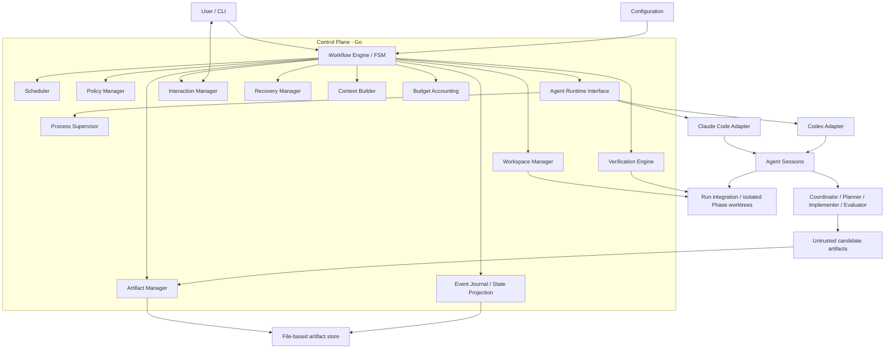
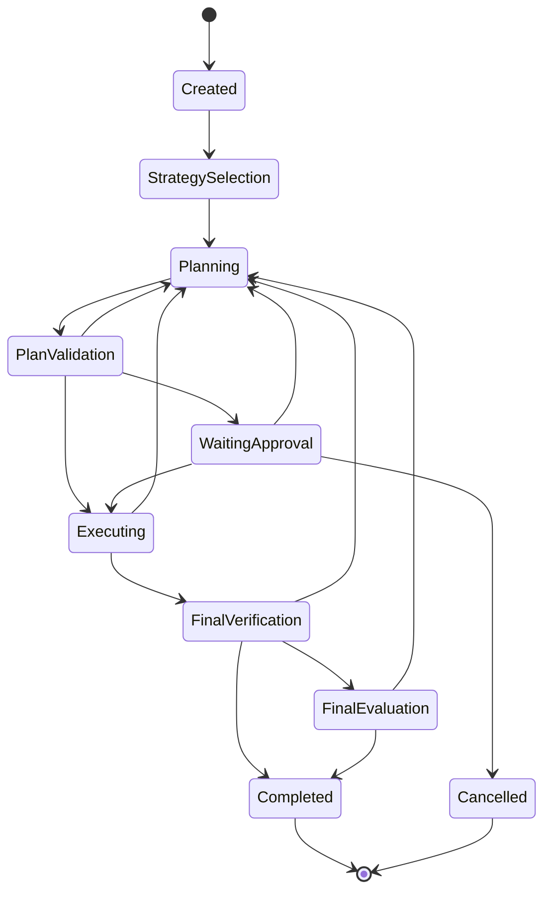
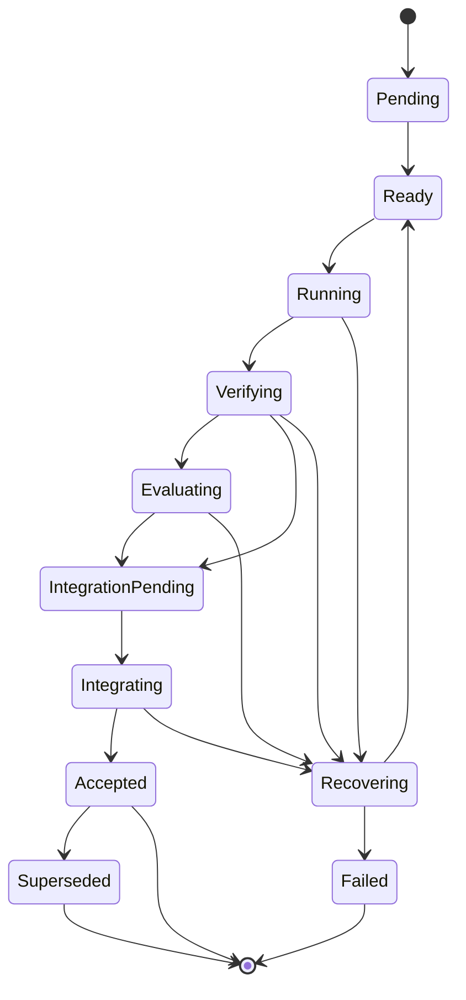
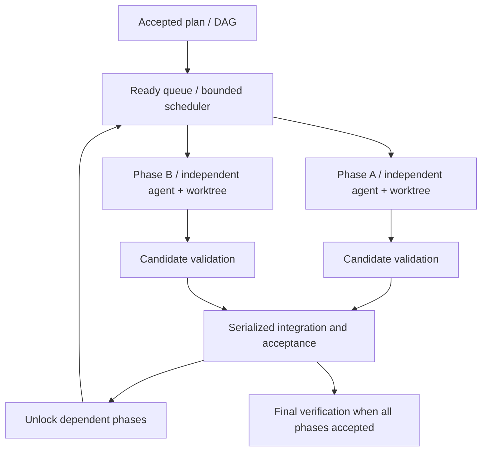

# Bellona — Architecture Specification

- Status: Proposed / pre-implementation
- Scope: Local-first agent workflow engine for software development
- Initial platform: Linux
- Core language: Go (standard-library-first; no third-party Go modules targeted for MVP)
- Workspace isolation: Git worktree only; no Bellona-managed sandbox
- Execution model: Daemon-optional; foreground CLI for MVP
- Durability: Local file journal, immutable artifacts, explicit reconciliation
- Scheduling: Bounded parallel DAG execution and isolated phase worktrees are MVP requirements

## Conventions

The key words MUST, MUST NOT, SHOULD, SHOULD NOT, and MAY are to be interpreted as described in RFC 2119 and RFC 8174 when, and only when, they appear in capitals.

The requirements are in §4 to §15, §17 to §19, and §22, except §11.3. In those sections, a sentence in the imperative ("Record…", "Do not…") or a sentence that uses "must" states a requirement with the force of MUST, unless it uses SHOULD or MAY. A sentence about later or optional work, such as a feature to consider after the MVP, is a plan and not a requirement.

The following are informative: §1 to §3, diagrams, JSON and command examples, §11.3, §16, §20, §21, and §23.

Appendix A gives each requirement an identifier, a milestone, and a strength. It adds no rules. The body states each rule; where the two differ, the body prevails and the index is corrected. A rule that the index does not list is still binding.

## 1. Overview

Bellona is a local-first workflow engine that runs existing coding agents as external processes and controls planning, implementation, evaluation, and verification.

Rather than replacing Claude Code or Codex, Bellona operates as a control layer above them. Unlike orchestrators primarily concerned with issue-level job management, Bellona focuses on the execution flow within individual development tasks.

> Non-deterministic reasoning, deterministic execution.

Reasoning and semantic judgments are delegated to LLMs, while execution order, dependencies, logical role responsibilities, retries, state transitions, and completion criteria are controlled programmatically. OS-level access control is outside the scope of the initial implementation.

## 2. Goals and non-goals

### Goals

- Local-first: No external database or persistent service is required.
- Harness-agnostic: Support Claude Code, Codex, and other harnesses through a common interface.
- Deterministic execution: Prevent state transitions that bypass planning or verification gates.
- Adaptive effort: Allow models to be configured while letting the LLM select effort according to the task or phase.
- Artifact-driven communication: Use structured artifacts for handoffs between agents.
- Independent evaluation: Separate implementation from quality evaluation.
- Recoverability: Reconcile execution state and artifacts after abnormal termination and resume when appropriate.
- Parallel execution: Launch agents for independent phases concurrently, with the engine controlling dependencies, concurrency limits, workspace separation, and integration verification. Sequential execution is a special case with a concurrency limit of one.
- Human-in-the-loop: Present structured decisions to users, accept natural-language answers outside the offered choices, and support safe suspension and resumption.
- Observability: Make execution history, decision rationale, verification results, and execution parameters traceable.

### Non-goals for the initial release

- Implementing an LLM inference runtime or a coding agent itself.
- Distributed workers, clustering, multi-tenancy, or a persistent daemon.
- Continuous synchronization with issue trackers.
- A custom general-purpose workflow DSL or an arbitrary-code plugin framework.
- Dependencies on SQLite or other databases.
- A Bellona-managed sandbox, containers, OS-level access control, or management of harness sandbox settings.
- Frameworks or general-purpose parsers requiring third-party Go libraries. The MVP targets standard-library-only implementation.
- Automatic commits to user branches, pushes, pull request creation, or production deployment. Internal commits on Bellona-managed refs for artifact preservation and integration are part of the MVP (§10.2).

## 3. System architecture



### Components

| Component | Responsibility |
| --- | --- |
| Workflow Engine | Sole authority for state transitions. Controls execution order, failure branches, and termination conditions. |
| Scheduler | Manages phase dependencies, concurrency, and runnable phases. |
| Policy Manager | Validates role-specific model configuration, permitted effort values, budgets, retry and time limits, and logical role restrictions. |
| Agent Runtime | Abstracts host-specific launch, resume, cancellation, and event collection. |
| Verification Engine | Performs typed JSON validation, semantic checks, diff inspection, tests, linting, and other checks; produces evidence. |
| Artifact Manager | Validates and stores artifacts, associating them with revisions and attempts. |
| Event Journal | Appends state changes and preserves execution history. |
| State Projection | Derives current Run, Phase, and Attempt state from events. |
| Workspace Manager | Prepares Git workspaces, manages base revisions, obtains diffs, and handles integration. |
| Interaction Manager | Validates and presents structured questions, adds Other, validates and persists answers, and passes them to the resume target. |
| Recovery Manager | Reconciles uncertain attempts, classifies errors, and determines whether retries or replanning are permitted. |
| Context Builder | Selects role-specific input artifacts, manages size, and constructs handoff context when a session is lost. |
| Budget Accounting | Accounts for execution limits, usage, and retry counts within a single Run. |
| Process Supervisor | Handles process launch, termination, reaping, and timeouts within the adapter. |

These are logical responsibilities, not a requirement to implement each as a separate service or package. The MVP implements only the necessary small Go components.

## 4. Agent roles

Because the term Orchestrator can refer to either a program or an LLM, Bellona calls the program-side component the Workflow Engine and the LLM-side component the Coordinator.

| Role | Kind | Responsibilities | Production code | Plan |
| --- | --- | --- | --- | --- |
| Workflow Engine | Program | Execution control, state transitions, acceptance gates | No direct edits | Accept/version only |
| Coordinator | LLM | Strategy selection, initial effort, exception handling, resource allocation | Read-only | Propose only |
| Planner | LLM | Investigation, design, phase decomposition, acceptance criteria, per-phase effort | Read-only | Produce/revise |
| Implementer | LLM | Implementation, fixes, and tests for the assigned phase | Write in assigned workspace | Read-only |
| Evaluator | LLM | Independent assessment of specification compliance, quality, and regressions | Read-only | Read-only |
| Verification Engine | Program | Mechanical verification and evidence generation | No direct edits | Read-only |

The Coordinator is not a continuously running parent agent. It is launched only when reasoning is needed, such as initial strategy selection, Planner effort selection, failure analysis, replanning, or retry decisions.

The Planner and Evaluator may inspect source code but must not modify it. The table describes logical role contracts, not mandatory OS access controls. Every role runs in a Bellona-managed worktree, never in the user's working tree. Bellona compares the tracked files of the worktree before and after each execution of a read-only role; a change to them is a role contract violation (§14.1), and the output of that Attempt is not accepted. Untracked byproducts of running the software or its tests are not a violation; they are discarded when the worktree is reset (§10.2). Evaluator verification commands run in the Phase worktree after the candidate has been snapshotted (§10.2), or in a dedicated verification worktree checked out at the commit under review. The Evaluator SHOULD exercise the software, for example by running it or its tests, and not only read the diff. A role that can run commands cannot be made read-only by tool restrictions alone, so for such a role the worktree comparison is the check that its contract held.

Agents may report their own completion but cannot determine whether a phase or Run is accepted. The engine verifies the required evidence before granting acceptance.

## 5. Domain model

- **Run**: A workflow execution for one user request.
- **Plan Revision**: An immutable version of an accepted plan. Replanning creates a new revision.
- **Phase**: A unit of work in a plan, with dependencies, acceptance criteria, and an intended change scope.
- **Attempt**: One execution of one role, for a Phase (Implementer, Evaluator) or for the Run (Planner, Coordinator). Every retry receives a new ID, and an Evaluator's execution is an Attempt of its own.
- **Agent Session**: Host-specific conversation and execution context, with a lifecycle independent of a Phase.
- **Turn**: One instruction and its response. An Attempt consists of one Turn, plus one further Turn for each structured-output repair and each continuation after user input. In the MVP, each Turn is one CLI process.
- **Process**: An OS process such as an agent CLI. It need not correspond one-to-one with a Session or Turn.
- **Run Manifest**: A frozen record of configuration, role definitions, contracts, and Runtime information at execution start.
- **Artifact**: Structured output such as plans, results, reviews, and evidence, associated with the Run, Plan Revision, Phase, and Attempt.
- **Event**: A state change committed by the engine, distinct from raw events received from agents.
- **Interaction Request**: A collection of questions requiring user judgment, associated with the originating role, Attempt, plan revision, and resume target.
- **User Answer**: A selection or free-text answer submitted by the user and validated and recorded by Bellona.

In the MVP, a session belongs to one role and one worktree. The engine resumes a session in three cases: to continue an Attempt (structured-output repair or continuation after user input), to run a repair Attempt for the same Phase in the same worktree, and to run a later Planner Attempt of the same Run (plan-validation retries, plan changes requested by the user, and replanning). Reusing a session across Phases is deferred (M6): each Phase has its own worktree, so the session's context would refer to the paths and state of a different worktree. Multiple active Attempts must not run concurrently in one session. An Evaluator must not reuse an Implementer session.

Resuming the Planner keeps its investigation of the codebase. Before a resumed Planner Turn, update the Planner's worktree to the current integration commit, and take the baseline for the role-contract comparison (§4) after that update. Tell the Planner which commits were integrated since its previous Turn and which files they changed. If the session no longer exists, start a new session with the handoff context (§12.3).

## 6. Workflow and state transitions

The initial implementation uses a fixed state machine written in Go. Declarative workflow definitions will be considered only when multiple workflows are actually needed.

Bellona tracks three separate state machines: the Run, each Phase, and each Attempt. The state of the Run must not be overwritten with the state of a single Phase, and multiple Phases may be in different states during a Run. The transition tables below are normative; the diagrams are informative. The engine rejects every transition that is not listed.

### Run states



The diagram omits the suspended states `WaitingForUser`, `Blocked`, and `RecoveryRequired`, which can be entered from the states named in the table and return to the recorded resume state.

| From | Condition | To |
| --- | --- | --- |
| `Created` | Manifest frozen, workspaces prepared (§13), baseline checks passed (§9) | `StrategySelection` |
| `Created` | Baseline checks failed or the environment is missing | `Blocked` |
| `StrategySelection` | No decision is delegated to the Coordinator, or its decision is validated | `Planning` |
| `Planning` | Plan candidate received | `PlanValidation` |
| `PlanValidation` | Invalid, retry allowed | `Planning` |
| `PlanValidation` | Valid, approval required | `WaitingApproval` |
| `PlanValidation` | Valid, no approval required | `Executing` |
| `WaitingApproval` | Approved (bound to the plan hash, §6.2) | `Executing` |
| `WaitingApproval` | Changes requested with user feedback | `Planning` |
| `WaitingApproval` | Rejected | `Cancelled` |
| `Executing` | All Phases `Accepted`; no active Attempts, unresolved questions, or pending integrations | `FinalVerification` |
| `Executing` | Replan authorized and all active Attempts terminated and reconciled | `Planning` |
| `Executing` | No Phase can make progress, and replanning is not authorized | `Blocked` |
| `FinalVerification` | Checks passed, final review required | `FinalEvaluation` |
| `FinalVerification` | Checks passed, all reviews satisfied | `Completed` |
| `FinalVerification` | Checks failed | `Planning` (repair replanning) |
| `FinalEvaluation` | Accepted, evidence current | `Completed` |
| `FinalEvaluation` | Rejected | `Planning` (repair replanning) |
| `FinalEvaluation` | Evaluator execution failed or returned invalid output, retry allowed | `FinalEvaluation` (new Evaluator Attempt) |
| `StrategySelection`, `Planning`, `Executing`, `FinalEvaluation` | Validated question request and all execution processes reaped | `WaitingForUser` |
| `WaitingForUser` | All mandatory answers received and freshness checks passed (§6.2) | Recorded resume state |
| Any nonterminal state | A Run-wide limit is reached (replan count, Run time, budget, or retries of a Planner, Coordinator, or final Evaluator Attempt), or the issue cannot be resolved without the user, such as a missing environment | `Blocked` |
| `Blocked` | User resumes after resolving the cause or amending the policy (§6.3) | Recorded resume state |
| Any nonterminal state | Unknown external execution outcome | `RecoveryRequired` |
| `RecoveryRequired` | Reconciled (§12.1) | Recorded resume state |
| Any nonterminal state | Cancellation requested and all active Attempts terminated and reconciled | `Cancelled` |

`Completed` and `Cancelled` are the only terminal Run states. `WaitingForUser`, `Blocked`, and `RecoveryRequired` are suspended states: the engine records the state to resume, no agent process is running, and the Run can continue later.

`WaitingForUser` represents a pending design decision and is distinct from `WaitingApproval` (pending plan approval) and `Blocked` (unresolvable issue or execution limit reached). Any role may request input, and after an answer execution returns to the resume target recorded by the engine. See §6.1.

`StrategySelection` launches the Coordinator only when a decision is delegated to it, such as Planner effort with `decidedBy: coordinator`. Otherwise the engine passes through this state without launching an agent.

Plan approval offers three responses: approve, request changes, and reject. Requested changes return to the Planner with the user's feedback; they are recorded separately and do not consume the replan counter. Only rejection cancels the Run.

A final verification or final evaluation failure has no single owning Phase. The engine returns to `Planning`, and the Planner adds repair Phases as a new Plan Revision based on the current integration commit (§10.2). Repair replanning consumes the replan counter. The Direct strategy may omit the Planner but must not bypass mandatory gates.

### Phase states



| From | Condition | To |
| --- | --- | --- |
| `Pending` | All dependencies `Accepted` | `Ready` |
| `Ready` | Slot and all required locks acquired; launch intent persisted | `Running` |
| `Running` | Implementer reported `implemented` and its process was reaped | `Verifying` |
| `Running` | Execution failed, output invalid, or a status other than `implemented` reported | `Recovering` |
| `Verifying` | Checks passed, phase review required | `Evaluating` |
| `Verifying` | Checks passed, review deferred to final evaluation | `IntegrationPending` |
| `Verifying` | Change scope violated, or checks failed on the candidate snapshot (§10.2) | `Recovering` |
| `Evaluating` | Accepted verdict received | `IntegrationPending` |
| `Evaluating` | Rejected verdict received | `Recovering` |
| `Evaluating` | Evaluator execution failed or returned invalid output, retry allowed | `Evaluating` (new Evaluator Attempt) |
| `Evaluating` | Evaluator retries exhausted | `Recovering` |
| `IntegrationPending` | Selected by the serialized integration queue | `Integrating` |
| `Integrating` | Integrated, post-integration evidence valid, integration ref advanced | `Accepted` |
| `Integrating` | Git conflict or post-integration checks failed | `Recovering` |
| `Recovering` | Retry authorized | `Ready` (new Attempt) |
| `Recovering` | The Phase cannot succeed under the current plan and needs replanning | `Failed` |
| `Running`, `Evaluating`, `Recovering` | Validated question request | `WaitingForUser` |
| `WaitingForUser` | Answers received | Recorded resume state |
| `Running`, `Verifying`, `Evaluating`, `Integrating` | Unknown external execution outcome | `RecoveryRequired` |
| `RecoveryRequired` | Reconciled (§12.1) | State determined by reconciliation |
| `Accepted` | A new Plan Revision does not carry the acceptance over | `Superseded` |
| Any state except `Accepted` and `Superseded` | A new Plan Revision removes or redefines the Phase | `Superseded` |

`Recovering` is the state in which the engine classifies the failure (§14.1) and, where reasoning is needed, launches the Coordinator. A Phase that has reached its retry limit stays in `Recovering` and waits: a policy amendment (§6.3) lets it receive a new Attempt, and replanning supersedes it. `Failed` ends a Phase within its Plan Revision; only replanning can replace it. Neither condition blocks the Run by itself, and neither changes the state of independent Phases, which continue (§10). The Run becomes `Blocked` only when no Phase can make progress and replanning is not authorized.

### Attempt states

An Attempt is one execution of one role: an Implementer or Evaluator working on a Phase, or a Planner or Coordinator working for the Run. Evaluator executions are Attempts of their own, distinct from the Implementer Attempt they review.

| From | Condition | To |
| --- | --- | --- |
| `Scheduled` | Launch confirmed | `Running` |
| `Scheduled` | Launch did not occur (confirmed by reconciliation) | `Abandoned` |
| `Running` | Valid output received and process reaped | `Finished` |
| `Running` | Process failed or output invalid after permitted repairs | `Failed` |
| `Running` | Turn timeout | `TimedOut` |
| `Running` | Cancelled and process reaped | `Cancelled` |
| `Running` | Validated question request and process reaped | `WaitingForUser` |
| `WaitingForUser` | Answers received and the session resumed (next Turn) | `Running` |
| `WaitingForUser` | Session cannot be restored | `Abandoned` (a new Attempt continues, §6.1) |
| `Scheduled`, `Running` | Outcome cannot be determined | `Unknown` |
| `Unknown` | Reconciled (§12.1) | `Finished`, `Failed`, or `Abandoned` |

`Abandoned` Attempts do not consume failure or retry counts. When a failed Planner, Coordinator, or Evaluator Attempt is retried within its limit, the Run and Phase states do not change; the retry is a new Attempt in the same state.

### Mandatory invariants

1. Do not start implementation until an accepted plan exists (or a task contract for Direct execution).
2. A Phase may start only after all its dependencies have been accepted.
3. Do not infer implementation success solely from the process exit code.
4. Accept only artifacts and evidence corresponding to the current Attempt and Plan Revision.
5. Do not grant acceptance if mandatory checks have failed, not run, or become stale.
6. If review is mandatory, an acceptance verdict from an independent Evaluator is required.
7. Complete a Run only after all phases are accepted and final verification of the integrated artifacts succeeds.
8. Stop when retry, replan, time, cost, or other permitted limits are exceeded.
9. Only the Workflow Engine may perform state transitions and artifact acceptance through the supported engine path. Agents must not edit state files or accepted artifacts. The MVP does not, however, provide security guarantees against direct modification by the same OS user.

10. Do not start work that depends on an unanswered mandatory question. Do not accept questions or recommendations as answered or approved by the LLM itself.
11. Do not equate an uncertain external execution outcome with failure. Do not repeat the same work until reconciliation is complete.
12. Freeze the workflow, configuration, and role definitions at Run start. Afterwards, only an explicit, journaled user policy amendment may change execution limits (§6.3). Stop if compatibility cannot be established on resume.
13. State reconstruction through replay must have no side effects. Do not rerun accepted phases while their evidence remains valid.
14. Prohibit concurrent Attempts for the same Phase or Session. A single control loop manages slot reservation, release, and state changes.
15. Produce parallel-phase artifacts in independent worktrees and commit integration, verification, and acceptance serially. Dependencies must be both integrated and accepted. The integration ref only moves forward within a Run.
16. On replanning or cancellation, stop new dispatches and safely terminate and reconcile active Attempts before committing a revision change or termination.

### Recovery decisions

| Condition | Action |
| --- | --- |
| Invalid plan / output | Return schema errors and regenerate within the permitted limits. |
| Mechanical check failed | Collect failure evidence and request a fix or root-cause analysis. |
| Semantic rejection | Pass findings to the Implementer; replan if the plan is defective. |
| Change scope violated | Preserve the worktree state and do not snapshot or integrate it. Have the Implementer remove the out-of-scope changes, or ask the Planner to amend the scope in a new Plan Revision. |
| Insufficient reasoning | The Coordinator may propose a change in effort. |
| Missing environment / permissions | Stop as `Blocked` and report the required user action (§14.1). Ask the user instead only when an answer, rather than a change to the environment, resolves it. Do not attempt to resolve this by increasing effort. |
| Unknown external execution state | Do not automatically rerun before reconciling the workspace, session, and artifacts. |
| Retry or budget exhausted | A Phase at its retry limit waits in `Recovering` while independent Phases continue. When no Phase can make progress, or a Run-wide limit is reached, mark the Run as `Blocked` and report the reason and recovery steps (§6.3). |

Replanning never rewinds the integration ref. The Planner produces the new Plan Revision against the current integration commit and is told which Phases are already integrated. A Phase in the new revision keeps its `Accepted` state only if a Phase with the same ID was `Accepted` in the previous revision and its definition digest and the definition digests of all its transitive dependencies are unchanged. The definition digest covers every Phase field except `execution` and `evaluation`. Every other previously accepted Phase becomes `Superseded`: its commits stay in the integration history, and any rework is expressed as new Phases on top of the current integration commit. Preserve historical evidence.

### 6.1 Human-in-the-loop (HITL)

Bellona provides a common question-and-answer interface independent of harness-specific question tools. When user judgment is needed, an agent returns structured final output indicating `needs_user_input` together with a collection of questions, rather than ordinary chat prose. In the MVP, questions are presented after the non-interactive CLI execution finishes. Relaying native harness input-request events during execution is a future adapter extension.

```mermaid
sequenceDiagram
    participant P as Planner session
    participant B as Bellona
    participant U as User
    P->>B: needs_user_input + questions
    Note over P: Turn completes; CLI process exits
    B->>B: Validate and persist request
    B->>U: Present questions + Other
    U->>B: Submit selections or natural language
    B->>B: Validate and persist answers
    B->>P: Resume session with questions and answers
    P->>B: Updated plan or further questions
    B->>B: Validate plan before implementation
```

- Any Coordinator, Planner, Implementer, or Evaluator may request input. The Workflow Engine may also request approval, but approvals and design questions use distinct event contracts.
- The Planner asks questions when user intent needs clarification, such as ambiguous specifications, multiple reasonable designs, or irreversible changes. It must not interrupt the user for matters it can investigate or decide independently, or merely to select effort.
- When a question is accepted, the engine records its origin, session ID, target revision, and resume state. In the MVP, new dispatches across the Run stop; already-running independent Attempts are supervised until they finish safely, and their results are saved. Commit `WaitingForUser` only after all execution processes are reaped. Defer new integrations after the question arises and reconcile assumptions after answers arrive. Continuing to dispatch independent phases while limiting the scope of a question is a future feature.
- In interactive mode, only Bellona waits on standard input. Agent CLI processes have exited normally, and no inference requests are made while waiting for input.
- In non-interactive mode, persist questions and results from already-started Attempts, reap all execution processes, and then exit Bellona itself. Use a dedicated exit code to signal pending input and allow answers and resumption later. The exact exit code will be defined during implementation.
- Waiting for user input is a normal state and does not consume failure, retry, or replan counts. Execution time limits apply to active processing (§11.2). Time spent waiting for input is measured separately and, by default, does not count toward them.
- Resume the originating session after all mandatory questions have been answered. The resumed execution is the next Turn of the same Attempt, in the same worktree. If the session cannot be restored, mark the Attempt `Abandoned` and continue in a new Attempt and a new session of the same role using the original request, current plan, questions, and answers. Reconcile workspace state before resuming work that makes actual changes.
- Answers to Planner questions (including Other) are interpreted by the Planner and incorporated into the plan. Do not pass them directly to the Implementer and bypass plan validation. If an answer to another role requires a plan change, return to the Planner and validate the revised plan.
- Follow-up questions are allowed. Do not fill in unanswered questions automatically on EOF, cancellation, or partial answers. Handle the harness's own tool-permission approvals separately, without altering existing approval settings. The only permission rules that Bellona adds are those of scope enforcement, when the user enables it (§14).

### 6.2 Input freshness and approval binding

Associate questions and approvals with the originating Attempt, plan revision, relevant base commit, and required artifact identifiers. Treat accepting answers and resuming execution as separate operations. Acquire the Run lock on resume and check whether the worktree or plan assumptions have changed. Do not automatically rebase an existing Run just because the original repository's HEAD has advanced. If changed assumptions affect execution, require Planner reassessment, further questions, or an explicit user decision.

Record question cancellation and invalidation as events. Bind approval to the hash of the relevant plan or artifact, and never reuse it as approval of a modified version. For duplicate answers with identical content, return the existing result or reject the duplicate; do not silently overwrite an existing answer with different content. Design questions, approvals, and harness tool-permission requests have separate contracts.

### 6.3 Blocked runs and policy amendment

`Blocked` is a suspended state, not a terminal one. When a Run becomes `Blocked`, the engine records the reason, the state to resume, and the recovery steps, reaps all execution processes, and exits. Accepted Phases, their evidence, and the integration ref are preserved.

The user continues a `Blocked` Run with `resume` after resolving the cause, for example by fixing the environment or authentication. If the cause is an exhausted limit, the user may raise that limit with an explicit policy amendment. A policy amendment:

- is requested only by the user through the CLI, never by an LLM or by lower-priority configuration;
- may change only execution limits (retry and replan limits, time limits, and per-Turn step and cost caps), not role definitions, contracts, or the workflow;
- is appended to the journal as a `PolicyAmended` event that records the previous value, the new value, and the time. The frozen `manifest.json` and `policy.json` are not rewritten; the effective policy is derived from them plus the amendments in the journal.

After an amendment that raises the Phase retry limit, a Phase waiting in `Recovering` receives a new Attempt. After one that raises the replan limit, replanning can be authorized again. Without an amendment, resuming a Run whose limit is still exhausted returns it to `Blocked`.

## 7. Adaptive effort allocation

Separate model selection from effort selection.

- **Model:** Configure per role through harness settings. Explicit user configuration takes precedence.
- **Initial Coordinator effort:** Start with a configured fixed value or the host default (bootstrap).
- **Planner effort:** A configured fixed value, or selected by the Coordinator based on the initial task when delegated.
- **Implementer effort:** The Planner selects it per phase.
- **Evaluator effort:** The Planner proposes it in the plan based on the evaluation target and risk: per Phase for phase reviews, and once for the final evaluation. Starting an Evaluator does not require a Coordinator launch.
- **Recovery effort:** The Coordinator analyzes the failure and proposes a change.

Do not require users to specify effort every time. The LLM considers complexity, uncertainty, impact, risk, previous failures, and other relevant factors when selecting effort. Reasoning effort may vary between phases even when the model is fixed.

### Capability-aware execution

The adapter exposes supported effort values for each execution host and model; the Policy Manager narrows the permitted range. Present only selectable options to the LLM.

Do not assume that `high` represents the same amount of reasoning across vendors. If the host does not support setting effort or changing it on resume, do not claim the setting was applied. Follow an explicit fallback policy: create a new session, execute with the default, or stop.

Record the requested value, the value passed to the adapter, and the value confirmed by the host (when available) separately. Record the model the same way: a host may serve a Turn with a different model than requested, for example through a configured fallback, or run at a lower effort level than requested, without failing. Where the host does not report the value it applied, record the confirmed value as unknown. Reasoning effort is not a strict budget cap; manage time, token, and other limits independently. Do not treat unmeasurable costs as known values.

## 8. Artifact contracts

Define artifact contracts using versioned, typed Go structs and explicit validation functions. JSON Schema may be used to publish contracts and request structured output from compatible harnesses, but the MVP does not require a general-purpose JSON Schema validator. The examples below are illustrative; formal types and constraints will be finalized during implementation.

Use `encoding/json` to read JSON and reject unknown fields, trailing JSON values, missing required fields, nulls where invalid, invalid values, and duplicate keys. Implement semantic constraints, such as dependencies and revisions, through Go validation functions. If JSON Schema descriptors are provided, test their consistency with the types and contracts.

### Attempt binding

Agent output does not contain identifiers that the engine assigns, such as the Plan Revision, the Attempt ID, or the Phase an Attempt works on. An agent could only echo them, and a wrong echo would cost a repair Turn without adding assurance. The engine writes an Attempt binding when it persists launch intent, and it associates each output with the Attempt whose process produced it.

```json
{
  "schemaVersion": 1,
  "attemptId": "attempt-07",
  "role": "evaluator",
  "planRevision": 1,
  "phaseId": "phase-01",
  "baseCommit": "<commit>",
  "subject": {"attemptId": "attempt-03", "commit": "<commit>", "tree": "<tree>"}
}
```

`subject` is present for Evaluator Attempts and identifies the Implementer Attempt and the candidate commit under review. The binding is stored at `attempts/<attempt-id>/attempt.json` (§12) and is the mechanism behind invariant 4: an output is accepted only if its Attempt's binding matches the current Plan Revision and the Phase's current Attempt. References that the agent chooses, such as `dependsOn`, `criterionId`, the `phaseId` of a Coordinator decision, and a recommended option, remain in the output and are validated.

### Plan

```json
{
  "schemaVersion": 1,
  "phases": [
    {
      "id": "phase-01",
      "title": "Implement authorization middleware",
      "goal": "Reject requests from authenticated users who lack the required permission",
      "dependsOn": [],
      "changeScope": ["internal/auth/**"],
      "contextFiles": ["internal/auth/session.go"],
      "steps": [
        {
          "file": "internal/auth/middleware.go",
          "action": "create",
          "detail": "Add middleware that checks the permission before calling the handler"
        }
      ],
      "constraints": ["Do not change the session cookie format"],
      "resources": {"exclusive": []},
      "execution": {
        "effort": "high",
        "rationale": "Security-sensitive changes across authorization paths"
      },
      "evaluation": {"effort": "medium"},
      "acceptanceCriteria": [
        {
          "id": "AC-01",
          "description": "Authenticated users without permission receive HTTP 403",
          "verifiedBy": ["unit-tests", "evaluator"]
        }
      ],
      "verificationRefs": ["unit-tests", "lint"]
    }
  ],
  "finalEvaluation": {"effort": "high"}
}
```

`goal`, `steps`, `constraints`, and `contextFiles` carry the Planner's investigation and design to the Implementer. Without them, the Implementer would receive only a title and acceptance criteria. `steps[].action` is `create`, `modify`, or `delete`, and every step file must lie within the change scope. `evaluation.effort` is the Planner's proposal for the phase review and is used only when phase reviews are enabled; `finalEvaluation.effort` is its proposal for the final evaluation.

Every acceptance criterion names how it is verified in `verifiedBy`: one or more checks from the Phase's `verificationRefs`, the reserved value `evaluator`, or both. Plan validation rejects a criterion without a verification means, a check name that is not in the Phase's `verificationRefs`, and `evaluator` when no Evaluator will run (`independentReview: none`, §10).

The engine assigns the Plan Revision number when it accepts a plan; the Planner does not write it. `verificationRefs` name checks defined in trusted configuration (§9), so a plan cannot introduce its own commands. A narrower check for a Phase is added by defining another named check in configuration.

Plan validation checks ID uniqueness, reference existence, cyclic dependencies, acceptance criteria, permitted effort values, and valid verification references. Treat change scopes as repository-relative paths and reject references outside the directory.

Change-scope patterns use a small grammar defined by Bellona: `/`-separated repository-relative paths in which `*` matches within one path segment and `**` matches zero or more segments. Absolute paths, `..` segments, and negation are rejected. The standard library's `path.Match` does not support `**`, so matching is purpose-built code.

### Implementation result

```json
{
  "schemaVersion": 1,
  "status": "implemented",
  "summary": "Authorization middleware and unit tests added",
  "reportedChangedFiles": ["internal/auth/middleware.go", "internal/auth/middleware_test.go"],
  "issues": []
}
```

`implemented` is an agent report and is distinct from `accepted` by Bellona. The engine obtains the actual diff and compares it with the report. Candidate statuses are `implemented`, `needs_replan`, `blocked`, and `failed`. An Implementer that needs a user decision returns the common `needs_user_input` output instead.

### Evaluation result

```json
{
  "schemaVersion": 1,
  "verdict": "rejected",
  "criteria": [
    {
      "criterionId": "AC-01",
      "result": "fail",
      "evidence": "A request with a session that lacks the permission returned HTTP 200"
    }
  ],
  "findings": [
    {
      "criterionId": "AC-01",
      "severity": "blocking",
      "category": "spec_compliance",
      "file": "internal/auth/middleware.go",
      "evidence": "Missing permission check on an authenticated request path",
      "requiredAction": "Enforce permission check before calling the handler"
    }
  ]
}
```

`criteria` reports every acceptance criterion under review exactly once, with `result` `pass` or `fail` and the evidence for it. A phase review covers the criteria of the Phase, and the final evaluation covers the criteria of every Phase in the accepted plan. The engine rejects an evaluation that omits a criterion, so an Evaluator cannot pass work by not mentioning a criterion.

`verdict` is `accepted` or `rejected`, and `severity` is `blocking` or `advisory`. The verdict must agree with the rest of the output: `accepted` requires every criterion to pass and no `blocking` finding, and `rejected` requires a failed criterion or a `blocking` finding. Anything else is invalid output.

Provide the Evaluator with the original request, accepted plan, actual diff, and verification evidence. Do not share the Implementer's full conversation history by default. The engine binds the review to the Implementer Attempt, candidate commit, and tree recorded in the Evaluator's Attempt binding, which prevents reuse of a review for a different version.

### Coordinator decision

```json
{
  "schemaVersion": 1,
  "action": "retry",
  "phaseId": "phase-01",
  "effort": "high",
  "rationale": "The implementation failed on a cross-cutting authorization case"
}
```

A decision is a proposal, not direct command execution or a state change. The engine executes it only after validating state, target Phase, permissions, budget, and supported capabilities. In the MVP, the engine decides whether a session is resumed by the rule in §5, so neither a plan nor a decision carries a session preference.

### Interaction request and answer

Role-specific artifact contracts allow an agent to return either its normal artifact or the common `needs_user_input` output. This output is the only way for any role to ask the user; no role-specific artifact has a separate status for it. A question request is not treated as successful implementation.

```json
{
  "schemaVersion": 1,
  "status": "needs_user_input",
  "questions": [
    {
      "id": "Q-001",
      "type": "single_choice",
      "question": "Which authentication mechanism should be used?",
      "options": [
        {
          "id": "session",
          "label": "Session-based authentication",
          "description": "Server-side session management"
        },
        {
          "id": "jwt",
          "label": "JWT-based authentication",
          "description": "Stateless token-based authentication"
        }
      ],
      "recommended": "session",
      "rationale": "The application is an internal server-side system."
    }
  ]
}
```

| Question type | Answer contract |
| --- | --- |
| `single_choice` | Exactly one existing option, or free text through Other alone. |
| `multiple_choice` | Multiple existing options, optionally combined with free text through Other. Other alone is also allowed. |
| `confirm` | Explicit Yes / No response. Free text is not a substitute for approval at an approval gate. |
| `text` | Free text. |

**Other is a built-in UI feature.** For choice-based questions, Bellona always appends Other at presentation time instead of asking the Planner to generate it. Reject agent-generated options using the reserved ID `other`. Selecting Other allows natural-language input. Display recommended options and rationale, but do not finalize them without an explicit user answer.

Example answer selecting an existing option:

```json
{
  "questionId": "Q-001",
  "selected": ["session"]
}
```

Example answer using Other:

```json
{
  "questionId": "Q-001",
  "selected": [],
  "customText": "Use Entra ID for SSO and server-side sessions in the application."
}
```

For multiple-choice questions, `selected` and `customText` may be combined. Use `customText` for `text` and a dedicated Boolean for `confirm`. Store the free text verbatim rather than storing Other as an actual option ID.

The engine assigns a Request ID unique within the Run and associates it with question IDs (unique within the request), the originating role, Attempt, Session ID, target plan revision (unset before initial planning), and resume target. Identify answers by the pair of Request ID and question ID; reject input for already answered, invalidated, or different-Run questions. Go validation functions check option IDs, duplicates, selection counts, recommendation references, empty free text, and size limits. Support presenting question sets together and persisting partial answers, but do not transition until all mandatory answers are present.

Pass free text to the next agent as user requirements, without interpreting or executing it as shell arguments or directly changing engine constraints or permission settings. Formal types and size limits will be finalized during implementation.

## 9. Mechanical verification and acceptance

Perform verification independently of the agent's self-reported results.

- Typed JSON structural validation and explicit semantic consistency checks (dependencies, IDs, revisions, permitted values).
- Compare Git diffs against allowed change scopes, including untracked files.
- Tests, linting, type checks, builds, and other checks specified by the user or trusted repository configuration.
- SAST and architecture constraint checks, when they are configured as checks.
- Semantic evaluation of specification compliance and quality by an independent Evaluator.

Verification evidence records the command identifier, exit code, timeout, log references, and target artifact identifiers. Do not execute arbitrary LLM-generated shell strings with control-plane privileges. Resolve verification commands from trusted definitions and execute them in the target worktree. This is not security isolation.

Protect the verification itself. `verification.protectedPaths` lists patterns, in the change-scope grammar (§8), for existing tests and check configuration. A candidate that modifies or deletes an existing file matching a protected pattern is a scope violation (§14.1), unless a step of the Phase names that file with the matching action. The rule does not restrict adding new test files.

At Run start, after preparing the integration worktree and running workspace setup (§13), run the required checks once on the base commit. If this baseline fails, the Run becomes `Blocked` before any agent is launched and reports the failing checks. Checks that already fail on the base commit would otherwise fail every Phase and consume agent effort on failures that predate the Run. A baseline that fails because of the environment can be resumed after the environment is fixed. A baseline that fails because of the repository itself cannot be repaired within the Run, because the base commit is frozen: cancel the Run, fix the base, and start a new Run.

The baseline run also records the files that the checks create and that are neither tracked nor ignored. Record these paths with the baseline evidence and treat them as ignored for the rest of the Run. Otherwise a check run inside a Phase worktree would add them to the change set, and they would be reported as scope violations.

Give the Implementer the commands of its Phase's checks, so that it can run them and fix failures before it reports `implemented`. This saves repair Attempts, each of which starts a new process. The Implementer's own runs are not evidence: acceptance rests only on the engine's verification of the candidate commit. A self-check that is refused or skipped is not a failure. Whether the Implementer may run the commands depends on the role's permissions (§14). The Phase must declare in `resources.exclusive` the shared resources that its checks use, because the engine does not coordinate a check that the agent runs itself (§10.1).

Mechanical verification does not guarantee complete software correctness, and Evaluator judgments may also be wrong. Prioritize never treating failed or unexecuted mandatory checks as success.

## 10. Adaptive orchestration and scheduling

Bellona has one workflow, the fixed state machine in §6, identified by the workflow version in the Run manifest. A strategy is a named preset of parameters for that workflow, not a separate workflow. It is selected with `execution.strategy` or the `--strategy` CLI option.

| Strategy | Execution |
| --- | --- |
| Direct | A single Implementer and mandatory verification, for small changes. |
| Standard | Planner → Implementer → final Evaluator. |
| Phased | Planner → multiple phases according to dependencies → mechanical verification and evaluation. |
| Strict | Independent evaluation per phase, strict acceptance criteria, and final integration verification. |

Strategies primarily differ in phase granularity, session count, and evaluation frequency. Enforced conditions such as logical operation restrictions, mandatory verification, and budgets remain in effect for every strategy.

The MVP implements Standard, Phased, and Strict. Standard is the same workflow with an initial plan of exactly one Phase. Plan validation enforces the single Phase for the first Plan Revision only, because repair replanning adds Phases in later revisions (§6). No transition is added. Evaluation frequency is set by one setting, `verification.independentReview`: `none` launches no Evaluator, `final` runs the Evaluator only in the final evaluation, and `phase` also runs it for every Phase before integration. Standard and Phased default to `final`. `none` exists so that the Evaluator's contribution can be measured (§19); mechanical verification and final verification still apply. Strict is Phased with `phase` as a minimum that configuration cannot lower.

Direct and strategy selection by the Coordinator are later milestones (M7). Direct omits the Planner, which needs a transition or an engine-generated task contract that the MVP does not define.

The DAG Scheduler considers only phases whose dependencies have been accepted. The absence of dependencies alone does not establish that parallel execution is safe. Consider change scopes, shared resources, Git base revisions, and verification-environment conflicts. Fall back to serial execution when safety cannot be established.

The MVP requires actual concurrent launches of multiple agents. `execution.maxConcurrency` is a positive integer that bounds concurrently running agent processes: two or more permits concurrent execution of eligible phases, and one means sequential execution. With a value of one, the Scheduler also keeps at most one Phase in flight: it dispatches the next Phase only after the current one is `Accepted`, `Failed`, or `Superseded`. Sequential execution therefore integrates every Phase as a fast-forward. Native harness subagents are not required; supervise independent CLI processes using Go goroutines, channels, and contexts. No persistent daemon or external queue is required.



Run, Phase, and Attempt states and their transitions are defined in §6. An Attempt is a unique execution try, independent of Phase acceptance.

The Scheduler derives the Ready set from the accepted plan and checks dependency acceptance, change scopes, resources, slots, budgets, and waiting states. Break dispatch-order ties by plan order and Phase ID. Reserve a slot when persisting launch intent and release it after confirming agent termination and reaping. Count agent launches for every role, including Evaluators, against the same limit; separately coordinate resource conflicts among verification commands. A worker holding a slot must not wait to acquire another agent slot. Dispatch the next Ready Phase after its dependencies are accepted, without waiting for every other phase to finish.

Workers only return process or verification results through channels; they do not directly modify Run/Phase state, budgets, the event log, or the integration ref. A single control loop validates candidate results and commits events. Completion order may vary across executions, but replay of the recorded event sequence is deterministic.

Failure of an independent Phase does not revoke other phases' successes. In the MVP, independent phases may continue after a recoverable local failure, but dependent phases must not start. Stop new dispatches on Run-wide events such as replanning, uncertain outcomes, overall budget exhaustion, a rate-limit rejection reported by a host, or HITL. During replanning, accept a new Revision only after active Attempts have finished or been cancelled and reconciled; reject late results from older revisions. Preserve artifacts and evidence of independent partial successes, and do not repeat them while their assumptions remain valid.

### 10.1 Resource coordination

Handle DAG dependencies and shared-resource exclusion separately. Even the MVP coordinates overlapping change scopes, the same Phase/Session, the integration ref, and explicitly declared shared resources. The Planner may propose logical resource IDs such as `database:integration-test` or `port:8080` in `resources.exclusive`. Check against trusted configuration and dispatch only when all necessary locks can be acquired together. Serialize execution when change scopes overlap or shared-resource safety cannot be established. Use a fixed acquisition order, and reconcile remaining processes after abnormal termination before releasing locks.

The two kinds of lock are held for different periods:

- **Shared-resource locks** are held until both the agent and the associated verification processes stop.
- **Change-scope locks** are acquired at the Phase's first dispatch and held until the Phase becomes `Accepted`, `Failed`, or `Superseded`. A Phase with an overlapping scope therefore starts from an integration commit that already contains the earlier Phase's changes, or after the earlier Phase has ended. Releasing the lock when the processes stop would let the later Phase start from a base without those changes.

Lock ownership follows from Phase state, so it is reconstructed by replay after a suspension or crash.

Worktree separation does not isolate databases, ports, caches, or similar resources. Within-Run locks do not guarantee exclusion against other Runs or processes outside Bellona. Dynamic resource discovery, cross-Run locks, and capacity-based scheduling are future work.

### 10.2 Workspace integration and acceptance (MVP)

1. Freeze the base commit at Run start and prepare a dedicated Bellona integration ref and workspace. At Phase start, record the current accepted integration commit containing its dependencies, create a dedicated worktree from that commit, and run the configured workspace setup (§13). Never allow multiple Implementers to write to the same worktree.
2. After the Implementer exits, determine the change set: commits made by the agent, uncommitted changes to tracked files, and untracked files that are not ignored. Ignored files are never part of a candidate. Check the change set against the allowed change scope before staging anything. A file outside the scope is a scope violation (§14.1); do not indiscriminately stage unrelated files or secrets. When the scope check passes, snapshot the change set as a candidate commit before running any check, and perform mandatory verification of that candidate commit. Create internal commits only on Bellona-managed refs, without running repository hooks and without requiring commit signing. Files produced by verification or evaluation are not part of the candidate: before a repair Attempt continues in the Phase worktree, reset the worktree to the candidate commit, leaving ignored files in place. Do not automatically apply changes to the user's working tree or branch.
3. Queue verified candidates for integration; break ties between candidates ready at the same time by plan order and Phase ID. Perform one integration at a time. If the integration ref still points at the candidate's base commit, integrate by fast-forwarding to the candidate commit. Otherwise merge the candidate into the current integration commit in a dedicated temporary integration worktree, producing a merge commit so that the candidate commit stays reachable. Do not automatically overwrite or resolve conflicts; preserve candidates and evidence and proceed to a repair Attempt or replanning. A repair Attempt after a conflict or a post-integration failure starts in a new worktree at the current integration commit, with the preserved candidate commit given as a reference. A repair Attempt after a verification failure or a semantic rejection continues in the Phase's existing worktree.
4. Run mandatory integration checks on the integration candidate. A phase review, when enabled, has already taken place on the candidate before integration; the combined result is evaluated in the final evaluation (step 6). Bind evidence to the target commit and its tree; do not reuse verification from an older base as post-integration evidence. When the integration result has the same tree as the verified candidate, as in a fast-forward, the candidate's evidence is valid for it and the checks need not be repeated. Do not advance the accepted integration ref if verification fails.
5. Record the pre-integration ref, candidate commit, and intended integration commit as execution intent. Update the ref to the verified integration commit using a comparison with the expected old commit, then persist the observed result. Commit `PhaseAccepted` only after successful integration and confirmation of valid mandatory evidence. After a crash, reconcile refs, commits, candidates, and evidence rather than blindly repeating uncertain integration operations. Git operations and JSONL writes are not a single transaction.
6. After all phases are accepted, perform mandatory final verification on the final integration commit and, unless `independentReview` is `none`, the final evaluation. Subsequent integrations may invalidate the semantic assumptions of earlier phases; never complete the Run if final verification fails.
7. The integration ref only moves forward within a Run. Replanning, repair, and superseded Phases add commits on top of the current integration commit and never rewind or rewrite it (§6).

When a Run is `Completed`, Bellona reports the final integration commit and the name of the Bellona-managed ref that points at it. The user applies the result with ordinary Git operations such as merge or cherry-pick. This is the MVP's way of delivering the result; a dedicated apply command is optional later work.

Even with the same plan, integration results may vary with parallel completion order and external LLM responses. Bellona makes execution order, base commits, integration commits, and decisions traceable, but does not guarantee identical source output on every execution.

## 11. Agent runtime abstraction

```go
// Conceptual interface; exact signatures are not yet frozen.
type AgentRuntime interface {
    Capabilities(ctx context.Context) (Capabilities, error)
    Start(ctx context.Context, req AgentRequest) (Execution, error)
    Resume(ctx context.Context, sessionID string, req AgentRequest) (Execution, error)
}

type Execution interface {
    Events() <-chan AgentEvent
    Wait() (ExecutionResult, error)
    Cancel(ctx context.Context) error // Staged: graceful interrupt, terminate, kill (§11.2)
}

type AgentRequest struct {
    Role          string
    Model         string
    Effort        string
    Instructions  string
    Workspace     string
    Inputs        []ArtifactRef
    OutputSchema  string
    SessionID     string     // Assigned by the engine before launch, where supported
    Limits        TurnLimits // Per-Turn step and cost caps, where supported (§14.2)
    Customization string     // Host customization scope for the role (§14)
    Env           []string   // Names of additional environment variables to pass (§14)
    Scope         *ScopeRules // Generated permission rules under scope enforcement (§14)
    Subagents     string     // Whether the role may delegate to host subagents (§11.1)
    ExtraArgs     []string   // User-configured host arguments for the role (§14)
}

type ExecutionResult struct {
    SessionID         string
    Outcome           string             // completed, limit_reached, output_invalid, failed, interrupted
    Output            []byte             // Final structured output, if any
    ExitCode          int
    Receipt           *LaunchReceipt     // Configuration the host reported as applied, if any
    PermissionDenials []PermissionDenial // Calls the host refused, if reported
    Models            []string           // Models that served the Turn, if reported
    Usage             *Usage             // Tokens and cost, if reported; may be cumulative per session
}
```

The agent's final message is its output channel. The adapter captures it from the harness's output stream, using host-native structured output where the host supports it, and the engine validates it and writes the stored artifact. Agents do not write artifact files, so no output location has to be reserved inside a worktree or made writable outside it.

Derive the outcome from the host's result, never from the exit code alone: a host can exit successfully after refusing the calls that the task needed.

Everything beyond the session, outcome, output, and exit code is optional, and so is every capability: a session ID assigned before launch, native structured output, a launch receipt, per-Turn step and cost caps, a graceful interrupt, a customization scope, reporting of refused calls, path-scoped permission rules, and read-only subagents. The core must work when a capability is absent. A role setting that requires an absent capability fails configuration validation at Run start instead of being silently ignored.

- **Launch receipt.** When the host reports the configuration it applied at session start, the adapter stores it with the Attempt: model, working directory, session ID, host version, permission mode, available tools, loaded extensions, sandbox state, and credential source, but never the credential. A receipt that contradicts a value the adapter itself set, namely the working directory, the session ID, or the permission mode under scope enforcement (§14), fails the Attempt as `MissingEnvironment`. Values that come from the user's host settings or from `args`, such as tools and permission mode, are recorded but not compared, because the adapter does not interpret `args`. The receipt matters because a host may ignore invalid settings without reporting an error.
- **Refused calls.** Always record the calls that the host refused. A refusal is evidence, not an error: an agent may complete its task another way, and refusals are expected for a role whose tools are restricted. Use refusals to classify a failure only when the Attempt did not produce acceptable output. If a refused call was needed for the task, that failure is `MissingEnvironment`. A refusal caused by a rule that Bellona generated for scope enforcement is different: it means the plan's scope is too narrow, not that the environment is missing. The Implementer reports `needs_replan`, the engine passes the refused paths recorded for the Attempt to the Planner, and recovery follows the scope-amendment path (§6).
- **Environment.** The adapter builds the environment of the agent process explicitly instead of inheriting Bellona's. It passes a baseline needed to run the host, such as the home directory, the search path, and the locale, plus the variables named in `agents.<role>.env`. Record the names in the manifest, never the values. Host variables can override the model, the effort level, or the credentials of a run, so an inherited environment would make the requested values unreliable.
- **Prompt layout.** The role definition SHOULD be identical across the Attempts of a role in a Run, and everything that varies, such as the Phase, the inputs, and the working directory, SHOULD go in the user message. A host that caches prompts can then reuse the role definition across Attempts and worktrees. The benefit is not established: record cache usage for every Attempt and measure it in M0 (§11.3).

| Runtime | Initial integration | Possible future integration |
| --- | --- | --- |
| Claude Code | Non-interactive CLI (headless) | Claude Agent SDK |
| Codex | `codex exec` | Codex App Server |

Verify actual arguments, output formats, session resumption, and effort changes against each host's official specifications and real behavior at integration time. Keep host-specific argument names and event formats out of the core.

Use `os/exec` and `context.Context` for process launch. Pass argument arrays rather than concatenated shell strings, and collect output, exit status, and session ID. Account for termination and reaping of descendant processes on cancellation.

MVP input requests are processed after the agent Turn and process finish. Persist the session ID and input request, then use the adapter's resume capability after the user answers. Keep Process, Session, Turn, Phase, and Run lifecycles distinct.

### 11.1 Process, session and turn lifecycle

In the MVP, Bellona launches independent CLI sessions directly rather than delegating to native subagents. Wait for normal agent termination and verify results before proceeding. For the Implementer and the Coordinator, disallow native subagent delegation as a role contract and enforce it within host capabilities, but do not enforce it through a custom sandbox. Where the host reports subagent use, record it.

The Planner and the Evaluator may use the host's subagents for read-only investigation when `agents.<role>.subagents` is `readOnly`; the default is `none`. Subagents are not Attempts. They run inside the Attempt's slot, the Attempt's output is still the role's own final message, and their usage counts toward the Attempt's usage and caps. Bellona does not schedule them, so they add load beyond `maxConcurrency`, draw on the same quota, and can lengthen the wait after the final answer (§11.2). Their read-only behaviour is checked by the worktree comparison (§4), as for the role itself. A role that delegates needs the host's delegation tool, so a tool allow-list in `args` must include it. Configuration validation rejects `subagents: readOnly` for the Implementer and the Coordinator.

Whether a process is launched per Turn or retained across multiple Turns is the adapter's responsibility. The MVP uses non-interactive `claude -p` / `codex exec` processes and launches a new process for every Turn, including Turns that resume a session. Future integrations such as App Server separate Turn completion from Process termination and release resources at Run completion or cancellation. Every Evaluator Attempt starts in a new session.

Three session rules apply to every adapter. Resume only by explicit session ID, never through a host's selection of the most recent session, which can pick a session of another process. Pass the instructions of a resumed Turn in the user message, because a host may keep the system prompt it recorded when the session started. A host may delete old sessions after a retention period; a session that no longer exists is handled as a session that cannot be restored (§6.1).

### 11.2 Process supervision and timeouts

| Limit | Semantics | Stage |
| --- | --- | --- |
| Startup timeout | Limit startup and required initial response time, where the adapter can detect it. | MVP (within supported capabilities) |
| Turn timeout | Time limit for one external execution. | MVP |
| Phase timeout | Cumulative active execution time including attempts and repairs for a Phase. | MVP |
| Run timeout | Cumulative active execution time for the Run; track input-wait time separately by default. | MVP |
| Cancellation grace period | Time allowed between attempting graceful termination and forced termination. | MVP |
| Idle timeout / heartbeat | Detect gaps in events without assuming silence during inference is a failure. | P1 |

Active execution time for a Phase or a Run is the wall-clock time during which at least one agent or verification process supervised by Bellona is running for it. Time spent by processes running in parallel is not added together. The engine records start and end times in events. For an Attempt interrupted by a crash, the interval whose end was not recorded is charged up to the earlier of the reconciliation time and the Turn timeout.

Cancellation is staged. First use the adapter's graceful interrupt, where the host has one, so that the host can end the Turn and record its state. Then send a termination signal to the process group, and force termination after the grace period. The same stages apply when a Turn times out. An Attempt that is cancelled or times out ends as `Cancelled` or `TimedOut` even if the host produced a result during the graceful interrupt; that output is kept for inspection and is not accepted.

A host may keep its process alive after the final answer to wait for background work that the agent started. The Turn timeout bounds this wait, and the adapter sets the host's own wait limit explicitly where one exists. The slot stays reserved until the process is reaped (§10).

Use `context.Context` and `os/signal`. On Linux, use dedicated process groups and reap the process with `Wait`. Do not identify surviving processes by PID alone. Reconcile process creation time and owned execution identifiers; do not terminate processes whose identity is uncertain. Complete cleanup of descendants that escape the process group is not guaranteed. Consume stdout and stderr concurrently to avoid deadlocks caused by stalled output or oversized records.

### 11.3 Claude Code adapter notes (informative)

These notes record what was observed and read when this specification was revised (Claude Code 2.1.332, 2026-11-27). They are inputs for the M0 capability probe, not requirements. Verify each of them again at integration time.

The Agent SDK overview recommends this form of integration for other languages: "To drive the same agent loop from a language other than Python or TypeScript, run the CLI as a subprocess with the `-p` flag and `--output-format json`."

Evidence levels: **observed** means seen in non-interactive runs on one machine, with a small model and customizations disabled. **help** means stated by the CLI's help text. **docs** means quoted from code.claude.com.

| Topic | Finding | Evidence |
| --- | --- | --- |
| Prompt | Non-interactive mode reads the prompt from standard input. An option that takes several values absorbs a prompt argument that follows it. | observed |
| Adapter-owned arguments | Among others: `-p`, `--output-format`, `--input-format`, `--json-schema`, `--session-id`, `--resume`, `--continue`, `--fork-session`, `--no-session-persistence`, `--model`, `--effort`, `--max-turns`, `--max-budget-usd`, and the options that implement the customization scope. Under scope enforcement, also `--permission-mode`, `--allowedTools`, and `--disallowedTools`. | help; `--max-turns` is in the docs and accepted by the CLI but absent from its help |
| Session ID | `--session-id <uuid>` sets the ID, and the result reports the same ID. | observed |
| Resume | `--resume <id>` worked from a sibling worktree and from an unrelated directory. Two processes resuming one session can lose messages. Interrupted tool calls are not rerun. Transcripts are kept for 30 days by default (`cleanupPeriodDays`). | observed; docs |
| System prompt on resume | The system prompt is recorded on the first request and reused on resume, even when a later launch passes different text. This recording is off by default under `--bare`. | help |
| Result | The JSON result carries `subtype`, `is_error`, `terminal_reason`, `permission_denials`, `structured_output`, `total_cost_usd`, `usage`, `modelUsage`, and `num_turns`. | observed |
| Refused calls | With no permission handler, a call that needs approval is refused and the run continues. The process exits with code 0 and `subtype: success`, and `permission_denials` lists the refused calls. | observed |
| Structured output | `--json-schema` returns the object in `structured_output`, also when built-in tools are restricted with `--tools`. The host retries invalid output itself and ends with `error_max_structured_output_retries`. | observed; docs (Agent SDK) |
| Cost | `total_cost_usd` and `modelUsage` accumulate across resumes of one session. | observed |
| Cost cap | `--max-budget-usd` stops a run on the host's own cost estimate, and spend can pass the cap. | docs |
| Tool restriction | `--tools "Read,Grep,Glob"` removes the other built-in tools. `--disallowedTools "Edit,Write"` does not prevent writes: with `acceptEdits`, a shell redirection created a file. `--permission-mode dontAsk` refuses calls that would prompt and still runs calls matched by `--allowedTools`. | observed |
| Scope rules | With `--permission-mode dontAsk`, `--allowedTools "Edit(src/**)"` allowed a write under `src/` and refused one elsewhere, and the rule also governed the Write tool. A `--disallowedTools "Edit(src/protected/**)"` rule overrode the allow rule. User settings were not loaded in these runs. | observed |
| Subagents | The delegation tool is listed as `Task`. With `--tools "Read,Grep,Glob,Task"`, a subagent could not write a file, and the result reported `subagent_stats.spawned: 2`, one of them started by the other subagent. Subagent spend counts toward `--max-budget-usd`. | observed; docs |
| Prompt cache | In one probe of four runs, a second fresh worktree created the same number of cache tokens with and without `--exclude-dynamic-system-prompt-sections`, and about 12,000 tokens were read from cache in every run. No effect of the flag was observed. | observed |
| Restricted mode | `--restricted` removes the tools that run commands and ignores user, project, and local settings files. | help |
| Permission prompts | `--permission-prompts host` routes prompts to an SDK host or to `--permission-prompt-tool`; `none` denies them. | help |
| Launch receipt | With `--output-format stream-json --verbose`, the first event (`system` / `init`) reports `model`, `cwd`, `session_id`, `permissionMode`, `tools`, `plugins`, `mcp_servers`, `sandbox_enabled`, `claude_code_version`, and `apiKeySource`. It did not report the effort level, also when `--effort` was passed. | observed |
| Silent settings failure | In `-p` mode, settings files that fail validation are ignored without an error. | help |
| Customization | Without `--bare`, a `-p` run executes the hooks in the project's settings and connects the servers in its `.mcp.json` without a trust prompt. `--bare` skips hooks, plugin sync, auto memory, and instruction-file discovery, and for Anthropic authentication it reads only an API key. The docs say `--bare` "will become the default for `-p` in a future release". `--safe-mode` disables customizations and keeps normal authentication. | docs; help |
| Auto memory | Auto memory is "Per repository, shared across worktrees". | docs |
| Signals | On SIGTERM the process exits with code 143, leaves the Turn in progress unfinished, and records no result for it. SIGINT ends the Turn first. | docs |
| Background wait | After the final answer the process can wait for background work. Unless a background command started by the main conversation is still running, it stops after 10 minutes of continuous idle waiting by default (`CLAUDE_CODE_PRINT_BG_WAIT_CEILING_MS`). | docs |
| Session data | Each working directory gets its own session data under `~/.claude/projects/`, and `claude purge <path>` deletes it. | observed; help |

Open questions for the M0 probe. None of these is verified:

- Does an environment variable take precedence over `--effort`, and is an unsupported effort level lowered without an error?
- Does an API key in the environment take precedence over a subscription login in `-p` mode?
- Which result subtypes report a turn cap and a cost cap?
- How do rate limits surface when several processes run in parallel? A `rate_limit_event` appeared in the event stream of a normal run with `status: allowed`. It was only observed and was not found in the docs, like the `subagent_stats` field of the result.
- Under `hostCustomization: inherit`, do the user's own permission rules widen the scope rules that the adapter generates?
- Do tool restrictions apply to every subagent, including the built-in agent types? How is delegation turned off for a role, and is `subagent_stats` a reliable signal of it?
- Under `dontAsk`, which read-only shell commands still run? Only writes were tested, and an Implementer under scope enforcement needs commands such as `git diff`.
- Does an identical role definition increase cache reuse across Attempts and worktrees? Measure it with the cache token counts in the result.
- Does the host retry API errors itself, and how many times?
- Is auto memory read or written in `-p` runs, and does `--safe-mode` turn it off?
- Do union schemas (`anyOf`, `oneOf`) work with `--json-schema`?
- How do SIGINT and SIGTERM behave in practice, and what do hooks and the built-in sandbox do in a linked worktree?

The Agent SDK overview (https://code.claude.com/docs/en/agent-sdk/overview) states: "Unless previously approved, Anthropic does not allow third party developers to offer claude.ai login or rate limits for their products, including agents built on the Claude Agent SDK." Whether this bears on Bellona, which runs the user's own CLI, has not been determined (§21).

## 12. Persistence — file-based, no SQLite

Create per-Run files under XDG State Home (default `~/.local/state`). The initial implementation assumes a local filesystem and does not guarantee strong crash durability on network filesystems.

```text
$XDG_STATE_HOME/bellona/
└── runs/
    └── <run-id>/
        ├── run.lock
        ├── manifest.json
        ├── definitions/
        ├── task.json
        ├── policy.json
        ├── events.jsonl
        ├── state.json
        ├── plans/
        │   └── rev-0001/
        │       └── plan.json
        ├── interactions/
        │   └── <request-id>/
        │       ├── questions.json
        │       └── answers/
        ├── attempts/
        │   └── <attempt-id>/
        │       ├── attempt.json
        │       ├── turns/
        │       │   └── 0001/
        │       │       └── output.json
        │       └── evidence/
        ├── worktrees/
        └── logs/
```

Each Attempt has its own directory, including Evaluator Attempts, so a review is never stored beside the result it reviews. `attempt.json` is the engine-written Attempt binding (§8). `turns/<n>/output.json` is the validated output of one Turn: a result, review, plan candidate, decision, or question request. `worktrees/` is the default location of the Run's Git worktrees (§13).

Agents never write into the Run directory. The adapter captures agent output from the process's output stream (§11), and only the engine writes stored artifacts; raw, unvalidated output is kept in logs. In the MVP, this separation does not constitute access control.

### Event journal and state projection

The append-only `events.jsonl` is the authoritative source for Run state; `state.json` is a snapshot reconstructible from events. A full general-purpose event-sourcing framework is unnecessary; record only events needed for the Run lifecycle.

```jsonl
{"schemaVersion":1,"seq":1,"type":"RunCreated","runId":"run-01","payload":{}}
{"schemaVersion":1,"seq":2,"type":"PlanAccepted","runId":"run-01","payload":{"revision":1}}
{"schemaVersion":1,"seq":3,"type":"AttemptScheduled","runId":"run-01","payload":{"phaseId":"phase-01","attemptId":"attempt-01","effort":"high"}}
{"schemaVersion":1,"seq":4,"type":"AttemptStarted","runId":"run-01","payload":{"attemptId":"attempt-01"}}
{"schemaVersion":1,"seq":5,"type":"PhaseAccepted","runId":"run-01","payload":{"phaseId":"phase-01","attemptId":"attempt-01"}}
```

Actual events include timestamps, target revisions, evidence references, and other fields required by each event type. The preceding example is simplified.

Manage input waiting through events as well. Persist and synchronize finalized question and answer files before appending events that reference them. The following example shows events during input waiting, omitting sequence numbers and similar fields.

```jsonl
{"type":"UserInputRequested","payload":{"requestId":"req-01","role":"planner","sessionId":"session-01","resumeState":"Planning"}}
{"type":"RunSuspended","payload":{"reason":"user_input","requestId":"req-01"}}
{"type":"UserInputReceived","payload":{"requestId":"req-01","questionId":"Q-001","answerRef":"interactions/req-01/answers/Q-001.json"}}
{"type":"RunResumed","payload":{"requestId":"req-01"}}
```

During replay, reconstruct only the presence of answers and the waiting state. Resume as a new execution after confirming that all required answers are present. Questions and answers may contain confidential information; logs SHOULD NOT duplicate them.

### Durability and concurrency

- Prevent concurrent modifications by multiple processes with a per-Run OS file lock.
- Use a single state-update loop and single writer within the engine. Workers send candidate events through channels.
- Finalize artifacts by writing a temporary file, synchronizing it, and atomically renaming it into place. Then append and synchronize events containing artifact references and hashes.
- Apply persisted events to the Reducer and update the snapshot. Store the last applied sequence number in the snapshot.
- Use rename within the same filesystem for atomic file replacement; fsync the file before the rename and the parent directory after it.
- On resume, validate event sequence numbers, formats, and artifact references. Recover incomplete trailing records under lock; never silently ignore corruption in the middle of the journal.
- Limit event replay to pure state reconstruction. Do not replay side effects such as LLM calls or command execution.

### Crash recovery

External agent launches and file changes cannot be part of a single transaction with local event writes.

Persist execution intent (`AttemptScheduled`) before launch and record `AttemptStarted` after confirming launch. If an Attempt has uncertain state after abnormal termination, reconcile session information, workspace, Git diff, candidate artifacts, and surviving processes. Do not repeat execution unless safe continuation can be established. Do not claim exactly-once external execution.

Do not introduce an external database. Reconsider storage only if actual requirements arise for cross-Run searches, shared writes from many processes, or distributed execution.

### 12.1 Reconciliation and attempt identity

Associate each Attempt with a unique ID, target Run/Phase/Role, Plan Revision, base commit, worktree identifier, Session ID (assigned by the engine before launch where the host supports it, otherwise recorded when the host reports it), requested model and effort, and execution state. Create a new Attempt for each retry without overwriting previous Attempts. During recovery, first acquire the Run lock, replay events, and then reconcile external state.

| Journal state / observation | Recovery action |
| --- | --- |
| Scheduled / launch uncertain | Reconcile execution records, surviving processes, worktree, and candidate artifacts. Do not ignore the possibility that launch already occurred. When the session ID was assigned before launch, check whether the host holds a record of that session. |
| Running / corresponding process alive | Prevent duplicate launch. Choose supervision, termination, or user confirmation based on adapter capabilities and reliable process identification. |
| Running / candidate result exists | Recheck the association with the Attempt, diff, target revision, and mandatory verification before deciding acceptance. |
| Running / incomplete changes exist | Preserve existing changes and proceed to session resumption or a recovery decision. |
| Running / outcome unknown | Mark the Attempt `Unknown` and enter `RecoveryRequired`. Do not automatically rerun or discard. |
| Accepted / valid evidence and artifacts | Do not rerun. |
| Accepted / stale or corrupted evidence | Rerun the mandatory checks on the recorded commit and record fresh evidence if they pass. If they fail or cannot be run, stop as `Blocked`; any fix is a repair Phase from replanning. Never rewind the integration ref. |

Use separate code paths for event replay and side effects. The Reducer does not access clocks, randomness, the network, Git, or LLMs; it derives state solely from committed values in events. Perform external operations such as launch, modification, and termination after recording intent, and record observed completion as a separate event. Exactly-once external execution is not guaranteed. The same applies when Git or tests cause side effects in external services; uncertain outcomes require reconciliation.

### 12.2 Artifact references and durability

Domain Events contain small data needed for state transitions and artifact references. Do not embed full plans, large diffs, test logs, or entire conversations in events.

```json
{
  "schemaVersion": 1,
  "seq": 42,
  "type": "PlanGenerated",
  "runId": "run-01",
  "payload": {
    "revision": 1,
    "artifact": {"path": "plans/rev-0001/plan.json", "sha256": "<digest>", "size": 4218}
  }
}
```

Finalized artifact files are immutable; record paths relative to the Run, sizes, and SHA-256 hashes. Persist and synchronize referenced files before committing events, and update the snapshot after synchronizing the event. Orphaned, unreferenced files are not accepted artifacts. Detect loss or mismatch of finalized artifacts and stop. Hashes detect accidental corruption and artifact mix-ups, not deliberate modification by the same OS user. CAS and external object stores are unnecessary.

Configure size limits per artifact type, individual event, CLI output record, question, and answer. Handle limit violations explicitly. Do not silently truncate required input. Separate detailed logs from the authoritative state-reconstruction data.

### 12.3 Context ownership and reconstruction

| Context | Owner | Persistence / recovery |
| --- | --- | --- |
| Native conversation context | Claude Code / Codex | Use host-native session persistence, compaction, and resumption. Bellona stores Session IDs and Runtime information. |
| Workflow context | Bellona | Store original requests, plans, decisions, questions and answers, results, evaluations, and verification evidence in JSON/JSONL. |
| Code context | Git worktree | Preserve the base commit, current diff, and required integration results. |

Bellona does not implement its own conversation store or context compaction. If a session is lost, do not assume that the original conversation can be reconstructed completely; assess whether work can continue in a new session using persisted artifacts and workspace state. Apply the same approach when a Runtime does not support resumption.

The Context Builder selects the minimum information needed by each role, providing reference paths and necessary summaries as input. The MVP uses fixed role-specific input contracts; advanced retrieval, compression, and adaptive selection are future features.

| Role | Required context |
| --- | --- |
| Coordinator | Original request, progress, failure evidence, applicable effort values, remaining budget. |
| Planner | Original request, code, user decisions, current plan and rationale for changes, verification contracts. When replanning: the current integration commit, the Phases already integrated, and the commits integrated since the session's previous Turn with the files they changed. |
| Implementer | Assigned Phase (goal, steps, constraints, context files), acceptance criteria, the commands of the Phase's checks, dependency results, target worktree, findings for repair attempts. |
| Evaluator | Original request, acceptance criteria, actual diff, independent verification results. Do not share the Implementer's entire conversation by default. |

### 12.4 Run manifest and compatibility

At execution start, record the effective configuration, role definitions, and fixed workflow identifier and version. Freeze actual configuration and prompt contents by copying them to `definitions/` or an equivalent location; hashes alone are insufficient. Check version compatibility for state machines embedded in the engine.

Bellona's frozen definitions do not cover what a host loads on its own: user and project instruction files, memory, extensions, hooks, and tool servers. `agents.<role>.hostCustomization` states the intended scope per role (§14), and the launch receipt records what was actually loaded (§11). Keep both with the Run so that differences between Runs can be explained.

```json
{
  "runId": "run-01",
  "engineVersion": "0.1.0",
  "workflowVersion": 1,
  "schemaVersion": 1,
  "workflowDigest": "sha256:<digest>",
  "roleDefinitionsDigest": "sha256:<digest>",
  "runtimes": {"claude-code": {"version": "<observed version>"}}
}
```

Plan Revision represents plan changes within a Run and is distinct from Schema Version and Workflow Version. If the engine or event contracts are incompatible on resume, migrate only through an explicit migration procedure; otherwise refuse resumption. Record Runtime updates and changes in model availability, and do not silently apply configuration changes. The only configuration change applied to an existing Run is a user policy amendment recorded in the journal (§6.3). Complete reproduction of external model responses and environments is not guaranteed.

## 13. Workspace and trust model

Use only Git worktrees for workspace separation in the initial implementation. Bellona-managed sandbox configuration, OS-level isolation, container management, and network restrictions are out of scope. Respect existing user settings for each CLI; Bellona does not edit harness configuration files, never adds sandbox arguments, and by default adds no permission arguments. The one exception is scope enforcement, which the user enables for the Implementer (§14). Otherwise the adapter adds only the arguments it owns: non-interactive mode, output, session, model, effort, limits, and the configured customization scope (§11). In a non-interactive run, a call that needs approval is refused unless something is configured to answer the prompt, and the MVP attaches no permission handler. The arguments a role needs in order to work without prompts are therefore explicit user configuration (§14).

- Record repository state and the base commit at Run start. Do not overwrite or discard existing uncommitted changes. By default, the MVP rejects a dirty working tree.
- Prepare a Bellona-managed integration worktree per Run and independent worktrees per concurrently executed Phase. Integration ref updates and internal commits follow §10.2. Applying changes to the user's working tree is an explicit operation.
- Create worktrees under `workspace.root`, which defaults to the `worktrees/` directory of the Run (§12). Worktrees are never created inside the user's working tree.
- A new worktree contains only tracked files. Ignored files such as installed dependencies, build caches, and local environment files are absent, so checks may not run in it as they do in the user's working tree. Run the commands listed in `workspace.setup` in every new worktree before any agent or check uses it. Setup commands are trusted definitions frozen in the manifest, like checks (§9). A setup failure is `MissingEnvironment` (§14.1).
- Harness settings kept in ignored files, for example a project-local settings file, are also absent from a new worktree. Agent permissions therefore must not depend on such files; they come from the user's own harness settings, from the role's configured arguments, and from generated scope rules when scope enforcement is enabled (§14).
- The prohibition on Planner/Evaluator source edits, Implementer change scopes, and prohibition on direct control-state writes are logical operation contracts. Address detectable violations through pre/post-execution diff inspection, artifact validation, and transition guards.
- Do not intentionally save credentials or API keys in artifacts or logs. Do not prioritize instructions embedded in issues, code, logs, or external documents over user approvals or engine policy.
- Validate paths, symbolic links, and sizes of artifacts loaded by the engine; reject unexpected paths and invalid input.
- Do not unconditionally delete worktrees when a Run ends. Check for unpreserved changes and retain artifacts required for recovery. A host may keep session data for each working directory outside the worktree; removing a worktree does not remove that data (§21).

### Trust assumptions and limitations

A Git worktree separates working trees; it is not a security boundary. Git metadata is shared, and agents can access files and processes of the same OS user to the extent permitted by the host CLI. Bellona does not claim to prevent malicious alteration of events, configuration, or verification evidence. Test commands may also execute arbitrary code; use Bellona with trusted local environments and repositories. In non-interactive mode, a host may also run hooks and connect tool servers that the repository defines, without asking for trust. Every worktree contains the repository's definitions, so this applies to every agent launch.

Deterministic state-transition guarantees assume that execution follows Bellona's supported path and that control state has not been modified externally. The Strict strategy refers to verification rigor, not security isolation. Consider sandboxing separately if a future need arises.

## 14. Configuration

Treat models, execution limits, and logical operation restrictions as user-managed configuration. Do not grant LLMs authority to change configuration. Persist the effective policy at Run start. Use JSON (`bellona.json`) to avoid third-party Go libraries.

```json
{
  "schemaVersion": 1,
  "agents": {
    "coordinator": {
      "runtime": "claude-code",
      "model": "opus",
      "effort": {"mode": "fixed", "value": "high"},
      "hostCustomization": "isolated",
      "args": ["--tools", "Read,Grep,Glob", "--permission-mode", "dontAsk"]
    },
    "planner": {
      "runtime": "claude-code",
      "model": "opus",
      "effort": {"mode": "adaptive", "decidedBy": "coordinator"},
      "args": ["--tools", "Read,Grep,Glob", "--permission-mode", "dontAsk"]
    },
    "implementer": {
      "runtime": "codex",
      "effort": {
        "mode": "adaptive",
        "decidedBy": "planner",
        "allowed": ["low", "medium", "high"]
      },
      "args": ["<host arguments that permit edits in the worktree>"]
    },
    "evaluator": {
      "runtime": "claude-code",
      "model": "sonnet",
      "effort": {"mode": "adaptive", "decidedBy": "planner"},
      "hostCustomization": "isolated",
      "args": [
        "--tools", "Read,Grep,Glob,Bash",
        "--permission-mode", "dontAsk",
        "--allowedTools", "Bash(go test *)"
      ]
    }
  },
  "execution": {
    "strategy": "phased",
    "maxConcurrency": 3,
    "maxPhaseRetries": 3,
    "maxReplans": 2,
    "maxAgentSteps": 200,
    "maxTurnCostUsd": 5,
    "timeout": "2h"
  },
  "commands": {
    "deps": {"argv": ["go", "mod", "download"]},
    "unit-tests": {"argv": ["go", "test", "./..."]},
    "lint": {"argv": ["go", "vet", "./..."]}
  },
  "verification": {
    "independentReview": "final",
    "requiredChecks": ["unit-tests", "lint"],
    "protectedPaths": ["**/*_test.go"]
  },
  "workspace": {
    "requireCleanRepository": true,
    "setup": ["deps"]
  }
}
```

The example is proposed Bellona configuration, not a Claude Code or Codex configuration file. Model names, effort values, timeouts, retry counts, caps, concurrency of three, `args` values, and commands are examples, not formal defaults. The MVP requires actual parallel operation with concurrency of at least two.

`commands` defines named commands as argument arrays, not shell strings. `verificationRefs` in a plan, `verification.requiredChecks`, and `workspace.setup` refer to these names. Define commands in trusted project configuration; they are frozen in the manifest at Run start.

`agents.<role>.args` lists extra command-line arguments for the harness for that role. Each adapter declares the arguments it owns, and configuration validation at Run start rejects `args` that contain one of them. The adapter decides the argument order and passes the prompt separately from `args`, so an option that takes several values cannot absorb the prompt. The arguments are frozen in the manifest. Verify the actual argument names for each host at integration time (§11).

By default, Bellona adds no permission arguments of its own. It never adds sandbox arguments, and it has no permissive default. The user decides, per role, what the harness may do without prompting:

- The Implementer must be able to edit files in its worktree in non-interactive mode.
- For a role that must not write, restrict the tools that are available instead of listing tools to deny. A deny list leaves other ways to write, such as shell commands.
- A tool allow-list covers only the host's built-in tools. Combine it with `hostCustomization: isolated` when the role must not reach tools from user-configured extensions.
- A role that can run commands, such as the Evaluator in the example, is not read-only by configuration. The worktree comparison checks its contract (§4), and the host's own sandbox is the user's option for confinement.

Refused calls are recorded and classified as described in §11.

`agents.<role>.hostCustomization` states how much of the user's and the project's host customization the role loads. `inherit`, the default, loads what the host normally loads: instruction files, memory, extensions, hooks, and tool servers. `isolated` starts the host without them, where the adapter supports it. Isolation also removes the project's instruction files, so it is not the default. It suits roles that need independence more than project conventions. In particular, host memory that is shared across worktrees can carry an Implementer's notes to the Evaluator.

`agents.implementer.scopeEnforcement` chooses when the change scope is enforced. With `detect`, the default, the engine inspects the change set after the Turn (§10.2). With `host`, the adapter also generates host permission rules for each Implementer Attempt, so that an edit outside the scope is refused when it is attempted and the agent can adjust within the same Turn:

- Edits are allowed only to paths in the Phase's `changeScope`.
- Edits to `protectedPaths` are refused in a Phase whose steps name no protected file. A Phase whose steps name protected files relies on the inspection after the Turn for them.
- The commands of the Phase's checks, of `workspace.setup`, and of `agents.implementer.allowedCommands` may run. `allowedCommands` lists names from `commands`, for example a formatter or a code generator. Other calls that need approval are refused.

In this mode the adapter owns the role's permission mode and permission-rule arguments, and `args` must not contain them. The mode requires a host that supports path-scoped rules; without one, configuration validation fails. If a scope pattern cannot be expressed in the host's rule syntax, the adapter runs that Phase with detection only and records that enforcement was not applied.

Host enforcement reduces wasted Attempts; it is not a boundary. A permitted command, such as a test runner, can still write anywhere, and with `hostCustomization: inherit` the user's own host rules may widen what is allowed. The engine's inspection after the Turn remains the authority. An Implementer that needs a file outside its scope reports `needs_replan`, and the Planner receives the refused paths (§11).

`agents.<role>.subagents` states whether the Planner or the Evaluator may delegate read-only investigation to host subagents (§11.1). `agents.<role>.env` names additional environment variables to pass to the agent process (§11). `execution.maxAgentSteps` and `execution.maxTurnCostUsd` cap one Turn where the host supports it (§14.2). `verification.protectedPaths` protects existing tests and check configuration (§9).

Configuration precedence is explicit CLI settings, user settings, trusted project settings, and built-in defaults, in that order. Lower-priority settings and LLM proposals must not weaken operation restrictions or budget ceilings. After Run start, execution limits change only through a user policy amendment (§6.3).

### 14.1 Error classification and retry policy

Do not retry every error indiscriminately. Persist separate counters for transport retries, structured-output repairs, implementation repairs, and replanning. A retried Evaluator Attempt counts against the transport-retry or structured-output-repair counter, according to the error. A retry after a `RoleContractViolation` counts against the structured-output-repair counter. A retry after `TurnLimitReached` counts as an implementation repair for an Implementer and against the structured-output-repair counter for other roles. Plan change requests by the user are recorded but not limited, because each one is an explicit user decision.

| Error / outcome | Action |
| --- | --- |
| `TransientError`, `RateLimitExceeded` | Only when external side-effect outcomes are not uncertain, use exponential backoff with a cap and jitter and respect host-provided wait instructions. If the host already retries internally, do not add Bellona retries on top of it. A rate-limit rejection is a Run-wide event, because the agent processes of a Run draw on the same quota: stop new dispatches, and use the reset time as the next eligible retry time when the host reports one. |
| `InvalidAgentOutput` | Request structured-output repair within the limit. If code changes have already occurred, reconcile first. When the host has already retried invalid structured output internally, count that as one repair. |
| `VerificationFailed`, `SemanticRejection` | Provide evidence and proceed to implementation repair or failure analysis. |
| `PlanInvalid` | Return to the Planner. |
| `SessionUnavailable` | Reconcile workspace state, then continue with a new Session from the handoff context when the persisted artifacts and the workspace state allow it (§12.3). |
| `AuthenticationFailed`, `MissingEnvironment` | Stop as `Blocked` and report the required user actions, or ask the user when an answer resolves it (§6). |
| `WorkspaceConflict` | Preserve the conflict for reconciliation or user confirmation. |
| `ScopeViolation` | An Implementer changed files outside the Phase's change scope. Preserve the worktree state and do not snapshot or integrate it. Proceed to implementation repair that removes the out-of-scope changes, or to a scope amendment by the Planner in a new Plan Revision. |
| `RoleContractViolation` | A read-only role changed tracked files in its worktree. Preserve the diff as evidence, do not accept the Attempt's output, restore the worktree to the recorded commit, and retry in a new Attempt within the limit. |
| `NeedsUserInput` | Normal waiting state; does not consume retry budget. |
| `TurnLimitReached` | A per-Turn step or cost cap set by Bellona stopped the Attempt. The Attempt ends as `Failed`, and recovery proceeds as for any other failed Attempt. This is not a Run-wide budget stop. |
| `BudgetExceeded` | A Run-wide budget is exhausted. Stop. |
| `UnknownExecutionOutcome` | `RecoveryRequired`. Do not automatically rerun until resolved. |

Avoid redundant retry loops between the harness and Bellona. Do not casually classify an unknown error as transient. Record the reason, count, and next eligible retry time for each retry so that restarting the process cannot reset the limits.

### 14.2 Execution budgets

The MVP manages Attempt counts, replan counts, and Turn/Phase/Run time limits. Where the host supports it, also cap the agent steps and the estimated cost of each Turn (`execution.maxAgentSteps`, `execution.maxTurnCostUsd`). The host enforces these caps on its own estimate and can pass them, so they bound a runaway Turn but are not a guaranteed monetary limit. Where the host has no such cap, record the caps as not applied, as for effort (§7); the Turn timeout remains the bound. Do not equate reasoning effort with a token or cost ceiling. Persist actual token usage, cache usage, and API-equivalent cost only when available. Represent unavailable values as `unknown` or null, never as zero in aggregates. Distinguish subscription charges from API-equivalent costs. A host may report cost cumulatively for a session; aggregate cost per session from the latest reported value instead of adding up the values of its Turns. The adapter states which form its host uses. This matters in particular for the Planner, whose Attempts share one session (§5). Do not guarantee a strict monetary limit for hosts whose exact usage cannot be controlled in advance. Advanced budget allocation and cross-Run aggregation are P1 or later.

## 15. CLI concept

```bash
bellona init
bellona run "Implement session-based authentication"
bellona run --strategy phased "Refactor the authorization module"
bellona status <run-id>
bellona logs <run-id>
bellona inspect <run-id>
bellona resume <run-id>
bellona resume <run-id> --amend maxPhaseRetries=5
bellona approve <run-id>
bellona approve <run-id> --request-changes "Split the migration into its own phase"
bellona approve <run-id> --reject
bellona cancel <run-id>
bellona run --non-interactive "Implement authentication"
bellona questions <run-id>
bellona answer <run-id> <request-id> Q-001 --select session
bellona answer <run-id> <request-id> Q-001 --text "Use Entra ID for SSO"
```

Initially, use foreground execution and simple text output. `approve` records the user's response to a plan approval (§6), and `resume --amend` records a policy amendment before resuming a `Blocked` Run (§6.3). When a Run is `Completed`, `status` and `inspect` show the final integration commit and its ref (§10.2). Cancellation from a separate process without a persistent daemon requires additional implementation of safe process identification or cancellation-request delivery. Until then, use signals sent to the running CLI.

In interactive mode, display numbered choices as shown below. Bellona adds Other.

```text
[Planner] Q-001: Which authentication mechanism should be used?
  1. Session-based authentication (recommended)
     Server-side session management
  2. JWT-based authentication
     Stateless token-based authentication
  3. Other (free text)
Select an option: 3
Your answer: Use Entra ID for SSO and server-side sessions.
```

For multiple-choice questions, accept a set of numbers and collect free text if Other is included. Use ordinary terminal input through `bufio` and `fmt`, without requiring an external TUI library. Preserve questions on EOF or exit with unanswered questions. In non-interactive mode, use `questions` and `answer` to manage questions and answers, and `resume` to continue. The CLI arguments above are proposed; the exact syntax will be finalized during implementation.

Consider MCP, external APIs, a TUI, and real-time dashboards after the core stabilizes.

### 15.1 Observability and optional daemon

`status` and `inspect` read state snapshots or committed events. `events` and `usage` commands MAY be added. Distinguish Domain Events (state reconstruction), Agent Events (host observations), Process Logs (stdout/stderr and similar), Decision Records (effort and recovery rationale), and Evidence (verification results). Correlate them by Run ID, Attempt ID, and Session ID. Logs SHOULD NOT duplicate confidential data. Manage detailed log retention separately from data required for state reconstruction.

Bellona is daemon-optional. The MVP foreground CLI starts when a Run begins and exits on completion or suspension. Non-interactive Runs waiting for input also exit after persistence. Keep the Core Engine independent of CLI input/output and persistent execution modes so future entry points such as `serve`, `submit`, and `attach` can be added. Continuous monitoring, cross-Run scheduling, and automatic recovery are not initial requirements.

## 16. Proposed repository layout

```text
bellona/
├── cmd/bellona/
├── internal/
│   ├── engine/          # FSM, transition guards, execution loop
│   ├── domain/          # Run, Phase, Attempt, Session, Event
│   ├── scheduler/       # DAG, ready queue, bounded dispatch, resource coordination
│   ├── policy/          # Model, effort, budget and capability checks
│   ├── recovery/        # Reconciliation and retry decisions
│   ├── context/         # Role-specific input assembly (as needed)
│   ├── agent/           # Runtime contracts and normalized events
│   ├── runtime/
│   │   ├── claudecode/
│   │   └── codex/
│   ├── interaction/     # Questions, Other, answers, input validation
│   ├── artifact/        # Schema and artifact lifecycle
│   ├── verification/    # Checks, evidence, acceptance gates
│   ├── workspace/       # Git workspaces and integration
│   ├── storage/         # File journal, snapshots, locking
│   └── config/
├── roles/
│   ├── coordinator.md
│   ├── planner.md
│   ├── implementer.md
│   └── evaluator.md
├── schemas/
│   ├── plan.schema.json
│   ├── result.schema.json
│   ├── review.schema.json
│   ├── decision.schema.json
│   ├── question.schema.json
│   └── answer.schema.json
├── evals/
├── docs/
├── AGENTS.md
├── flake.nix
├── go.mod
└── README.md
```

Role definitions, plan schemas, and verification tests in the existing `implementing-in-phases` skill in `shutx-net/skills` can serve as migration inputs. However, move enforcement of state transitions and verification from the former parent agent into Go. Use the existing Python validation scripts as reference implementations and preferably port core validation to Go.

## 17. Technology choices

| Area | Initial choice |
| --- | --- |
| Language | Go |
| Workflow | Explicit state machine (custom FSM) |
| Scheduling | Bounded parallel DAG execution; concurrency limit of one for sequential execution |
| Persistence | JSON / append-only JSONL; no external DB |
| Configuration | JSON (`encoding/json`) |
| Contracts | Go structs + explicit validation; optional JSON Schema descriptors |
| Agent execution | `os/exec`, `context.Context` |
| Concurrency | goroutines, channels, single writer |
| Logging | `log/slog` and per-attempt logs |
| Workspace | Git worktree |
| Workspace separation | Git worktree only; no Bellona-managed sandbox |
| CLI | `flag`, `os.Args`, `fmt`, `bufio` |
| File locking (Linux) | OS file lock via standard-library `syscall.Flock` |
| Tests | `testing`, fake runtime, temporary Git repositories |
| Distribution | Go binary, Nix Flakes as optional packaging |

Maximize use of the Go standard library and target zero third-party Go module dependencies in the MVP. Do not adopt Cobra, external FSM libraries, YAML parsers, general-purpose JSON Schema validators, ORMs, or logging frameworks. Implement state transitions, DAG validation, and typed JSON validation as small, purpose-built Go code. Do not implement a general-purpose YAML parser or JSON Schema processor either.

- CLI: `flag` and per-subcommand handling.
- Files, events, and locking: `os`, `io`, `bufio`, `encoding/json`, `sync`, and Linux OS file locking.
- Hashes and IDs: `crypto/sha256`, `crypto/rand`, `encoding/hex`.
- Signals and processes: `os/exec`, `os/signal`, `context`, and necessary Linux-specific handling.
- Embedded role definitions: `embed` if needed.

Consider third-party libraries individually only when actual requirements arise that are difficult to satisfy maintainably or correctly using the standard library alone. Zero Go module dependencies is distinct from runtime dependencies such as Git, Claude Code, Codex, and project-specific verification commands.

## 18. Implementation roadmap

| Milestone | Deliverables | Acceptance conditions |
| --- | --- | --- |
| M0 — Core contracts | Domain types, FSM (Run, Phase, and Attempt transition tables), fake runtime, file journal, host capability probe | Reject invalid state transitions and reconstruct the same internal state from events. Record how each target host handles non-interactive permissions, session resumption, structured output, and effort, and answer the open questions listed for the host (§11.3), before the AgentRuntime contract is frozen. |
| M1 — Agent runtime | First CLI adapter, process and log management, isolated worktrees with setup and baseline checks, concurrency slots, fixed workflow | Execute from planning through final verification in a test repository and supervise at least two independent agents concurrently. Do not declare completion on failure. |
| M2 — Adaptive planning | Coordinator, Planner, per-phase effort, plan types and validation, HITL | Reject unsupported effort values and record actual launch requests for each Phase. Verify choice selection, Other, non-interactive answer persistence, and resumption. |
| M3 — Verification and recovery | Independent Evaluator, retries, replanning, recovery from abnormal termination | Prevent acceptance with failed, missing, or stale evidence and safely stop on uncertain Attempts. |
| M4 — Parallel DAG (MVP) | DAG Scheduler, basic resource locks, controlled integration, partial success, HITL, and recovery under concurrency | Execute at least two independent phases concurrently using integration-test processes, respect dependencies, limits, and conflicts, and require post-integration verification. Confirm concurrent launches with real CLIs as well. |
| M5 — Second runtime | The other Claude Code/Codex adapter | Execute the same workflow with another harness and report host-specific limitations. |
| M6 — Advanced scheduling | Session reuse optimization, dynamic concurrency, advanced resource locks | Improve execution efficiency based on measurements while preserving mandatory gates. |
| M7 — Adaptation & extensibility | Direct strategy, strategy selection by the Coordinator, declarative definitions and MCP if needed | Switch configurations while preserving mandatory constraints. |

Appendix A assigns each requirement to one of these milestones. The first practical MVP covers M0–M4. It is not complete until M4 delivers parallel DAG execution and integration. Run manifests, persisted Attempt launch intent, persistence ordering, error classification and retry limits, process termination, and reconciliation are mandatory MVP requirements. Complete manifests, events/reducer, and locking in M0; process management and fixed input contracts in M1; questions, answers, and revision checks in M2; and post-crash reconciliation and error-specific recovery in M3. The initial implementation may use only one harness, but design the adapter interface to be vendor-independent. Begin evaluation infrastructure, worktree lifecycle management, and logical state-gate testing in the first milestone.

Resuming the Planner session and passing check commands to the Implementer are default behaviour and belong to M2. Host scope enforcement and read-only subagents are optional, off by default, and not required for the MVP; schedule them after M4.

## 19. Testing and empirical evaluation

### Deterministic tests

Each item has an identifier so that Appendix A can refer to it.

- **T-01** State-transition tables for Run, Phase, and Attempt; rejection of unlisted transitions; dependency cycles, incomplete dependencies, and budget ceilings.
- **T-02** Suspension and replanning: resuming a `Blocked` Run with and without a policy amendment, plan approval with requested changes, repair replanning after a final verification failure, and acceptance carry-over and `Superseded` Phases across Plan Revisions.
- **T-03** Invalid JSON, unknown statuses, incorrect target IDs, stale artifacts, and discrepancies between reported and actual diffs.
- **T-04** Event replay, partial writes, snapshot corruption, duplicate launches, and abnormal termination.
- **T-05** Success, failure, timeout, cancellation, and replanning using a fake runtime.
- **T-06** Worktree creation and deletion, workspace setup, a failing baseline blocking the Run before any agent launch, preservation of uncommitted changes, detection of unexpected diffs, scope violations, changes made by read-only roles, rejection of path traversal, invalid artifacts, and corrupt events. OS-level isolation testing is outside the MVP scope.
- **T-07** HITL: Single and multiple selection, automatic addition of Other and preservation of free text, rejection of empty input, unknown IDs, duplicate answers, and invalidated questions; partial answers, EOF, suspension and resumption, follow-up questions, resume-target checks, prohibition of implementation before required answers, and agent termination while awaiting input.
- **T-08** Runtime contract: rejection of adapter-owned arguments in `args`, a prompt that is not absorbed by multi-value options, a session ID assigned before launch and recorded with the launch intent, a launch receipt stored per Attempt, an Attempt failing when the receipt reports a different working directory or session ID, refused calls recorded without failing an Attempt that succeeded, a per-Turn cap ending the Attempt as `Failed` without stopping the Run, cost aggregated per session from cumulative values, an explicitly built child environment, staged cancellation, and output from a cancelled Attempt not being accepted.
- **T-09** Verification integrity: rejection of an evaluation that omits a criterion or whose verdict contradicts its criteria, rejection of a criterion without a verification means at plan validation, changes to protected paths without a matching step treated as scope violations, rejection of a first-revision Standard plan with more than one Phase, and acceptance of repair Phases in later revisions of a Standard plan.
- **T-10** Host capabilities: Planner Attempts resuming one session, with the worktree updated first and the role-contract baseline taken after the update; check commands present in the Implementer's input; baseline byproducts excluded from change sets; under `scopeEnforcement: host`, rules generated from the Phase, permission options in `args` rejected, a refusal by a generated rule not classified as `MissingEnvironment`, and a `needs_replan` report following the scope-amendment path; subagent use recorded where the host reports it, and `subagents: readOnly` rejected for the Implementer and the Coordinator.
- **T-11** Integration tests using actual CLI adapters (optional execution).
- **T-12** Fault injection: Abnormal termination immediately after synchronizing AttemptScheduled, immediately after process launch, immediately after implementation completes, immediately after artifact finalization, and after event synchronization but before snapshot update. Confirm existing diffs are preserved and uncertain external operations are not automatically rerun.
- **T-13** Replay: Confirm no side effects such as LLM or Git operations, identical state from identical event sequences, and detection of corruption, missing records, and stale references.
- **T-14** Manifest: Detect configuration and role-definition changes, incompatible versions, and Runtime updates. Prevent unauthorized application to older Runs.
- **T-15** Retry / timeout: Error-specific limits, separation of waiting and active processing time, counter persistence across resumption, cancellation and child-process reaping, and prevention of erroneous termination during silent execution.
- **T-16** Context: Reconstruction from artifacts when a session is unavailable, isolation of Implementer conversation history from Evaluators, and explicit termination when required input exceeds size limits.
- **T-17** HITL freshness: Detect cancelled questions, revision mismatches, stale approvals, and worktree changes while awaiting answers.
- **T-18** MVP parallelism: Use test processes with synchronization barriers to confirm at least two concurrent executions. Verify sequential behavior with `maxConcurrency=1` (one Phase in flight, every integration a fast-forward), concurrency-limit enforcement, prohibition of premature dependent-phase launch, immediate dispatch after dependency acceptance, rejection of dependency cycles, and prevention of duplicate launches for the same Phase/Session.
- **T-19** Parallel integration: Confirm isolated worktrees, different completion orders, serialization of overlapping change scopes and shared resources, change-scope locks held until the earlier Phase is accepted or has ended, non-destructive stopping on Git conflicts, invalidation and regeneration of evidence after integration, reuse of candidate evidence only when the integrated tree is identical, an integration ref that never moves backward, and preservation of user branches.
- **T-20** Parallel recovery: Preserve partial successes on individual failures; stop new dispatches and reap processes during HITL, replanning, and cancellation; reject late results from older revisions; reconcile crashes immediately before and after integration ref updates; and detect state-update data races with `go test -race`.

### Comparative evaluations

Compare the following variants over multiple trials using the same task set, models, verification conditions, initial code, and comparable budgets.

| Variant | Description |
| --- | --- |
| Baseline A | Single agent + mandatory checks |
| Baseline B | Fixed-effort Planner + Implementer |
| Variant C | Adaptive-effort Planner + Implementer |
| Variant D | Adaptive effort + independent Evaluator |
| Variant E | Variant D + session reuse / parallel scheduling |

Evaluation metrics include independent acceptance-test pass rate, regressions, unnecessary changes, execution time, measurable tokens and costs, retry count, and plan revision count. Do not use model self-evaluation alone as a success metric. When comparing with fixed effort, test whether quality improves at a comparable budget or cost decreases at comparable quality. Run Baseline B at each permitted effort level, so that adaptive effort is compared with the best fixed level and not with an arbitrary one. Baseline B and Variant C use `independentReview: none`. Until the Direct strategy exists, run Baseline A outside Bellona with the same checks. Report token use and cost as a multiple of Baseline A.

Calibrate the Evaluator separately: measure its miss rate on diffs with seeded defects and its false-rejection rate on correct diffs.

Improvements from adaptive effort allocation and multi-agent execution are hypotheses; their effects in Bellona have not yet been validated.

## 20. References and design influences

- [OpenAI Symphony](https://github.com/openai/symphony) — Programmatic execution control, workspace management, retries, and state management.
- [OpenAI Harness Engineering](https://openai.com/index/harness-engineering/) — Mechanical constraints and repository-based knowledge management.
- [Anthropic: Harness design for long-running application development](https://www.anthropic.com/research/harness-design-long-running-apps) — Separation of planning, implementation, and evaluation, and revisiting configurations as model capabilities change.
- [Agentless](https://arxiv.org/abs/2407.01489) — Software repair through fixed stages.
- [shutx-net/skills — implementing-in-phases](https://github.com/shutx-net/skills/tree/main/skills/implementing-in-phases) — The phased implementation skill that inspired Bellona.

### Workflow engine references

- [Temporal — Activity Definition](https://docs.temporal.io/activity-definition) / [Durable Execution](https://docs.temporal.io/durable-execution) — History-based recovery and risks of repeating external side effects.
- [LangGraph — Persistence](https://docs.langchain.com/oss/python/langgraph/persistence) / [Interrupts](https://docs.langchain.com/oss/python/langgraph/interrupts) — Checkpoints, preservation of partial successes, and HITL.
- [AWS Step Functions — Error handling](https://docs.aws.amazon.com/step-functions/latest/dg/concepts-error-handling.html) / [Redrive](https://docs.aws.amazon.com/step-functions/latest/dg/redrive-executions.html) — Error classification, retries, and resuming from failed steps.
- [Azure Durable Functions — Orchestrator code constraints](https://learn.microsoft.com/en-us/azure/azure-functions/durable/durable-functions-code-constraints) — Deterministic replay and precautions when changing active workflows.
- [Argo Workflows — Synchronization](https://argo-workflows.readthedocs.io/en/latest/synchronization/) — DAGs and shared-resource exclusion.
- [OpenAI Symphony — SPEC.md](https://github.com/openai/symphony/blob/main/SPEC.md) — External process supervision, workspaces, and reconciliation.
- [Dagu — Agent internals](https://docs.dagu.sh/writing-workflows/agent-internals) — File-based execution state, resumption after waiting for input, and execution limits.

These specifications inform the design; they do not imply that Bellona has equivalent fault tolerance, performance, or distributed execution capabilities. No empirical comparison has been conducted.

## 21. Open design decisions

The following decisions should be finalized when implementation begins. The host capability items affect the AgentRuntime contract and the configuration schema, so settle them with the M0 capability probe before those are frozen. The other items do not require a change to the initial architecture.

- Whether Claude Code or Codex will be the first adapter.
- Whether user plan approval is mandatory by default or risk-based.
- Formal typed JSON fields and validation contracts, and the scope of any JSON Schema descriptors.
- Exact CLI operations for preserving and deleting worktrees. Result delivery follows §10.2; whether to add a dedicated apply command is open.
- Retention and deletion policies for plans, events, and logs.
- How to verify host-specific budget, effort, session-resumption, structured-output, and non-interactive permission capabilities.
- Manifest compatibility rules, migration procedures, and identification of surviving Attempt processes.
- Formal error codes, retry and timeout defaults, and artifact size limits.
- Default MVP concurrency, formal configuration contracts for shared-resource IDs, and naming and retention of internal integration refs. The basic integration procedure follows §10.2.
- Which host options implement `hostCustomization: isolated`, and whether `inherit` should remain the default for every role.
- Whether worktree cleanup also removes the host's per-directory session data.
- Authentication and licensing terms of each host when Bellona is distributed (§11.3).
- How long a Run waits after a rate-limit rejection before it suspends as `Blocked`.
- Whether failure-driven replanning should resume the Planner session or start a new one. A resumed session keeps its investigation but may hold on to a defective plan.

## 22. Architectural commitments

1. Implement the Bellona core in Go.
2. Exclude external databases and SQLite from the initial configuration.
3. The Workflow Engine is the sole authority for state transitions and acceptance.
4. Separate model configuration from effort selection; the LLM dynamically proposes effort.
5. Treat Planner, Implementer, and Evaluator as distinct roles with different responsibilities and logical operation contracts.
6. Separate Phase from Agent Session.
7. Prioritize structured artifacts, independent verification, and reconstructible history.
8. Provide bounded parallel DAG execution from the MVP; sequential execution is a special case with a concurrency limit of one. Preserve independent worktrees, serialized integration, and mandatory verification.
9. Separate workspaces through Git worktrees; exclude a Bellona-managed sandbox and sandbox configuration management from the initial architecture.
10. Prefer the Go standard library and target zero third-party Go module dependencies in the MVP. Use JSON configuration and typed Go code for artifact validation.
11. Make HITL a first-class feature and automatically append Other to choice-based design questions. Do not proceed with dependent work while mandatory questions remain unanswered; interpret and revalidate answers through the appropriate role.

12. Separate external operation execution from history replay and reconcile Attempts with uncertain outcomes. Do not guarantee exactly-once execution.
13. Freeze Run definitions and execution policies, change execution limits only through journaled user amendments, and bind artifacts and evidence using immutable references.
14. Delegate conversation context to existing harnesses and retain workflow context in Bellona.
15. Treat Process, Session, Turn, Phase, and Run as distinct concepts; use independent CLI processes in the MVP.
16. Do not require a persistent daemon. Separate the core from its entry points.

## 23. Design review against established workflow engines

| Reference engine | Relevant pattern | Bellona adoption / boundary |
| --- | --- | --- |
| Temporal | Event history, external-operation retries and timeouts | File-based events, pure reducer, and Attempt reconciliation. Distributed workers, a service, and general-purpose code replay are unnecessary. |
| LangGraph | Checkpoints, interrupts, preservation of partial successes | Committed Phase/Attempt states, HITL, and role-specific input contracts. No custom LLM conversation store. |
| AWS Step Functions | Retry/Catch, Redrive, payload limits | Error classification and limits, preservation of completed phases, and artifact references. Defer a general-purpose state-machine DSL. |
| Azure Durable Functions | Persisted history, determinism, version compatibility | Side-effect-free reducer, Run manifest, and rejection of incompatible resumption. |
| Argo Workflows | DAGs, mutexes/semaphores, artifact management | Adopt parallel DAG scheduling, basic resource locks, and serialized integration in the MVP. Advanced resource management comes later. No Kubernetes dependency. |
| OpenAI Symphony | Programmatic supervision, workspaces, reconciliation | Independent CLI sessions, Git worktrees, and Attempt recovery. Issue monitoring and persistent operation are optional. |
| Dagu | Local workflows, file persistence, HITL | JSON/JSONL, exit and resume while waiting for input, frozen definitions, and execution limits. |

### Implementation priority

| Priority | Required design elements |
| --- | --- |
| P0 — MVP | Event store/reducer, Attempt management and Run locking, Run manifest, artifact references and hashes, independent CLI launch and termination, error classification and limits, reconciliation, HITL, fixed role-specific context, basic verification and execution-time management, parallel DAG scheduler, concurrency limits, basic resource locks, Phase worktrees, serialized integration and post-integration verification, and preservation of partial successes. |
| P1 — Hardening | Advanced context builder, usage and budget management, detailed event and log inspection, heartbeat/idle detection, and additional compatibility and recovery tests. |
| P2 — Scheduling optimization | Dynamic concurrency, cross-Run and advanced resource locks, scope-limited HITL, and snapshot optimization when needed. |
| P3 — Extensibility | Optional daemon, MCP, external API, and declarative format when multiple workflows are needed. |

P0 hashes are a basic requirement for artifact-reference and recovery integrity. Do not introduce complex CAS or tamper-prevention mechanisms. Limit each item to what can be implemented within a single Go binary; do not introduce SQLite, a custom sandbox, or third-party Go frameworks.

## Appendix A. Requirements index

This index gives each requirement of the body an identifier, the milestone in which it first has to hold, a strength, and the deterministic tests of §19 that name it. It adds no rules (see Conventions). Identifiers are stable: do not renumber them when rows are added or removed.

This appendix is generated by `docs/tools/gen_index.py`. To change it, edit the rows in that script and run it; do not edit the tables by hand.

- **Milestone**: M0 to M7 as defined in §18. M0 to M4 form the MVP and correspond to P0 in §23. `Post-MVP` marks hardening items that §23 lists as P1 and optional features that have no milestone. M6 corresponds to P2, and M7 to P3.
- **Strength**: MUST, SHOULD, or MAY as defined in Conventions.
- **Tests**: the items of §19 that name the behaviour. A dash means that no deterministic test in §19 names it yet. T-11, the tests with real CLI adapters, is not counted as coverage.
- A requirement that begins with "If … enabled" applies only when that optional feature is offered.

### Requirements by milestone

| Milestone | Requirements |
| --- | --- |
| M0 | R-FSM-01, R-FSM-02, R-FSM-03, R-ART-01, R-SCH-07, R-RUN-18, R-PER-01, R-PER-02, R-PER-03, R-PER-04, R-PER-05, R-PER-06, R-PER-07, R-MAN-01, R-MAN-02, R-WS-06, R-CFG-01, R-CLI-04, R-TECH-01, R-TECH-02, R-TECH-03 |
| M1 | R-ROLE-02, R-FSM-04, R-FSM-05, R-FSM-06, R-FSM-18, R-ART-02, R-ART-06, R-ART-07, R-VER-01, R-VER-02, R-VER-03, R-VER-04, R-SCH-03, R-SCH-06, R-INT-01, R-INT-02, R-INT-03, R-INT-04, R-INT-06, R-INT-09, R-INT-10, R-INT-12, R-RUN-01, R-RUN-02, R-RUN-03, R-RUN-04, R-RUN-05, R-RUN-06, R-RUN-07, R-RUN-09, R-RUN-10, R-RUN-12, R-RUN-15, R-RUN-17, R-RUN-20, R-PROC-01, R-PROC-02, R-PROC-03, R-PROC-04, R-PROC-05, R-PER-08, R-PER-09, R-REC-01, R-REC-05, R-CTX-01, R-CTX-02, R-MAN-03, R-MAN-04, R-WS-01, R-WS-02, R-WS-03, R-WS-05, R-WS-07, R-WS-08, R-WS-09, R-CFG-02, R-CFG-03, R-ERR-05, R-ERR-06, R-BUD-01, R-BUD-02, R-BUD-03, R-CLI-01, R-CLI-05, R-CLI-06 |
| M2 | R-ROLE-01, R-FSM-07, R-FSM-08, R-HITL-01, R-HITL-02, R-HITL-03, R-HITL-04, R-HITL-05, R-HITL-06, R-HITL-07, R-HITL-08, R-HITL-09, R-HITL-10, R-HITL-11, R-HITL-12, R-HITL-13, R-HITL-14, R-HITL-15, R-EFF-01, R-EFF-02, R-EFF-03, R-EFF-04, R-ART-03, R-ART-04, R-ART-05, R-ART-10, R-VER-05, R-VER-06, R-SCH-01, R-RUN-08, R-RUN-11, R-RUN-14, R-CTX-04, R-WS-04, R-CLI-02 |
| M3 | R-ROLE-03, R-FSM-09, R-FSM-10, R-FSM-11, R-FSM-12, R-FSM-13, R-FSM-14, R-FSM-15, R-FSM-16, R-EFF-05, R-ART-08, R-ART-09, R-VER-07, R-VER-08, R-VER-09, R-SCH-02, R-SCH-10, R-INT-05, R-RUN-13, R-PROC-06, R-REC-02, R-REC-03, R-REC-04, R-CTX-03, R-ERR-01, R-ERR-02, R-ERR-04, R-CLI-03 |
| M4 | R-FSM-17, R-SCH-04, R-SCH-05, R-SCH-08, R-SCH-09, R-SCH-11, R-RES-01, R-RES-02, R-RES-03, R-RES-04, R-INT-07, R-INT-08, R-INT-11, R-ERR-03, R-TECH-04 |
| M5 | R-RUN-19 |
| M6 | R-SCH-12 |
| M7 | R-SCH-13 |
| Post-MVP | R-RUN-16, R-PROC-07, R-CFG-04, R-CLI-07 |

### Roles

| ID | Requirement | Section | Milestone | Strength | Tests |
| --- | --- | --- | --- | --- | --- |
| R-ROLE-01 | Launch the Coordinator only when reasoning is needed; it is not a continuously running parent agent. | §4 | M2 | MUST | — |
| R-ROLE-02 | Let agents report completion, but grant acceptance only in the engine, after it has verified the required evidence. | §4 | M1 | MUST | — |
| R-ROLE-03 | Have the Evaluator exercise the software, for example by running it or its tests, and not only read the diff. | §4 | M3 | SHOULD | — |

### State model and gates

| ID | Requirement | Section | Milestone | Strength | Tests |
| --- | --- | --- | --- | --- | --- |
| R-FSM-01 | Track the state of the Run, of each Phase, and of each Attempt separately. | §6 | M0 | MUST | T-01 |
| R-FSM-02 | Reject every transition that the Run, Phase, and Attempt tables do not list. | §6 | M0 | MUST | T-01 |
| R-FSM-03 | Let only the Workflow Engine perform state transitions and artifact acceptance (invariant 9). | §6 | M0 | MUST | — |
| R-FSM-04 | Do not start implementation before an accepted plan exists (invariant 1). | §6 | M1 | MUST | — |
| R-FSM-05 | Complete a Run only after every Phase is accepted and final verification succeeds (invariant 7). | §6 | M1 | MUST | — |
| R-FSM-06 | Stop when a retry, replan, time, or other permitted limit is exceeded (invariant 8). | §6 | M1 | MUST | T-01, T-15 |
| R-FSM-07 | Record the state to resume when a Run is suspended, and keep no agent process running while it is suspended. | §6 | M2 | MUST | T-02, T-07 |
| R-FSM-08 | Offer approve, request changes, and reject for plan approval; a change request does not consume the replan counter. | §6 | M2 | MUST | T-02 |
| R-FSM-09 | Return to planning after a final verification or final evaluation failure, with repair Phases in a new Plan Revision. | §6 | M3 | MUST | T-02 |
| R-FSM-10 | Keep a Phase at its retry limit waiting in `Recovering`, and block the Run only when no Phase can make progress and replanning is not authorized. | §6 | M3 | MUST | — |
| R-FSM-11 | On replanning or cancellation, stop new dispatches and terminate and reconcile active Attempts before committing the change (invariant 16). | §6 | M3 | MUST | T-20 |
| R-FSM-12 | Never rewind the integration ref when replanning; plan the new revision against the current integration commit. | §6 | M3 | MUST | T-19 |
| R-FSM-13 | Carry acceptance over to a new revision only when the Phase ID, its definition digest, and the digests of its transitive dependencies are unchanged; other accepted Phases become `Superseded`. | §6 | M3 | MUST | T-02 |
| R-FSM-14 | Treat `Blocked` as resumable, and preserve accepted Phases, their evidence, and the integration ref. | §6.3 | M3 | MUST | T-02 |
| R-FSM-15 | Accept a policy amendment only from the user through the CLI and only for execution limits, and record it as a `PolicyAmended` event without rewriting the frozen files. | §6.3 | M3 | MUST | T-02 |
| R-FSM-16 | Do not equate an uncertain external outcome with failure, and do not repeat the work before reconciliation is complete (invariant 11). | §6 | M3 | MUST | T-12 |
| R-FSM-17 | Start a Phase only after all its dependencies are accepted and integrated (invariants 2 and 15). | §6 | M4 | MUST | T-01, T-18 |
| R-FSM-18 | Prohibit concurrent Attempts for the same Phase or session, and manage slots and state changes in a single control loop (invariant 14). | §6 | M1 | MUST | T-18 |

### Human in the loop

| ID | Requirement | Section | Milestone | Strength | Tests |
| --- | --- | --- | --- | --- | --- |
| R-HITL-01 | Accept a question from any role only as the common `needs_user_input` output, and never treat a question request as successful implementation. | §8 | M2 | MUST | — |
| R-HITL-02 | Assign each request an ID that is unique within the Run, and bind it to the originating role, Attempt, session, plan revision, and resume target. | §8 | M2 | MUST | T-07 |
| R-HITL-03 | When a question is accepted, stop new dispatches across the Run, let running Attempts finish, and commit `WaitingForUser` only after every execution process is reaped. | §6.1 | M2 | MUST | T-07, T-20 |
| R-HITL-04 | In non-interactive mode, persist the questions, reap all processes, and exit with a dedicated exit code so that answers and resumption can follow later. | §6.1 | M2 | MUST | T-07 |
| R-HITL-05 | Do not charge waiting for input to failure, retry, or replan counts, and measure waiting time separately from active time. | §6.1 | M2 | MUST | T-15 |
| R-HITL-06 | Resume the originating session as the next Turn of the same Attempt; if the session cannot be restored, mark the Attempt `Abandoned` and continue in a new Attempt with the handoff context. | §6.1 | M2 | MUST | T-07, T-16 |
| R-HITL-07 | Have the Planner interpret answers into the plan; never pass an answer to the Implementer in a way that bypasses plan validation. | §6.1 | M2 | MUST | — |
| R-HITL-08 | Do not start work that depends on an unanswered mandatory question, never fill in answers automatically, and never treat a recommendation as an answer (invariant 10). | §6, §6.1 | M2 | MUST | T-07 |
| R-HITL-09 | Append Other to every choice question at presentation time, reject an agent option with the reserved ID `other`, and store free text verbatim. | §8 | M2 | MUST | T-07 |
| R-HITL-10 | Validate answers against the contract of the question type, and reject input for answered, invalidated, or other-Run questions. | §8 | M2 | MUST | T-07 |
| R-HITL-11 | Bind an approval to the hash of the plan or artifact, and never reuse it for a modified version. | §6.2 | M2 | MUST | T-17 |
| R-HITL-12 | On resume, check whether the worktree or the plan assumptions changed; do not rebase a Run automatically, and require reassessment when the change affects execution. | §6.2 | M2 | MUST | T-17 |
| R-HITL-13 | Record cancellation and invalidation of questions as events, and never overwrite an existing answer with different content. | §6.2 | M2 | MUST | T-07, T-17 |
| R-HITL-14 | Pass free text to the next agent as user requirements; never execute it as shell arguments or let it change engine constraints. | §8 | M2 | MUST | — |
| R-HITL-15 | Have the Planner ask the user only when user intent needs clarification, not for matters it can investigate or decide itself. | §6.1 | M2 | MUST | — |

### Effort

| ID | Requirement | Section | Milestone | Strength | Tests |
| --- | --- | --- | --- | --- | --- |
| R-EFF-01 | Select the model and the effort separately, and do not require the user to specify effort for every Run. | §7 | M2 | MUST | — |
| R-EFF-02 | Offer the LLM only effort values that the adapter supports and the policy permits. | §7 | M2 | MUST | — |
| R-EFF-03 | Record the requested value, the value passed to the adapter, and the value confirmed by the host separately, for the effort and for the model; record an unreported value as unknown. | §7 | M2 | MUST | — |
| R-EFF-04 | When the host cannot set the effort, or cannot change it on resume, do not claim that it was applied; follow an explicit fallback policy. | §7 | M2 | MUST | — |
| R-EFF-05 | Take the Evaluator's effort from the Planner's proposal in the plan; do not launch the Coordinator to start an Evaluator. | §7 | M3 | MUST | — |

### Artifact contracts

| ID | Requirement | Section | Milestone | Strength | Tests |
| --- | --- | --- | --- | --- | --- |
| R-ART-01 | Validate artifacts with typed structures, and reject unknown fields, trailing values, missing required fields, invalid nulls and values, and duplicate keys. | §8 | M0 | MUST | T-03 |
| R-ART-02 | Keep engine-assigned identifiers out of agent output; write an Attempt binding with the launch intent, and accept an output only when its binding matches the current Plan Revision and Attempt (invariant 4). | §8 | M1 | MUST | T-03 |
| R-ART-03 | Validate plans for unique IDs, existing references, acyclic dependencies, acceptance criteria, permitted effort values, verification references, and repository-relative scopes. | §8 | M2 | MUST | T-01 |
| R-ART-04 | Require every acceptance criterion to name its verification means in `verifiedBy`, and reject a criterion that has none or names an unavailable one. | §8 | M2 | MUST | T-09 |
| R-ART-05 | Require every step file to lie within the change scope, and let only the engine assign the Plan Revision number. | §8 | M2 | MUST | — |
| R-ART-06 | Match change scopes with the Bellona pattern grammar, and reject absolute paths, `..` segments, and negation. | §8 | M1 | MUST | T-06 |
| R-ART-07 | Treat `implemented` as a report only, and compare the reported changed files with the actual diff. | §8 | M1 | MUST | T-03 |
| R-ART-08 | Reject an evaluation that omits an acceptance criterion or whose verdict disagrees with its criteria and findings. | §8 | M3 | MUST | T-09 |
| R-ART-09 | Bind each review to the Implementer Attempt, the candidate commit, and the tree, so that it cannot be reused for another version. | §8 | M3 | MUST | T-03 |
| R-ART-10 | Treat a Coordinator decision as a proposal, and execute it only after validating state, target Phase, permissions, budget, and capabilities. | §8 | M2 | MUST | — |

### Verification

| ID | Requirement | Section | Milestone | Strength | Tests |
| --- | --- | --- | --- | --- | --- |
| R-VER-01 | Verify independently of the agent's report, and never grant acceptance when a mandatory check failed, did not run, or is stale (invariant 5). | §9 | M1 | MUST | — |
| R-VER-02 | Run only named checks that are resolved from trusted definitions; never execute a shell string that an LLM generated. | §9 | M1 | MUST | — |
| R-VER-03 | Record in the evidence the command identifier, exit code, timeout, log references, and target identifiers. | §9 | M1 | MUST | — |
| R-VER-04 | Run the required checks on the base commit at Run start, and block the Run before any agent launch when this baseline fails. | §9 | M1 | MUST | T-06 |
| R-VER-05 | Record the files that the checks create in the baseline run, and treat them as ignored for the rest of the Run. | §9 | M2 | MUST | T-10 |
| R-VER-06 | Give the Implementer the commands of its Phase's checks; do not use its own runs as evidence, and do not treat a refused self-check as a failure. | §9 | M2 | MUST | T-10 |
| R-VER-07 | Treat a change to, or the deletion of, an existing protected file as a scope violation unless a step of the Phase names the file with that action. | §9 | M3 | MUST | T-09 |
| R-VER-08 | When review is mandatory, require an accepted verdict from an independent Evaluator before acceptance (invariant 6). | §6 | M3 | MUST | — |
| R-VER-09 | Set the evaluation frequency with `independentReview` (`none`, `final`, `phase`), and keep mechanical and final verification under `none`. | §10 | M3 | MUST | — |

### Strategies and scheduling

| ID | Requirement | Section | Milestone | Strength | Tests |
| --- | --- | --- | --- | --- | --- |
| R-SCH-01 | Implement Standard and Phased as presets of the one workflow, and enforce the single Phase of Standard for the first Plan Revision only. | §10 | M2 | MUST | T-09 |
| R-SCH-02 | Implement Strict as Phased with `phase` as a review minimum that configuration cannot lower. | §10 | M3 | MUST | — |
| R-SCH-03 | Bound the concurrently running agent processes of every role by `maxConcurrency`, and launch at least two agents concurrently when it allows. | §10 | M1 | MUST | T-18 |
| R-SCH-04 | With `maxConcurrency` of one, keep at most one Phase in flight. | §10 | M4 | MUST | T-18 |
| R-SCH-05 | Derive the Ready set from the accepted plan, break ties by plan order and Phase ID, and dispatch a Phase as soon as its dependencies are accepted. | §10 | M4 | MUST | T-18 |
| R-SCH-06 | Reserve a slot when the launch intent is persisted and release it after the process is reaped; a worker that holds a slot never waits for another. | §10 | M1 | MUST | T-18 |
| R-SCH-07 | Have workers return results through channels only, and let a single control loop validate results and commit events. | §10 | M0 | MUST | T-20 |
| R-SCH-08 | Keep the successes of independent Phases when one Phase fails, do not start its dependents, and do not repeat preserved work while its assumptions hold. | §10 | M4 | MUST | T-20 |
| R-SCH-09 | Stop new dispatches on Run-wide events: replanning, an uncertain outcome, budget exhaustion, a rate-limit rejection, or a question to the user. | §10 | M4 | MUST | T-20 |
| R-SCH-10 | Accept a new revision only after active Attempts have finished or been cancelled and reconciled, and reject late results from older revisions. | §10 | M3 | MUST | T-20 |
| R-SCH-11 | Fall back to serial execution when parallel safety cannot be established. | §10 | M4 | MUST | T-19 |
| R-SCH-12 | Optimize session reuse, dynamic concurrency, and advanced resource locks from measurements, while preserving the mandatory gates. | §18 | M6 | MUST | — |
| R-SCH-13 | Add the Direct strategy and strategy selection by the Coordinator. | §10 | M7 | MUST | — |

### Resource coordination

| ID | Requirement | Section | Milestone | Strength | Tests |
| --- | --- | --- | --- | --- | --- |
| R-RES-01 | Check declared resource IDs against trusted configuration, acquire all needed locks together in a fixed order, and dispatch only when they are held. | §10.1 | M4 | MUST | T-19 |
| R-RES-02 | Hold shared-resource locks until the agent and its verification processes have stopped. | §10.1 | M4 | MUST | T-19 |
| R-RES-03 | Hold change-scope locks from a Phase's first dispatch until it is `Accepted`, `Failed`, or `Superseded`. | §10.1 | M4 | MUST | T-19 |
| R-RES-04 | Derive lock ownership from Phase state so that replay reconstructs it. | §10.1 | M4 | MUST | — |

### Workspace integration

| ID | Requirement | Section | Milestone | Strength | Tests |
| --- | --- | --- | --- | --- | --- |
| R-INT-01 | Freeze the base commit at Run start, use a dedicated integration ref and workspace, and never apply changes to the user's branch or working tree automatically. | §10.2 | M1 | MUST | T-06, T-19 |
| R-INT-02 | Create a dedicated worktree for each Phase from the current accepted integration commit, and never let two Implementers write to one worktree. | §10.2 | M1 | MUST | T-19 |
| R-INT-03 | Determine the change set, check it against the change scope before staging, and snapshot it as a candidate commit before any check runs. | §10.2 | M1 | MUST | T-06 |
| R-INT-04 | Create internal commits only on Bellona-managed refs, without running repository hooks and without requiring signing. | §10.2 | M1 | MUST | — |
| R-INT-05 | Reset the Phase worktree to the candidate commit before a repair Attempt continues in it. | §10.2 | M3 | MUST | — |
| R-INT-06 | Integrate a candidate by fast-forward when the integration ref still points at its base commit. | §10.2 | M1 | MUST | T-18 |
| R-INT-07 | Integrate one candidate at a time, and use a merge commit when the ref has moved; never resolve conflicts automatically. | §10.2 | M4 | MUST | T-19 |
| R-INT-08 | Run the mandatory checks on the integration candidate, reuse candidate evidence only for an identical tree, and do not advance the ref when verification fails. | §10.2 | M4 | MUST | T-19 |
| R-INT-09 | Record the integration intent, update the ref by comparison with the expected old commit, persist the observed result, and commit `PhaseAccepted` only afterwards. | §10.2 | M1 | MUST | T-20 |
| R-INT-10 | Move the integration ref only forward within a Run (invariant 15). | §10.2 | M1 | MUST | T-19 |
| R-INT-11 | After a conflict or a post-integration failure, start the repair Attempt in a new worktree at the current integration commit, with the preserved candidate as a reference. | §10.2 | M4 | MUST | — |
| R-INT-12 | When a Run is `Completed`, report the final integration commit and the Bellona-managed ref that points at it. | §10.2 | M1 | MUST | — |

### Agent runtime

| ID | Requirement | Section | Milestone | Strength | Tests |
| --- | --- | --- | --- | --- | --- |
| R-RUN-01 | Keep host-specific argument names and event formats out of the core. | §11 | M1 | MUST | — |
| R-RUN-02 | Take the agent's final message as its output; agents write no artifact files, and only the engine writes stored artifacts. | §11 | M1 | MUST | — |
| R-RUN-03 | Derive the outcome of an execution from the host's result, never from the exit code alone (invariant 3). | §11 | M1 | MUST | — |
| R-RUN-04 | Treat every capability beyond the basic result as optional, and fail configuration validation at Run start when a role setting requires an absent capability. | §11 | M1 | MUST | — |
| R-RUN-05 | Store the launch receipt with the Attempt, and fail the Attempt when the receipt contradicts a value that the adapter set. | §11 | M1 | MUST | T-08 |
| R-RUN-06 | Record refused calls, and use them to classify a failure only when the Attempt produced no acceptable output. | §11 | M1 | MUST | T-08 |
| R-RUN-07 | Build the environment of the agent process explicitly, and record variable names but never values. | §11 | M1 | MUST | T-08 |
| R-RUN-08 | Keep the role definition identical across the Attempts of a role, and put variable content in the user message. | §11 | M2 | SHOULD | — |
| R-RUN-09 | Reject `args` that contain an adapter-owned argument, and pass the prompt separately from `args`. | §14 | M1 | MUST | T-08 |
| R-RUN-10 | Assign the session ID before launch where the host supports it, and record it with the launch intent. | §12.1 | M1 | MUST | T-08 |
| R-RUN-11 | Resume only by explicit session ID, and pass the instructions of a resumed Turn in the user message. | §11.1 | M2 | MUST | — |
| R-RUN-12 | Bind a session to one role and one worktree, never run two Attempts in one session at once, and never let an Evaluator reuse an Implementer session. | §5 | M1 | MUST | T-18 |
| R-RUN-13 | Start every Evaluator Attempt in a new session. | §11.1 | M3 | MUST | — |
| R-RUN-14 | Resume the Planner session for later Planner Attempts, after updating its worktree to the current integration commit and taking the comparison baseline. | §5 | M2 | MUST | T-10 |
| R-RUN-15 | Disallow native subagent delegation for the Implementer and the Coordinator as a role contract, and record subagent use where the host reports it. | §11.1 | M1 | MUST | T-10 |
| R-RUN-16 | If read-only subagents are enabled for the Planner or the Evaluator, treat them as part of the Attempt, and reject the setting for the Implementer and the Coordinator. | §11.1 | Post-MVP | MUST | T-10 |
| R-RUN-17 | Launch each role as an independent CLI process, with a new process for every Turn in the MVP. | §11.1 | M1 | MUST | — |
| R-RUN-18 | Probe the capabilities of each target host and answer its open questions before the AgentRuntime contract is frozen. | §18 | M0 | MUST | — |
| R-RUN-19 | Run the same workflow with a second host adapter, and report host-specific limitations. | §18 | M5 | MUST | — |
| R-RUN-20 | Record cache usage for every Attempt. | §11 | M1 | MUST | — |

### Process supervision

| ID | Requirement | Section | Milestone | Strength | Tests |
| --- | --- | --- | --- | --- | --- |
| R-PROC-01 | Launch agents in dedicated process groups, reap them with `Wait`, and consume stdout and stderr concurrently. | §11.2 | M1 | MUST | T-15 |
| R-PROC-02 | Enforce the startup, Turn, Phase, and Run timeouts and the cancellation grace period. | §11.2 | M1 | MUST | T-05, T-15 |
| R-PROC-03 | Measure active time as wall-clock time with at least one supervised process running, without adding parallel processes together. | §11.2 | M1 | MUST | — |
| R-PROC-04 | Cancel in stages: a graceful interrupt, termination of the process group, and forced termination after the grace period; apply the same stages when a Turn times out. | §11.2 | M1 | MUST | T-08, T-15 |
| R-PROC-05 | End a cancelled or timed-out Attempt as `Cancelled` or `TimedOut`, and do not accept output produced during the graceful interrupt. | §11.2 | M1 | MUST | T-08 |
| R-PROC-06 | Never identify a surviving process by PID alone, and do not terminate a process whose identity is uncertain. | §11.2 | M3 | MUST | — |
| R-PROC-07 | Detect idle agents from gaps in events, without treating silence during inference as a failure. | §11.2 | Post-MVP | MUST | T-15 |

### Persistence

| ID | Requirement | Section | Milestone | Strength | Tests |
| --- | --- | --- | --- | --- | --- |
| R-PER-01 | Keep per-Run files under the XDG state directory, and introduce no external database. | §12 | M0 | MUST | — |
| R-PER-02 | Treat the append-only `events.jsonl` as the authority for Run state, and `state.json` as a snapshot that can be rebuilt from it. | §12 | M0 | MUST | T-04, T-13 |
| R-PER-03 | Prevent concurrent modification with a per-Run OS file lock, and use a single writer inside the engine. | §12 | M0 | MUST | — |
| R-PER-04 | Finalize an artifact by temporary file, sync, and atomic rename before appending the event that references it, and update the snapshot after the event is synchronized. | §12 | M0 | MUST | T-04, T-12 |
| R-PER-05 | On resume, validate sequence numbers, formats, and artifact references; recover an incomplete trailing record, and never ignore corruption in the middle of the journal. | §12 | M0 | MUST | T-04, T-13 |
| R-PER-06 | Keep replay free of side effects: the Reducer derives state only from committed event values (invariant 13). | §12.1 | M0 | MUST | T-13 |
| R-PER-07 | Put only small data and artifact references (path, size, SHA-256) in events; keep finalized artifacts immutable, and stop when one is lost or does not match. | §12.2 | M0 | MUST | T-13 |
| R-PER-08 | Configure size limits for artifacts, events, output records, questions, and answers, and never truncate required input silently. | §12.2 | M1 | MUST | T-16 |
| R-PER-09 | Give each Attempt its own directory with its binding and per-Turn outputs; agents never write into the Run directory. | §12 | M1 | MUST | — |

### Recovery and reconciliation

| ID | Requirement | Section | Milestone | Strength | Tests |
| --- | --- | --- | --- | --- | --- |
| R-REC-01 | Persist the launch intent before launch, record the confirmed launch afterwards, and record observed completion as a separate event. | §12 | M1 | MUST | T-12 |
| R-REC-02 | On recovery, acquire the Run lock, replay events, and then reconcile external state as the reconciliation table prescribes. | §12.1 | M3 | MUST | T-12 |
| R-REC-03 | Mark an Attempt whose outcome cannot be determined `Unknown`, enter `RecoveryRequired`, and neither rerun nor discard it automatically. | §12.1 | M3 | MUST | T-12 |
| R-REC-04 | Do not rerun an accepted Phase while its evidence is valid; when the evidence is stale or corrupt, rerun the checks on the recorded commit. | §12.1 | M3 | MUST | — |
| R-REC-05 | Create a new Attempt for every retry, and never overwrite an earlier Attempt. | §12.1 | M1 | MUST | — |

### Context

| ID | Requirement | Section | Milestone | Strength | Tests |
| --- | --- | --- | --- | --- | --- |
| R-CTX-01 | Store the workflow context in Bellona and leave the conversation context to the host; implement no conversation store or compaction. | §12.3 | M1 | MUST | — |
| R-CTX-02 | Give each role the context that the role table requires, as a fixed input contract. | §12.3 | M1 | MUST | — |
| R-CTX-03 | Do not share the Implementer's conversation with the Evaluator. | §12.3 | M3 | MUST | T-16 |
| R-CTX-04 | When a session is lost or the host cannot resume, continue in a new session from persisted artifacts and workspace state. | §12.3 | M2 | MUST | T-16 |

### Run manifest

| ID | Requirement | Section | Milestone | Strength | Tests |
| --- | --- | --- | --- | --- | --- |
| R-MAN-01 | Freeze the effective configuration, the role definitions, and the workflow version at Run start by copying their contents (invariant 12). | §12.4 | M0 | MUST | T-14 |
| R-MAN-02 | Refuse to resume when the engine or the event contracts are incompatible, unless an explicit migration applies. | §12.4 | M0 | MUST | T-14 |
| R-MAN-03 | Record Runtime updates and changes in model availability, and apply no configuration change to an existing Run except a journaled policy amendment. | §12.4 | M1 | MUST | T-14 |
| R-MAN-04 | Keep the intended host customization scope and the launch receipt with the Run. | §12.4 | M1 | MUST | T-08 |

### Workspace

| ID | Requirement | Section | Milestone | Strength | Tests |
| --- | --- | --- | --- | --- | --- |
| R-WS-01 | Record the repository state at Run start, reject a dirty working tree by default, and never overwrite uncommitted changes. | §13 | M1 | MUST | T-06 |
| R-WS-02 | Create worktrees under `workspace.root`, never inside the user's working tree, and run every role in a Bellona-managed worktree. | §13 | M1 | MUST | T-06 |
| R-WS-03 | Run the `workspace.setup` commands in every new worktree before use, and classify a setup failure as `MissingEnvironment`. | §13 | M1 | MUST | T-06 |
| R-WS-04 | Compare the tracked files of the worktree before and after each execution of a read-only role, and do not accept the output when they changed. | §4 | M2 | MUST | T-06 |
| R-WS-05 | Do not save credentials or API keys in artifacts or logs. | §13 | M1 | MUST | — |
| R-WS-06 | Validate the paths, symbolic links, and sizes of artifacts that the engine loads. | §13 | M0 | MUST | T-06 |
| R-WS-07 | Do not delete worktrees unconditionally at the end of a Run; check for unpreserved changes first. | §13 | M1 | MUST | T-06 |
| R-WS-08 | Never edit harness configuration files or add sandbox arguments, and add no permission arguments unless scope enforcement is enabled. | §13 | M1 | MUST | — |
| R-WS-09 | Use Git worktrees as the only workspace separation. | §13 | M1 | MUST | — |

### Configuration

| ID | Requirement | Section | Milestone | Strength | Tests |
| --- | --- | --- | --- | --- | --- |
| R-CFG-01 | Keep models, limits, and restrictions in user-managed JSON configuration, and never let an LLM or a lower-priority setting weaken restrictions or budget ceilings. | §14 | M0 | MUST | — |
| R-CFG-02 | Define commands as named argument arrays, and resolve plan references, required checks, and workspace setup by name. | §14 | M1 | MUST | — |
| R-CFG-03 | Apply the host customization scope of each role: `inherit` by default, or `isolated`. | §14 | M1 | MUST | — |
| R-CFG-04 | If scope enforcement is enabled, generate the role's permission rules from the Phase, own the permission arguments, record a fallback to detection, and keep the inspection after the Turn as the authority. | §14 | Post-MVP | MUST | T-10 |

### Errors and retries

| ID | Requirement | Section | Milestone | Strength | Tests |
| --- | --- | --- | --- | --- | --- |
| R-ERR-01 | Classify errors as the error table prescribes, and keep separate persisted counters for transport retries, structured-output repairs, implementation repairs, and replanning. | §14.1 | M3 | MUST | T-15 |
| R-ERR-02 | Retry a transient error only when the outcome of external side effects is certain, with capped backoff and jitter, and without stacking retries on those of the host. | §14.1 | M3 | MUST | — |
| R-ERR-03 | Treat a rate-limit rejection as a Run-wide event, and stop new dispatches. | §14.1 | M4 | MUST | — |
| R-ERR-04 | Record the reason, the count, and the next eligible retry time of every retry, so that a restart cannot reset the limits. | §14.1 | M3 | MUST | T-15 |
| R-ERR-05 | End an Attempt that reaches a per-Turn cap as `Failed`, without stopping the Run. | §14.1 | M1 | MUST | T-08 |
| R-ERR-06 | Preserve the worktree state on a scope violation, and do not snapshot or integrate it. | §14.1 | M1 | MUST | T-06 |

### Budgets

| ID | Requirement | Section | Milestone | Strength | Tests |
| --- | --- | --- | --- | --- | --- |
| R-BUD-01 | Manage Attempt counts, replan counts, and the Turn, Phase, and Run time limits. | §14.2 | M1 | MUST | T-01, T-15 |
| R-BUD-02 | Cap the agent steps and the estimated cost of each Turn where the host supports it, and record the caps as not applied where it does not. | §14.2 | M1 | MUST | T-08 |
| R-BUD-03 | Persist usage and cost only when the host reports them, never record an unavailable value as zero, and aggregate cumulative cost per session. | §14.2 | M1 | MUST | T-08 |

### CLI and observability

| ID | Requirement | Section | Milestone | Strength | Tests |
| --- | --- | --- | --- | --- | --- |
| R-CLI-01 | Provide `run`, `status`, `logs`, `inspect`, `resume`, and `cancel` as a foreground CLI with text output. | §15 | M1 | MUST | — |
| R-CLI-02 | Provide `questions`, `answer`, and `approve`; show numbered choices with Other, and preserve questions on EOF. | §15 | M2 | MUST | T-07 |
| R-CLI-03 | Record a policy amendment with `resume --amend` before resuming a `Blocked` Run. | §15 | M3 | MUST | T-02 |
| R-CLI-04 | Keep the core engine independent of CLI input and output and of persistent execution modes, and require no daemon. | §15.1 | M0 | MUST | — |
| R-CLI-05 | Distinguish domain events, agent events, process logs, decision records, and evidence, and correlate them by Run, Attempt, and session ID. | §15.1 | M1 | MUST | — |
| R-CLI-06 | Keep confidential data out of logs where it would only be duplicated. | §15.1 | M1 | SHOULD | — |
| R-CLI-07 | Add `events` and `usage` commands when they are needed. | §15.1 | Post-MVP | MAY | — |

### Technology and evaluation

| ID | Requirement | Section | Milestone | Strength | Tests |
| --- | --- | --- | --- | --- | --- |
| R-TECH-01 | Implement the core in Go with the standard library, and add no third-party Go module in the MVP unless a requirement cannot be met maintainably or correctly without one. | §17 | M0 | MUST | — |
| R-TECH-02 | Test with the standard `testing` package, a fake runtime, and temporary Git repositories. | §17 | M0 | MUST | — |
| R-TECH-03 | Begin the evaluation infrastructure in the first milestone. | §18 | M0 | MUST | — |
| R-TECH-04 | Compare the variants of section 19 under the same task set, models, checks, and budgets, and do not use model self-evaluation alone as a success metric. | §19 | M4 | MUST | — |
